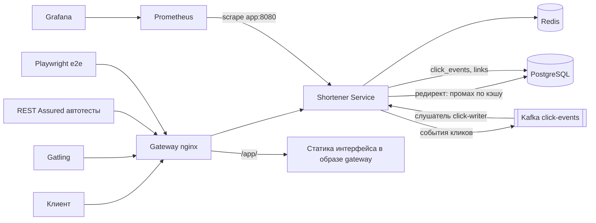

# URL Shortener с аналитикой

[](https://github.com/asterix1221/URL_Shortener/actions/workflows/autotests.yml)
[](https://github.com/asterix1221/URL_Shortener/actions/workflows/service-tests.yml)
[](https://github.com/asterix1221/URL_Shortener/actions/workflows/web.yml)


Сервис сокращения ссылок на Spring Boot: редирект, JWT-аутентификация, статистика кликов,
лимиты и TTL ссылок, кэш Redis, асинхронная запись кликов в Kafka, Prometheus/Grafana,
API-автотесты (REST Assured + Allure) и нагрузочные сценарии (Gatling).

## Архитектура



Клик проходит по двум разным путям, и это главное, что нужно понять по схеме: сам редирект только
публикует событие в `click-events` и **не ждёт** записи (302 уходит раньше, чем строка появляется
в базе), а в `click_events` её дописывает внутренний слушатель `click-writer`. Отсюда и статистика
с задержкой, и то, что узким местом стенда оказался именно слушатель, а не HTTP-тракт
(`docs/experiments/05-stress.md`, `06-soak.md`).

`/actuator/prometheus` открыт на самом сервисе, но наружу его закрывает gateway (`403`), поэтому
Prometheus ходит к `app:8080` внутри сети compose.

## Быстрый старт (три шага)

Нужны Docker Desktop, Java 21+ и PowerShell 7.

```powershell
# 1. поднять стек: gateway nginx + Postgres + Redis + Kafka + приложение
Copy-Item infra\.env.example infra\.env
docker compose -f infra\docker-compose.yml --env-file infra\.env up -d --build
# интерфейс: http://localhost:8080/app/ (тот же gateway, что и API)

# 1b. мониторинг для нагрузочных прогонов — отдельный профиль (в CI не поднимается)
docker compose -f infra\docker-compose.yml --env-file infra\.env --profile monitoring up -d

# 2. (опционально) запуск сервиса локально с hot reload, вместо контейнера
$env:JWT_SECRET = "dev-secret-dev-secret-dev-secret-123456"
cd shortener-service; .\mvnw.cmd spring-boot:run

# 3. зарегистрироваться, войти и создать ссылку
#    (аккаунта в чистой базе нет — миграции создают только схемы; адрес с Get-Random,
#     чтобы шаг можно было повторить на стенде, где данные уже остались)
$cred = @{ email = "demo$(Get-Random)@example.com"; password = "Passw0rd!" } | ConvertTo-Json
Invoke-RestMethod -Method Post http://localhost:8080/api/auth/register -ContentType 'application/json' `
  -Body $cred | Out-Null
$token = (Invoke-RestMethod -Method Post http://localhost:8080/api/auth/login -ContentType 'application/json' `
  -Body $cred).accessToken
Invoke-RestMethod -Method Post http://localhost:8080/api/links -Headers @{ Authorization = "Bearer $token" } `
  -ContentType 'application/json' -Body (@{ url = "https://example.com/very/long/path" } | ConvertTo-Json)
```

Приложение стартует порядка 15–30 секунд после `up`: в свежей проверке на чистой базе
`Started ShortenerApplication in 11.674 seconds`, в более ранней — 26 с от запуска контейнера до
ответа. В это время gateway отвечает 502, а `POST /api/links` — ошибкой соединения. Ориентир
готовности — `http://localhost:8080/actuator/health` отдаёт `{"status":"UP"}`.

Имя compose-проекта берётся из каталога файла (`infra`), поэтому второй клон репозитория на той
же машине поднимет стек в том же проекте и пересоздаст контейнеры первого; том `infra_pgdata`
при этом общий. Для параллельного стенда задавай проект явно: `docker compose -p other ...`.

Полный сценарий «регистрация → логин → ссылка → переходы → статистика»: `.\scripts\smoke.ps1`
(параметр `-BaseUrl`). Это не только печать: другой код вместо `401`, иная последовательность
переходов или ноль кликов в статистике за 20 с ожидания роняют скрипт с ненулевым кодом выхода.

Если порт 8080 на машине занят (например Jenkins), наружу поднимается gateway на `APP_PORT` из
`infra/.env` (здесь `28080`); локальный запуск сервиса — так же:
`$env:SERVER_PORT = "28080"; $env:APP_BASE_URL = "http://localhost:28080"`, а автотесты и
нагрузку указывай этим же адресом (`-DbaseUrl=...`, `BASE_URL`).

## Структура

```
infra/                docker-compose (gateway nginx, Postgres, Redis, Kafka, Prometheus, Grafana,
                      приложение) + nginx/nginx.conf + jenkins/ (образ CI, плагины, job)
shortener-service/    Spring Boot сервис
shortener-autotests/  REST Assured автотесты + Allure
shortener-loadtests/  Gatling-симуляции
shortener-web/        Vite+React+TS, Vitest, Playwright (e2e/)
Jenkinsfile           полный CI-прогон в Jenkins (тесты → образ → стек → автотесты → Allure)
scripts/              smoke.ps1, seed.sql, вспомогательные скрипты
docs/                 отчёты по тестам и нагрузочным экспериментам
```

## Решения и компромиссы

**Код ссылки — Base62 от sequence, а не хеш адреса.** `LinkService.create` берёт следующий `id` из
последовательности Postgres *до* вставки (`LinkRepository.nextId`) и кодирует его (`Base62`,
алфавит `0-9A-Za-z`). Коллизий у такой схемы нет по построению — id уникален, — и не нужен цикл
«сгенерировать → проверить занятость → повторить», который у хеша требует либо `SELECT`, либо
`INSERT` с перехватом нарушения уникальности. Плата — предсказуемость: коды идут подряд, их можно
перечислить, а `GET /{code}` не требует токена и не лимитируется, так что «код знает только тот,
кому его дали» — это держится на неизвестности адреса, а не на защите. Лечится в проекте частично:
пользовательский `alias` (`^[A-Za-z0-9_-]{3,32}$`, `409` на занятый, `400` на зарезервированный),
`expiresAt` и `maxClicks` с `410 Gone` после исчерпания, уникальный индекс `ux_links_code` как
страховка для алиасов. Чего не сделано: случайный солт кода и лимит на сам редирект — это в
«Ограничениях».

**Cache-aside вместо `@Cacheable`.** `LinkCache` читает пару ключей `link:<code>` (адрес) и
`link-id:<code>` (id для события клика) одной операцией `MGET`, пишет с TTL
`min(app.cache.ttl-seconds, время до expiresAt)` и снимает оба ключа при удалении ссылки — другого
способа изменить ссылку в API нет. У `@Cacheable` один ключ и один TTL на метод, а здесь у «что
отдаём клиенту» и «что нужно слушателю кликов» разная цена пропуска и разное время жизни; плюс без
собственного класса не было бы выключателя `APP_CACHE_ENABLED`, на котором построен эксперимент 7.1.
Цена: от stampede защита не делается — при холодном кэше все промахи по одной горячей ссылке
параллельно идут в БД, и это измерено (в 7.6 прогрев отдельным прогоном на 644 RPS дал 43,79 % KO у
генератора, `pending` HikariCP 192 и `inflight` 200). Устаревание закрывается TTL и `evict`, а не
инвалидацией по домену; поведение на отказе Redis
покрыто тестами `LinkCacheTest` (`redisFailureCountsErrorAndFallsBack`, `putSurvivesRedisOutage`,
`evictSurvivesRedisOutage`) и `CacheIT` на живом Redis.

**Клики через Kafka, а не `INSERT` внутри запроса.** Редирект публикует событие в `click-events`
(3 партиции) и не ждёт записи; строку в `click_events` дописывает слушатель `click-writer`
(`@KafkaListener`, группа `click-writer`). Выигрыш измерен в 7.3: p95 9 мс против 117 мс у
синхронной записи. Цена — задержка и возможная потеря: `max.block.ms=500`, отказ брокера
перехватывается и только двигает `shortener_clicks_publish_errors_total`, то есть при мёртвом Kafka
клиент получит свои 302, а событие не запишется никогда
(`ClickEventPublisherTest.producerFailureIsSwallowedAndCounted` и
`brokerRejectionIsCountedInCallback`). Потерь на стенде не
наблюдалось, но это свойство конкретных прогонов, а не гарантия: 7.3 даёт прирост `click_events`
= 126 000 = 3 × 42 000 при сумме `OK`, 7.6 — +550 620 при сумме ответов `302` и разнице 0. Флаг
`APP_CLICKS_CONSUMER_ENABLED=false` оставляет сервис работающим, а события — в топике; лаг
топика — метрика, по которой стенд начинает отказывать первым (7.5, 7.6).

**Ссылки с `maxClicks` не кэшируются** (`LinkCacheTest.linkWithMaxClicksIsNotCached`): их доступность
зависит от счётчика в строке `links`, а кэшировать «можно/нельзя» — значит врать между кликами.
Лимит держится атомарным `UPDATE links SET click_count = click_count + 1 WHERE … AND click_count <
max_clicks`: ноль обновлённых строк означает «исчерпано» и даёт `410`, поэтому конкурентные клики
не перерасходуют лимит, несмотря на отсутствие блокировки. В `ConcurrentClickIT` 20 параллельных
кликов по ссылке с `maxClicks=5` дают ровно 5 × 302 и 15 × 410. Безлимитные ссылки строку `links`
на переход не трогают вообще — иначе все
клики одной горячей ссылки выстраиваются в очередь на обновление единственной строки; статистика
считается по `click_events`.

**`/actuator/prometheus` открыт осознанно.** На самом сервисе эндпоинт доступен без токена — это
упрощение учебного проекта, без которого разваливаются healthcheck CI и скоупинг Prometheus. Наружу
его закрывает gateway (`deny all` → `403`), Prometheus ходит к `app:8080` внутри сети compose, а
`/actuator/health` открыт и через gateway, потому что им пользуются CI и прогонщики.

- **Rate limit создания ссылок** — Bucket4j в памяти процесса, `RATE_LIMIT_CREATE_PER_MINUTE`
  (по умолчанию 10 в минуту на пользователя), ответ 429 с `Retry-After`; при нескольких инстансах
  лимит считается на каждый свой (`RateLimitIT`).
- **Метрики** — `http_server_requests_seconds_bucket` (гистограмма percentiles),
  `shortener_cache_requests_total`, `shortener_clicks_publish_errors_total`, `hikaricp_*`, `jvm_*`,
  лаг консьюмера `kafka_consumer_fetch_manager_records_lag_max`.

## Gateway (nginx)

`infra/nginx/nginx.conf` монтируется в контейнер `gateway` (образ `nginx:1.30.6`), он слушает
`80` внутри сети compose и публикуется как `APP_PORT:80`. Порт самого приложения наружу больше
не проброшен — gateway единственная точка входа. Postgres/Redis/Kafka публикуют порты отдельно:
это нужно для `mvnw spring-boot:run` с хоста и для Testcontainers-тестов.

- `X-Forwarded-For/Proto/Port` + `Host: $http_host`, на стороне сервиса
  `server.forward-headers-strategy: native`. Без проброса адресов все клики в статистику
  писались бы с одним внутренним IP прокси; без `X-Forwarded-Port` Tomcat при
  `X-Forwarded-Proto` подставляет порт схемы по умолчанию, и OpenAPI/Swagger теряют `:APP_PORT`
  в адресе «Try it out» (порт nginx берёт из заголовка Host через `map`).
- `/actuator/prometheus` наружу закрыт (`deny all` → 403): Prometheus скоупит `app:8080`
  напрямую внутри сети compose. `/actuator/health` открыт — им пользуются CI и healthcheck.
- `GET /gateway-health` отвечает `ok` без похода в приложение — это healthcheck контейнера.
- `client_max_body_size 16k`: большее тело — 413 ещё до сервиса; `proxy_read_timeout` 10 s.
- Прокинутые статусы не подменяются (`proxy_intercept_errors off`), поэтому `302`, `410 Gone`
  и `429` с `Retry-After` доходят клиенту как есть.

## Интерфейс

Веб-интерфейс (`shortener-web/`, Vite + React + TypeScript) отдаётся тем же gateway под `/app/`:
бандл запечён в образ (`infra/web.Dockerfile`), отдельного контейнера у интерфейса нет, запросы
к API идут на свой origin — CORS не нужен. Что есть: вход и регистрация на одном экране, список
ссылок (создание, копирование короткого адреса, удаление с подтверждением, серверная пагинация
с выбором размера страницы 10/20/50/100 — селект доступен и на одной странице, а смена размера
сбрасывает номер на первую), карточка ссылки со статистикой (счётчик переходов, гистограмма
по дням, источники переходов), светлая и тёмная темы, русский и английский языки. Доступность:
цели нажатия не ниже 44px (замер фикс-раунда финального ревью — минимум ровно 44px у всех 110
видимых целей в восьми состояниях на двух вьюпортах, 1280x900 и 390x844), переходы цвета 120ms
отключаются по `prefers-reduced-motion`. Запуск, карта ошибок, пороги покрытия и числа
замеров — `docs/web.md`.

Чего в интерфейсе нет, и почему:

- **Редактирование ссылки.** В API нет эндпоинта PATCH/PUT для ссылки (`LinkController` — только
  создание, чтение, удаление и статистика), поэтому изменить адрес или срок жизни ссылки нельзя
  ни через интерфейс, ни напрямую; остаётся удалить и создать заново.
- **Refresh-токен и серверный logout.** `AuthController` даёт только register/login: токен живёт
  3600 с в sessionStorage, «выход» очищает его только в браузере, серверного отзыва нет.
- **Число переходов в списке.** `GET /api/links` его не отдаёт, а `/stats` на каждую строку был бы
  N+1 за счёт пользователя; счётчик виден в карточке ссылки.
- **Публичный редирект в UI.** Переход по короткой ссылке обслуживает сервис (`GET /{code}` → 302),
  интерфейс в нём не участвует.

## Тесты

| Что | Команда |
|---|---|
| Юнит + интеграционные (Testcontainers) | `cd shortener-service; .\mvnw.cmd clean verify` |
| Только юнит-тесты | `cd shortener-service; .\mvnw.cmd test` |
| Покрытие (гейт JaCoCo: 100% строк) | `start target\site\jacoco\index.html` после `clean verify` |
| API-автотесты (нужен поднятый стек) | `cd shortener-autotests; .\mvnw.cmd test "-DbaseUrl=http://localhost:8080"` |
| Only smoke / only regression | добавить `"-Dgroups=smoke"` или `"-Dgroups=regression"` |
| Allure-отчёт | `.\mvnw.cmd allure:serve` |
| Нагрузка | `.\scripts\run-load.ps1 -Sim RedirectSimulation -Profile constant -Rps 50 -Duration 120` — профили `constant` / `ramp` / `spike`, адрес сервиса `-BaseUrl` (по умолчанию берётся из `infra\.env`) |

Гейт покрытия жёсткий: в `shortener-service/pom.xml` правило `BUNDLE / LINE COVEREDRATIO >= 1.00`,
то есть `clean verify` падает, если хоть одна измеряемая строка осталась без теста. Из замера
исключены классы без логики — `**/*Application*`, `**/config/**`, `**/dto/**`, `**/entity/**`;
в отчёте 30 классов и 368 строк. Ветки (BRANCH) в гейт не входят и остаются отчётными: 83 из 90,
непокрытые — частично выполненные условия в `LinkCache` (3), `LinkService` (2), `UrlValidator` (1)
и `ApiExceptionHandler` (1).

Юнит и интеграционные тесты видны так же, как автотесты: workflow `service-tests` гоняет
`mvn verify`, пишет сводку (тесты по наборам, проваленные, покрытие) прямо на страницу сборки,
а отчёты складывает в артефакты `service-coverage` (HTML JaCoCo) и `service-test-reports`
(XML surefire/failsafe). Файл `docs/coverage.json` тот же workflow обновляет в `main` —
по нему живёт бейдж покрытия сверху. Тем же скриптом можно посмотреть сводку локально:
`python scripts\test-report-summary.py shortener-service\target docs\coverage.json`.

Интеграционные тесты поднимают Postgres 16, Redis 7 и Kafka 3.9 (apache/kafka) в Testcontainers —
нужен запущенный Docker.
База для тестов всегда чистая: контейнер создаётся под прогон, `jdbc:postgresql://localhost:<свободный порт>/test`.
Мутационная проверка тестов — в `docs/test-validation.md`.

## Результаты нагрузочных тестов

Шесть экспериментов этапа 7, каждый — с гипотезой, записанной **до** прогонов, и с отчётом в
`docs/experiments/`. Уровень и пороги фиксируются до запуска, поэтому часть гипотез не подтвердилась
и это оставлено в отчётах как есть, а не переформулировано задним числом.

| № | Что сравнивали | Базовое | С изменением | Что это значит | Отчёт |
|---|---|---|---|---|---|
| 7.1 | Redis-кэш vs без кэша, 200/500/1000 RPS и разгон | p95 на 1000 RPS выше в 3,1 раза (p99 — в 5 раз), CPU `app` 159,49 % | p95 ниже в 3,1 раза, CPU 92,24 %; на разгоне `pending` HikariCP 188 против нуля с кэшем | выигрыш кэша появляется только там, где сервис упирается в себя: на 200 RPS разница нулевая (4 мс против 4 мс); без кэша узкое место — очередь за соединением, а не CPU | [`01`](docs/experiments/01-redis-vs-no-cache.md) |
| 7.2 | Пул Hikari 5 / 10 / 20 / 50 на 800 RPS | `pending` 192 (пул 5) и 188 (пул 10) | `pending` 0 на пуле 20; на пуле 50 — 0, 0, 140 | оптимум 20, но выбран по механизму очереди (пик одновременности, а не среднее), не по кривой p95: медианы 192 / 641 / 211 / 302 мс стоят немонотонно, разброс внутри варианта больше разницы между ними | [`02`](docs/experiments/02-hikari-pool.md) |
| 7.3 | Клики асинхронно (Kafka) vs синхронно, 700 RPS | p95 117 мс, p99 488 мс, CPU Postgres 34,14 %, `acquire mean` 0,0152 с | p95 9 мс, p99 52 мс, CPU Postgres 25,40 %, `acquire mean` 0,0007 с | первая измеренная разница, где p95 различает варианты (интервалы не пересекаются); потерь нет ни там, ни там; у `async` неустойчив хвост (один прогон дал p99 369 мс) | [`03`](docs/experiments/03-clicks-mode.md) |
| 7.4 | Аналитика с индексом `(link_id, clicked_at)` и без него, 1 RPS | p95 1 582 мс, `Δidx_scan` 180, `Δseq_scan` 0 | p95 **1 127 мс** (то есть быстрее), `Δidx_scan` 0, `Δseq_scan` 537–540 | гипотеза «без индекса x5 хуже» не подтвердилась — и не подтвердилась знаком в другую сторону; дефект найден вслепую по метрикам и `EXPLAIN`, до вскрытия файла миграции (`docs/experiments/assets/explain-*.txt`) | [`04`](docs/experiments/04-missing-index.md) |
| 7.5 | Разгон 50 → 2000 RPS; затем слушатель `click-events` с параллельностью 1 → 3 | точка деградации **1074 RPS** (p95 24,6 мс при утроенном пороге 10,65 мс), KO за прогон 13 589 из 615 000 (2,21 %), `exit=1` | тот же разгон: **KO 0** при тех же 615 000 запросов, `exit=0`; в честной полосе +420…+570 с p95 276,0 → 79,0 мс | первое узкое место — лаг консьюмера (ненулевой с +180 с), а `pending` и `inflight = 200` появляются только через 150 с после точки деградации; отказ на верху серии — транспортный (`PrematureCloseException` 69,77 %, `ConnectException` 30,23 %), в логе шлюза нет ни 500, ни 502, ни 504 | [`05`](docs/experiments/05-stress.md) |
| 7.6 | Soak 644 RPS (≈60 % от точки деградации), 15 мин непрерывно | heap после GC 64,8 МиБ (первая треть), лаг 0, p99 31,0 мс | heap после GC 101,1 МиБ (третья треть, +4,565 МиБ/мин), лаг 17 342 (после остановки → 0), p99 12,0 мс | дно кучи растёт, и это не утечка: по `jdk.OldObjectSample` 55,07 МиБ из 56,83 — приёмные fetch-буферы Kafka (ёмкость 1 048 650 = `max.partition.fetch.bytes` + 74), рост совпадает с лагом (r = 0,975); при нулевом лаге дно плоское | [`06`](docs/experiments/06-soak.md) |

Отдельно стоит прочитать «Отличие от отменённой серии 7.1b» в [`05`](docs/experiments/05-stress.md)
и «Потолок по ступеням» в [`01`](docs/experiments/01-redis-vs-no-cache.md): серия, которая должна
была дать «потолок» числом, отброшена целиком, потому что на тех уровнях генератор нагрузки на той
же машине перестаёт быть нейтральным наблюдателем — Gatling показывал p50 111 с там, где сервис
насчитал максимум 5,6 с, а фактический `Cnt/s` упал до 433–460 при цели 2000–2500.

Кадры по 7.2–7.6 — `docs/experiments/assets/7*.png`; они построены по тем же журналам, что и
таблицы в отчётах (`exp-windows-75/76.jsonl`, `exp-results-74/75.jsonl`, `exp-gatling-75/76.jsonl` —
всё это лежит в репозитории), поэтому число с графика и число из таблицы не могут разойтись. У 7.1
кадра нет, а снимков Grafana нет ни в одном отчёте этапа 7: серверный рендер PNG на этом стенде
недоступен (в образе не было `grafana-image-renderer`), живой дашборд смотрят руками. Единственный
кадр интерфейса — `docs/baseline-grafana.png`, снятый из браузера на этапе 6.

Для 7.5 и 7.6 пересчёт чисел из журнала можно доверить машине: верификатор сверяет каждую ячейку
таблицы и каждую константу прозы, а мутационная прогонка проверяет сам верификатор (см.
«Как повторить» в каждом отчёте). Так отчёт нельзя «подогнать», не оставив следов.

## Документация кода (Javadoc)

Публичные классы сервиса описаны в Javadoc: `cd shortener-service; .\mvnw.cmd javadoc:javadoc`
даёт `target\reports\apidocs\index.html`. Генерация намеренно не привязана к сборке — CI от неё
не зависит, — а версия плагина зафиксирована (`maven-javadoc-plugin` 3.12.0). Doclint включён
во всех группах кроме `missing`: битая ссылка или незакрытый HTML-тег роняют генерацию,
а отсутствие `@param` у тривиальных геттеров и конструкторов DI — нет. Контракты REST
(коды ответов, схемы) при этом живут не в комментариях, а в `@Operation` и Swagger UI.

## CI/CD

Два контура, и оба видны из README.

**GitHub Actions** (`service-tests.yml`, `autotests.yml`, `web.yml`) — то, что проверяет сам GitHub:
юнит и интеграционные тесты, прогон автотестов против стека, который workflow поднимает на
раннере, бейджи и файл покрытия. Плагины и версии в нём зафиксированы числами.

`web.yml` — контур интерфейса, два job'а. `unit`: Node 26, `npm ci` → `npm run lint` →
`npm run typecheck` → `npm run coverage` (vitest + гейт покрытия), working-directory
`shortener-web`. `e2e` с `needs: unit` и `timeout-minutes: 30`: `cp infra/.env.example infra/.env`
и подмена `JWT_SECRET`, `docker compose … up -d --build` (стек на 8080, `APP_PORT` из
`.env.example`), ожидание `/actuator/health` (90 попыток по 2 с), проверка `/app/`, затем `npm ci`,
`npx playwright install --with-deps chromium` и `npx playwright test --workers=1`. В `env` job'а
`RATE_LIMIT_CREATE_PER_MINUTE: '2'` (нужен сценарию `ratelimit.spec.ts`, перекрывает 1000 из
`.env`), `E2E_BASE_URL: http://localhost:8080` (дефолт конфига — 28380, локальный стенд задачи 14)
и `APP_IMAGE_TAG: web-ci` — тег образов сборки. Отчёт `playwright-report` выгружается
артефактом только при падении (`if: failure()`). Предупреждение
`ExperimentalWarning: localStorage is not available …` в юнит-прогоне — средовое (мост в
`src/test/setup.ts` под Node 26), провалом стадии не считается.

Масти Node в двух job'ах разные сознательно. `unit` остаётся на 26: литералы `Intl` в
`src/lib/format.test.ts` замерены на v26.12.0 / ICU 78.3, на другой масти они вправе разойтись.
`e2e` переведён на 22 после первого прогона в CI: распаковщик Playwright 1.49.1 на Node 26
зависает уже после загрузки браузера — один и тот же zip `chromium-1148` на v26.12.0 обрывает
`chrome.dll` на 238948275 Б из 238968832 и не пишет `INSTALLATION_COMPLETE` (60 с без прогресса),
а на v22.23.5 распаковывается за 2.8 с, полный `install` — exit 0. Ассерты e2e от масти Node
не зависят: даты и числа считает Chromium, в `shortener-web/e2e` нет ни `Intl`, ни `toLocale*`.
`timeout-minutes: 30` поставлен там же: без границы зависший шаг молчит до дефолтных 360 минут
job'а, а не падает. Первый прогон на PR #4: `unit` — success, `e2e` простоял 41 минуту
в `Install browsers` и был отменён вручную, чтобы забрать логи job'а. Стадии Jenkins
не исполнялись: рабочий стенд остановлен.

**Jenkins** (`Jenkinsfile` + `infra/jenkins/`) — self-hosted, поднимается этим же
compose-файлом:

```powershell
docker compose -f infra\docker-compose.yml --env-file infra\.env --profile ci up -d jenkins
# UI: http://localhost:18088 (порт bound к 127.0.0.1), логин из infra\.env
```

Прогон `shortener-ci`: `mvn verify` (юнит + интеграционные + JaCoCo) → юнит-гейт интерфейса
(`docker build --target unit` + `docker run --rm`, образ `shortener-web-unit:ci-<номер>`:
Node на агенте нет, поэтому линт, типы, vitest и гейт покрытия едут в контейнере) →
`docker build` под тегом `shortener-service:ci-<номер>` и образ gateway с запечённым
`nginx.conf` (в CI-стеке конфигурация не монтируется из репозитория: хостовый демон, к которому
job обращается через сокет, не видит workspace сборки) → те же теги встают в CI-стек
`shortener-ci` на портах 28180/5442/6389/29092 (не пересекаются с рабочей копией) → ожидание
`/actuator/health` → API-автотесты через gateway → e2e интерфейса против того же стека
(`app` пересоздаётся с лимитом создания 2 в минуту, образ `shortener-web-e2e:ci-<номер>`,
контейнер `web-e2e` с `E2E_BASE_URL`, отчёт `playwright-report` в артефакты) → Allure в
артефакты → `down -v` в `post: always`. Секреты стенда генерируются `openssl rand` на время
сборки и в репозиторий не попадают. Обе веб-стадии написаны, но в реальном job не исполнены
(job берёт `Jenkinsfile` с GitHub, нужен push), поэтому `timeout(time: 60, unit: 'MINUTES')`
не поднят: фактического времени новых стадий нет. Нумерация шагов и честная оценка лимита —
в `docs/ci-jenkins.md`.

Отдельно от Actions этот контур нужен не потому, что стек не поднимается на раннере: его поднимают
и `autotests.yml`, и `web.yml`. Разница в том, что раннер эфемерный — история сборок, артефакты
внутри стенда и docker-демон с постоянной сетью остаются за Jenkins, как и интеграционные тесты на
Testcontainers с Allure. Установка job'а, плагинный набор с фиксированными версиями, права на сокет
и вывод реального прогона — `docs/ci-jenkins.md`.

## Ограничения и что улучшить

Про «одну машину» и «шум» в каждом отчёте этапа 7 сказано отдельно (раздел «Ограничения»), и это не
формальность: 4 ядра VM делят сервис, Postgres, Redis, Kafka, мониторинг и сам генератор Gatling,
поэтому абсолютные RPS и латентности здесь стендовые, а сопоставимы только числа внутри одного
прогона. Что осталось незакрытым по существу:

- **Один узел, отказоустойчивости нет.** Одно приложение, один Postgres без реплик, один брокер
  Kafka; Redis не кластер и не переживает перезапуск контейнера, так что после падения кэша
  первые секунды — это холодный `MGET`-промах в БД на каждый запрос.
- **Rate limit живёт в памяти процесса** (Bucket4j). При втором инстансе лимит считается на каждый
  свой, а не на кластер; при рестарте обнуляется. Упомянуто в `RateLimitIT` как поведение, а не как
  защита от распределённого случая.
- **Коды ссылок предсказуемы** (Base62 от sequence) и `GET /{code}` ничем не лимитирован, поэтому
  перечисление кодов — открытая дверь. Лечится солтом/случайной частью кода и отдельным лимитером
  на редирект; в этом проекте не сделано, осознанно (см. «Решения и компромиссы»).
- **Аналитика считается по сырым событиям.** В `click_events` после 7.6 лежит 12 413 609 строк (сам
  стенд потом пересеван), и каждый `/stats` агрегирует их на лету (`countByLinkId`, `clicksByDay`,
  `topReferrers`). Нужны инкрементальные агрегаты или rollup-таблица; сегодня это ровно то место, где
  эксперимент 7.4 нашёл расхождение в планах запроса (`Parallel Seq Scan` 149 835 блоков против
  `Bitmap Heap Scan` 77 907).
- **Слушатель `click-events` — узкое место, и оно не исправлено в ветке.** Три партиции топика при
  `concurrency` по умолчанию 1: на 644 RPS лаг вырос до 17 342 за 15 минут (7.6), а на разгоне —
  до 310 029 (7.5). Параллельность 3 убирает провальные ответы целиком (KO 13 589 → 0), но в
  `docker-compose.yml` осталось `:-1` — улучшение проверено как эксперимент, а не заложено как
  дефолт стенда.
  Следующий шаг — батч `INSERT` в слушателе и замер точки дренирования (при каком RPS лаг перестаёт
  расти на горизонте ≥ 15 минут); её число в отчётах сознательно не подставлено.
- **Soak был 15 минут, а не 60–120** — поэтому вывод «узкое место не HTTP-тракт» переносим, а
  вывод про «нет медленной утечки» на этом горизонте сделать нельзя (пункт 1 «Ограничений» в
  [`06`](docs/experiments/06-soak.md)).
- **Снимки дашборда не рисует Grafana** (нет `grafana-image-renderer`), вместо них кадры, собранные
  по журналам (7.2–7.6), — воспроизводимые, но не «как это видит человек в UI».
- **Интерфейс не объект нагрузочных замеров.** Профили Gatling и `docs/baseline.md` от этапа 9
  не изменились: нагрузка этапа 7 измеряет HTTP-тракт сервиса, а отрисовку SPA в браузере
  никто не мерил.

## Ссылки

- Swagger UI: `http://localhost:8080/swagger-ui/index.html` (Authorize — JWT из `/api/auth/login`)
  — адрес через gateway, в `APP_PORT` из `infra/.env`
- Метрики: снаружи gateway закрывает `/actuator/prometheus` (403); Prometheus скоупит
  `http://app:8080/actuator/prometheus` внутри сети compose. Сам Prometheus bound к `127.0.0.1`,
  цель видна на `http://localhost:9090/api/v1/targets`
- Grafana: `http://localhost:3000` (admin / `GRAFANA_PASSWORD` из `infra/.env`). Источник данных
  и дашборд «URL shortener: нагрузка» (10 панелей) подгружаются провижинингом из
  `infra/grafana/provisioning/` и `infra/grafana/dashboards/`. Файл, появившийся в
  `dashboards/` уже после старта контейнера, Grafana за пять минут не подхватил — изменения
  применяются перезапуском (`docker restart infra-grafana-1`)
- Baseline нагрузочных прогонов (железо, лимиты контейнера, p50/p95/p99, воспроизводимость,
  скриншот дашборда и ограничения методики) — `docs/baseline.md`

Отчёты по каждому эксперименту — в `docs/experiments/`, ответы на вопросы, которые по этому проекту
задают на собеседовании, — в `docs/interview-notes.md`.
