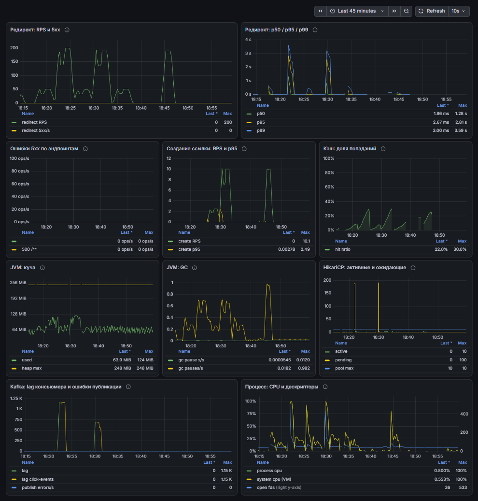

# Baseline нагрузочных тестов

Относится к этапу 6. Цифры здесь — точка отсчёта для экспериментов этапа 7: сравнивать надо
не с «нормой из интернета», а с этим документом.

## Методика

Перед каждым прогоном:

1. `docker compose -f infra\docker-compose.yml --env-file infra\.env restart app` — сервис с
   пустым JIT-профилем и пустыми счётчиками.
2. `docker compose -f infra\docker-compose.yml exec redis redis-cli FLUSHALL` — кэш редиректов
   чист, то есть первые запросы гарантированно идут в Postgres.
3. Ожидание `UP` на `/actuator/health`.

Затем **прогрев** 60 с на той же нагрузке (результат не фиксируется) и **измерительный прогон**
120 с. Прогрев и замер разделены, но без рестарта между ними: цель прогрева — разогреть JVM,
пулы и кэш-клиент, а рестартировать сервис после этого означало бы выбросить разогретое.

Запуски: `scripts\run-load.ps1 -Sim <Redirect|Mixed> -Profile constant -Rps <50|200> -Duration <60|120>`.
`docker stats --no-stream` снимался на 100-й секунде замерного прогона.

## Окружение

| | |
|---|---|
| Железо | Intel Core i5-10300H, 4 ядра / 8 потоков; 16 ГБ RAM хоста (свободно ~2,2 ГБ в момент замеров) |
| Виртуализация Docker | Docker Engine 29.9.2 (Docker Desktop, WSL2 2.7.13.0, ядро 6.18.33.2-microsoft-standard-WSL2) |
| Ресурсы Docker VM | 4 vCPU, 5.79 ГиБ |
| Лимиты контейнера `app` | `cpus: "2"`, `mem_limit: 1g` (заданы в `infra/docker-compose.yml`) |
| Сервис | Spring Boot 3.5.16, JDK в контейнере Temurin 21.0.13+9-LTS |
| Инфраструктура | Postgres 16, Redis 7, Apache Kafka (image `apache/kafka:3.9.1`, брокер сообщает `kafka_version=3.9.2`) |
| Генератор нагрузки | Gatling 3.16.0, `gatling-maven-plugin` 4.21.12, Maven 3.9.16, JDK хоста Temurin 25.0.4.1+1 |
| Вход в сервис | gateway (nginx) на `http://localhost:28080` — порт из локального `infra/.env` |
| Данные | 100 000 засеянных ссылок `s_1 … s_100000` (`scripts/seed.sql`), коды читаются из `codes.csv` в случайном порядке |
| Ограничение создания ссылок | `RATE_LIMIT_CREATE_PER_MINUTE=1000` — для смешанного профиля на 200 RPS это 600 созданий/мин, лимит не достигался |

## Результаты

Профиль `constant`, время ответа — по данным Gatling (мс), ошибки — доля KO от общего числа запросов.

| # | Симуляция | RPS | Запросов | p50 | p95 | p99 | max | Ошибки | CPU `app` (docker stats) | RAM `app` |
|---|---|---|---|---|---|---|---|---|---|---|
| A | Redirect | 50 | 6 000 | 4 | 6 | 7 | 23 | 0% | 18.73% | 413.6 МиБ |
| B | Redirect | 200 | 24 000 | 4 | 6 | 8 | 113 | 0% | 39.22% | 509.1 МиБ |
| C | Mixed | 50 | 6 000 | 4 | 7 | 9 | 42 | 0% | 17.18% | 432.8 МиБ |
| D | Mixed | 200 | 24 000 | 4 | 7 | 13 | 93 | 0% | — (см. ниже) | ~527 МиБ |
| E | Redirect (повтор A) | 50 | 6 000 | 4 | 6 | 7 | 29 | 0% | 24.19% | 427 МиБ |

Все пять прогонов прошли assertion `доля неудачных запросов < 1%` фактическим `0.0`.

Для прогона D снимок `docker stats` сделан уже после окончания нагрузки и непригоден, поэтому
CPU взята из Prometheus по окну прогона (120 с): `process_cpu_usage` — среднее 0.266, пик 0.488.
Это доля от всех четырёх ядер VM, то есть примерно 1.06 ядра в среднем и 1.95 ядра в пике
при лимите контейнера в 2 ядра. Память `app` в том же окне — 527 МиБ из 1 ГиБ лимита.

## Воспроизводимость

A и E — одна и та же нагрузка (Redirect, `constant`, 50 RPS, 120 с):

| Показатель | A | E | Расхождение |
|---|---|---|---|
| p50 | 4 | 4 | 0% |
| p95 | 6 | 6 | 0% |
| p99 | 7 | 7 | 0% |
| mean | 4 | 4 | 0% |
| CPU `app` | 18.73% | 24.19% | +29% при одинаковом времени ответа |

Время ответа воспроизводится в пределах округления Gatling до миллисекунды. CPU расходится
сильнее (18.73% против 24.19%), и причина расхождения этим замером не установлена: на той же
машине постоянно работает контейнер Jenkins, плюс фоновые процессы Windows. Для экспериментов
этапа 7 CPU — показатель порядка величины, а не дискретный критерий; решение по нему принимается
по времени ответа.

## Что видно в метриках под нагрузкой

- **Кэш не спасает от холодного старта.** В смешанном прогоне на 200 RPS доля попаданий
  (`shortener_cache_requests_total{result="hit"}`) выросла с 7% до 25% за 120 с: 100 000 кодов
  читаются в случайном порядке, за две минуты затрагивается малая их часть, поэтому ключи
  просто не успевают прогреться. Вывод «кэш не помог» из этого делать нельзя — для этого
  нужен эксперимент 7.1 с одинаковым набором кодов и прогретым кэшем.
- **Kafka отстаёт.** Под смешанной нагрузкой `kafka_consumer_fetch_manager_records_lag_max`
  доходил до 689 записей; по трём сериям этой метрики пики за прогон — 689, 405 и 562 записей. После
  окончания прогона значение метрики становится `NaN` (выборок нет), поэтому утверждать, что
  лаг «схлопнулся в ноль», по этой метрике нельзя.
- **Пул соединений не узкое место.** За прогон D `hikaricp_connections_active` — максимум 3
  при `hikaricp_connections_max=10`, `hikaricp_connections_pending` — 0.
- **GC почти не влияет.** `rate(jvm_gc_pause_seconds_sum[1m])` в окне D — максимум 0.0024 с/с,
  то есть доли процента времени; использование кучи по пулам — до ~121 МиБ при лимите ~248 МиБ.
- **Создание ссылки дороже редиректа.** B (200 RPS чистых редиректов) дал 39% CPU контейнера,
  D (190 редиректов + 10 созданий в секунду) — около 106% одного ядра. Десять операций записи
  в секунду стоят дороже, чем сто девяносто чтений, но сравнение косвенное: для B CPU взята
  из `docker stats`, для D — из `process_cpu_usage` (см. выше).

## Дашборд



Кадр снят с `http://localhost:3000/d/shortener-load` (kiosk-режим, окно «Last 45 minutes») во
время прогонов: в окне видны все пять замерных запусков таблицы A–E и прогревы перед ними,
поэтому это не окно одного замера. Всплески p95/p99 до ~3 с совпадают по времени с рестартом
контейнера перед прогонами — в сами замерные окна p99 не превышал 13 мс (см. таблицу). Панель
«Kafka: lag» показывает пики лага, а панель «Кэш: доля попаданий» — рост доли попаданий в
течении каждого прогона.

## Ограничения методики

1. **Gatling и тестируемый стек на одной машине.** Генератор нагрузки, Docker VM, Postgres,
   Redis, Kafka, Prometheus и Grafana делят четыре ядра. Абсолютные цифры этого baseline нельзя
   сравнивать с чужими стендами — только с последующими прогонами здесь же, на этом железе и
   с этой же методикой.
2. **Профиль `constant` без think time.** RPS держится ровно заявленный, пока генератор
   справляется; если бы не справлялся, Gatling показал бы падение фактического throughput.
   Фактический throughput во всех прогонах равен целевому (см. таблицу).
3. **Одна учётка на прогон.** Все `POST /api/links` идут под одним JWT, поэтому rate limit
   и размер пользовательских выборок в статистике одинаковы между прогонами.
4. **Ограничение контейнера задано, но не измерено сравнением.** `cpus: "2"` и `mem_limit: 1g`
   включены ради воспроизводимости; что изменится с другими лимитами — вопрос эксперимента 7.4.
5. **Время ответа округлено Gatling до миллисекунды.** p50 в 4 мс означает «от 3.5 до 4.5 мс»,
   поэтому различия между прогонами меньше миллисекунды неразличимы.
6. **Скриншот дашборда — не доказательство замеров.** `baseline-grafana.png` снят в браузере с
   окном 45 минут, то есть в нём несколько прогонов сразу, а Prometheus к моменту съёмки уже
   потерял часть детализации. Числа таблицы A–E взяты из отчётов Gatling, а работоспособность
   каждой из десяти панелей отдельно проверена запросом через API источников Grafana
   (`POST /api/ds/query`, uid `prometheus`) — все десять вернули непустые фреймы с точками на
   окне прогона, включая панели 5xx и «доля попаданий», которые без данных показали бы пустоту.

## Как повторить

```powershell
# стек с мониторингом (профиль monitoring поднимает Prometheus и Grafana)
docker compose -f infra\docker-compose.yml --env-file infra\.env --profile monitoring up -d --build
# данные, если их ещё нет
Get-Content scripts\seed.sql | docker compose -f infra\docker-compose.yml --env-file infra\.env exec -T postgres psql -U shortener -d shortener
# прогоны
.\scripts\run-load.ps1 -Sim Redirect -Profile constant -Rps 50 -Duration 120
.\scripts\run-load.ps1 -Sim Mixed -Profile constant -Rps 200 -Duration 120
```

Дашборд: `http://localhost:3000/d/shortener-load/` (папка `Shortener`), Prometheus:
`http://localhost:9090/api/v1/targets`.
