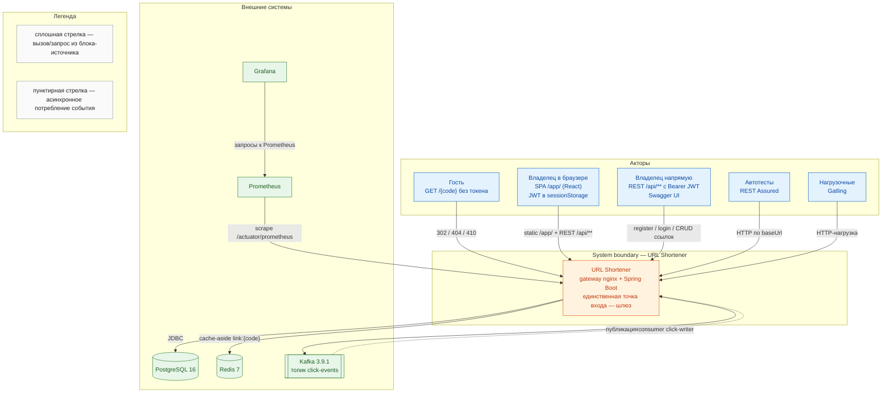

# C1 — Контекст системы

Диаграмма показывает URL Shortener как один чёрный ящик и всё вокруг него: внешних акторов и
внешние системы. Пригодится на старте онбординга и в разговоре с заказчиком, где внутренние детали
не нужны: видно, кто дергает систему (гость по короткой ссылке, владелец через SPA или Swagger,
автотесты, нагрузка), по каким протоколам и в какие хранилища/мониторинг она ходит. Шлюз (gateway
nginx) и приложение здесь слиты в один блок сознательно — на уровне контекста разделения нет.
Владелец приходит либо из браузера со SPA `/app/` (этап 9), либо напрямую в REST/Swagger.

## Источники

- Гость, публичный редирект без токена — `shortener-service/src/main/java/com/example/shortener/link/RedirectController.java:41` (`@GetMapping("/{code}")`); открыт в безопасности — `shortener-service/src/main/java/com/example/shortener/config/SecurityConfig.java:128` (`requestMatchers(HttpMethod.GET, "/{code}").permitAll()`).
- Коды ответа редиректа 302/404/410 — `RedirectController.java:36-39` (`@ApiResponse` 302, 404, 410).
- Владелец в браузере, SPA `/app/` — `shortener-web/src/main.tsx:21` (`BrowserRouter basename={import.meta.env.BASE_URL}`), маршруты `shortener-web/src/App.tsx:16-57`; токен в sessionStorage — `shortener-web/src/lib/session.ts:1-5`.
- Владелец напрямую, Bearer JWT на `/api/**` — `shortener-service/src/main/java/com/example/shortener/link/LinkController.java:38` (`@RequestMapping("/api/links")`) и `SecurityConfig.java:135` (`requestMatchers("/api/**").authenticated()`); регистрация/вход — `shortener-service/src/main/java/com/example/shortener/auth/AuthController.java:25` (`@RequestMapping("/api/auth")`).
- Swagger UI без токена — `SecurityConfig.java:134` (`/swagger-ui/**`, `/v3/api-docs/**` permitAll).
- Автотесты REST Assured — `shortener-autotests/pom.xml` (зависимость `io.rest-assured:rest-assured`); база URL `RestAssured.baseURI = System.getProperty("baseUrl", ...)` — `shortener-autotests/src/test/java/com/example/shortener/autotests/base/BaseApiTest.java`.
- Нагрузочные Gatling — модуль `shortener-loadtests` (зависимость `io.gatling.highcharts:gatling-charts-highcharts`).
- PostgreSQL — `spring.datasource.url` `jdbc:postgresql://...` в `shortener-service/src/main/resources/application.yml:3`; образ `postgres:16` — `infra/docker-compose.yml:3`.
- Redis (cache-aside) — ключ `link:<code>` в `shortener-service/src/main/java/com/example/shortener/cache/LinkCache.java:28` (`URL_KEY = "link:"`); образ `redis:7` — `infra/docker-compose.yml:19`.
- Kafka, топик `click-events` — `shortener-service/src/main/java/com/example/shortener/clicks/ClickEventPublisher.java:27` (`TOPIC = "click-events"`); образ `apache/kafka:3.9.1` — `infra/docker-compose.yml:24`.
- Асинхронный консьюмер `click-writer` — `shortener-service/src/main/java/com/example/shortener/clicks/ClickEventWriter.java:55` (`@KafkaListener(topics = ..., groupId = "click-writer")`).
- Prometheus скоупит `/actuator/prometheus` у `app:8080` — `infra/prometheus/prometheus.yml:4-7`; эндпоинт открыт — `application.yml:45-49`.
- Grafana ходит в Prometheus — datasource `http://prometheus:9090` в `infra/grafana/provisioning/datasources/prometheus.yml:7`; `depends_on: prometheus` — `infra/docker-compose.yml:141-142`.
- Единственная точка входа — gateway, порт приложения наружу не публикуется — `infra/docker-compose.yml:85-88` (`expose: "8080"`), `infra/nginx/nginx.conf:6-9` (`upstream shortener_app`).