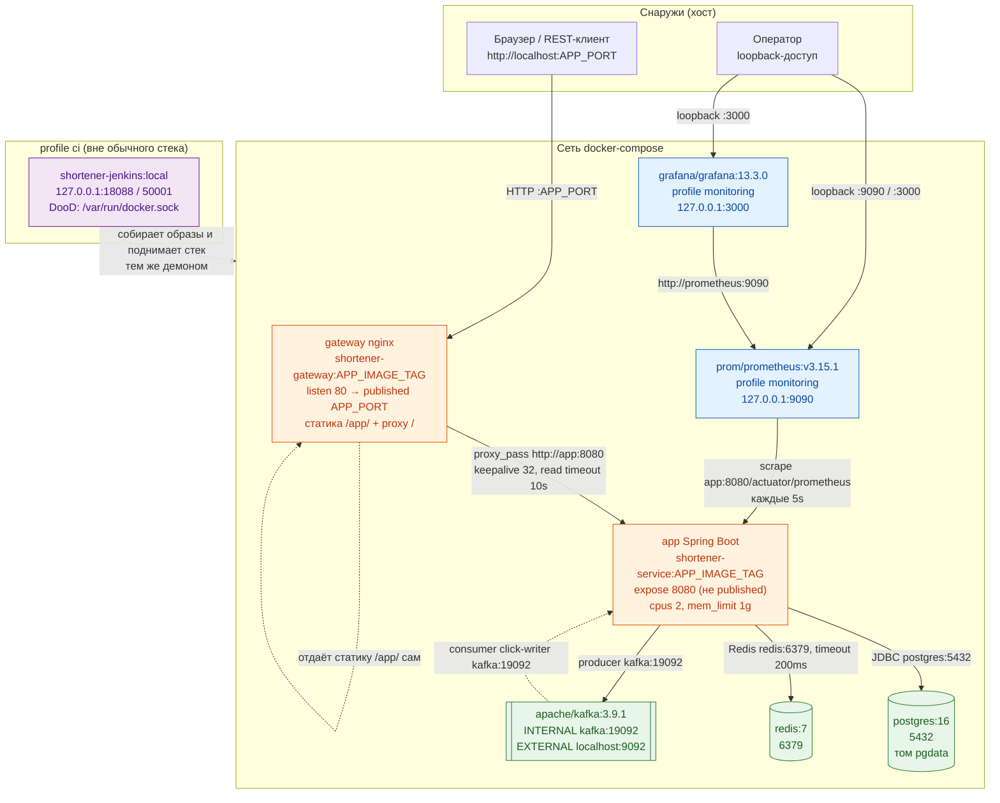

# C2 — Контейнеры и коммуникации

Диаграмма показывает рантайм-топологию стека docker-compose: какие контейнеры поднимаются, кто с
кем говорит, по каким портам и протоколам. Пригодится, чтобы понять единственную точку входа
(gateway), почему порт приложения наружу не опубликован, как Prometheus снимает метрики напрямую
с `app:8080` в обход шлюза, и чем внутренний listener Kafka отличается от внешнего. Лимиты
контейнеров и профили (`monitoring`, `ci`) подписаны там, где они заданы в compose.

## Источники

- gateway: образ и сборка — `infra/docker-compose.yml:96-100` (`build context ..`, `dockerfile infra/web.Dockerfile`, `image shortener-gateway:${APP_IMAGE_TAG:-dev}`); порт — `infra/docker-compose.yml:104-105` (`${APP_PORT}:80`); healthcheck — `infra/docker-compose.yml:106-110` (`curl /gateway-health`); `depends_on: app service_started` — `infra/docker-compose.yml:101-103`.
- Проксирование и таймауты — `infra/nginx/nginx.conf:6-9` (`upstream shortener_app { server app:8080; keepalive 32; }`), `infra/nginx/nginx.conf:110-128` (`proxy_pass`, `proxy_connect_timeout 2s`, `proxy_read_timeout 10s`, `proxy_send_timeout 10s`); размер тела — `infra/nginx/nginx.conf:34` (`client_max_body_size 16k`).
- Статика `/app/` отдаётся шлюзом — `infra/nginx/nginx.conf:80-108`; метрики наружу закрыты — `infra/nginx/nginx.conf:45-47` (`location = /actuator/prometheus { deny all; }`).
- app: образ и сборка — `infra/docker-compose.yml:44-49`; порт не публикуется — `infra/docker-compose.yml:85-88` (`expose: "8080"`); лимиты — `infra/docker-compose.yml:81-84` (`cpus: "2"`, `mem_limit: 1g`); `depends_on` — `infra/docker-compose.yml:50-56` (postgres `service_healthy`, redis/kafka `service_started`).
- Адреса зависимостей из app — `infra/docker-compose.yml:57-65` (`DB_URL jdbc:postgresql://postgres:5432/...`, `REDIS_HOST redis`, `KAFKA_BOOTSTRAP kafka:19092`).
- postgres — `infra/docker-compose.yml:2-16` (образ `postgres:16`, порт `${POSTGRES_PORT:-5432}:5432`, том `pgdata`, healthcheck `pg_isready` interval 5s/timeout 3s/retries 10).
- redis — `infra/docker-compose.yml:18-21` (образ `redis:7`, порт `${REDIS_PORT:-6379}:6379`); таймаут клиента — `shortener-service/src/main/resources/application.yml:10-14` (`timeout: 200ms`).
- kafka — `infra/docker-compose.yml:23-42` (образ `apache/kafka:3.9.1`, порт `${KAFKA_PORT:-9092}:9092`, `KAFKA_LISTENERS INTERNAL://:19092,EXTERNAL://:9092,CONTROLLER://:9093`, `KAFKA_ADVERTISED_LISTENERS INTERNAL://kafka:19092,EXTERNAL://localhost:${KAFKA_PORT:-9092}`).
- prometheus — `infra/docker-compose.yml:118-127` (образ `prom/prometheus:v3.15.1`, `profiles: ["monitoring"]`, порт `127.0.0.1:${PROMETHEUS_PORT:-9090}:9090`, конфиг `:ro`, `depends_on: app`); scrape — `infra/prometheus/prometheus.yml:1-7` (`scrape_interval: 5s`, `targets: ["app:8080"]`).
- grafana — `infra/docker-compose.yml:129-142` (образ `grafana/grafana:13.3.0`, `profiles: ["monitoring"]`, порт `127.0.0.1:${GRAFANA_PORT:-3000}:3000`, `depends_on: prometheus`); datasource — `infra/grafana/provisioning/datasources/prometheus.yml:7`.
- jenkins — `infra/docker-compose.yml:147-176` (`profiles: ["ci"]`, `image shortener-jenkins:local`, порты `127.0.0.1:${JENKINS_PORT:-18088}:8080` и `${JENKINS_AGENT_PORT:-50001}:50000`, монтирование `/var/run/docker.sock` — DooD).