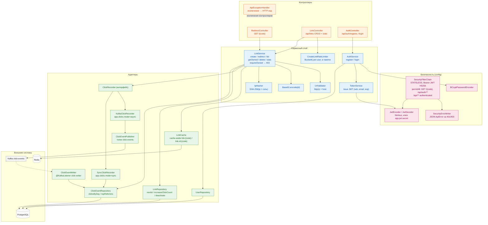

# C3 — Компоненты приложения Spring Boot

Диаграмма показывает внутреннее устройство `shortener-service`: цепочку безопасности, контроллеры,
сервисный слой и адаптеры к внешним системам. Пригодится, чтобы увидеть, где именно проверяется
владелец (`LinkService.requireOwned`, а не фильтр безопасности), как выбирается способ записи клика
(`ClickRecorder`: async через Kafka или sync в базу), и какие компоненты трогают PostgreSQL, Redis и
Kafka. Имена классов — ровно как в коде; условные бины помечены свойством, которое их включает.

## Источники

- SecurityFilterChain (STATELESS, Bearer, permitAll-список, `/api/** authenticated`) — `shortener-service/src/main/java/com/example/shortener/config/SecurityConfig.java:121-145`; SecurityErrorWriter как entryPoint/accessDeniedHandler — `SecurityConfig.java:137-143`.
- JwtEncoder/JwtDecoder HS256, ключ `app.jwt.secret` — `SecurityConfig.java:73-106`; BCryptPasswordEncoder — `SecurityConfig.java:61-64`.
- RedirectController `GET /{code}` — `shortener-service/src/main/java/com/example/shortener/link/RedirectController.java:41-48`.
- LinkController `/api/links`, лимит перед созданием — `shortener-service/src/main/java/com/example/shortener/link/LinkController.java:38-63`; владелец из `sub` — `LinkController.java:111-113`.
- AuthController `/api/auth` — `shortener-service/src/main/java/com/example/shortener/auth/AuthController.java:25-73`.
- ApiExceptionHandler (соответствие исключение → код) — `shortener-service/src/main/java/com/example/shortener/common/ApiExceptionHandler.java:19-27`.
- LinkService (create/redirect/list/getOwned/delete/stats, requireOwned → ForbiddenException) — `shortener-service/src/main/java/com/example/shortener/link/LinkService.java:96-258`.
- AuthService (BCrypt, findByEmailIgnoreCase) — `shortener-service/src/main/java/com/example/shortener/auth/AuthService.java:48-76`; TokenService (sub, email, exp) — `shortener-service/src/main/java/com/example/shortener/auth/TokenService.java:41-51`.
- CreateLinkRateLimiter (Bucket4j, корзины в памяти процесса) — `shortener-service/src/main/java/com/example/shortener/ratelimit/CreateLinkRateLimiter.java:18-61`.
- UrlValidator — `shortener-service/src/main/java/com/example/shortener/link/UrlValidator.java:28-44`; Base62 — `shortener-service/src/main/java/com/example/shortener/common/Base62.java:29-43`; IpHasher — `shortener-service/src/main/java/com/example/shortener/link/IpHasher.java:44-55`.
- LinkCache (ключи `link:`/`link-id:`) — `shortener-service/src/main/java/com/example/shortener/cache/LinkCache.java:28-29`.
- ClickRecorder и реализации — `shortener-service/src/main/java/com/example/shortener/clicks/ClickRecorder.java:12-20`, `KafkaClickRecorder.java:17-31` (`@ConditionalOnProperty app.clicks.mode=async, matchIfMissing`), `SyncClickRecorder.java:18-33` (`havingValue = "sync"`).
- ClickEventPublisher (топик `click-events`) — `shortener-service/src/main/java/com/example/shortener/clicks/ClickEventPublisher.java:27,57-77`; ClickEventWriter (`groupId = "click-writer"`) — `shortener-service/src/main/java/com/example/shortener/clicks/ClickEventWriter.java:55-66`.
- LinkRepository (nextId, increaseClickCount, deactivate) — `shortener-service/src/main/java/com/example/shortener/link/LinkRepository.java:38-66`; ClickEventRepository (clicksByDay, topReferrers) — `shortener-service/src/main/java/com/example/shortener/link/ClickEventRepository.java:28-46`.
- Топик 3 партиции/1 реплика — `shortener-service/src/main/java/com/example/shortener/config/KafkaConfig.java:25-28`; Flyway-миграции — `shortener-service/src/main/resources/db/migration/V1__create_links.sql` … `V4__create_click_events.sql`.