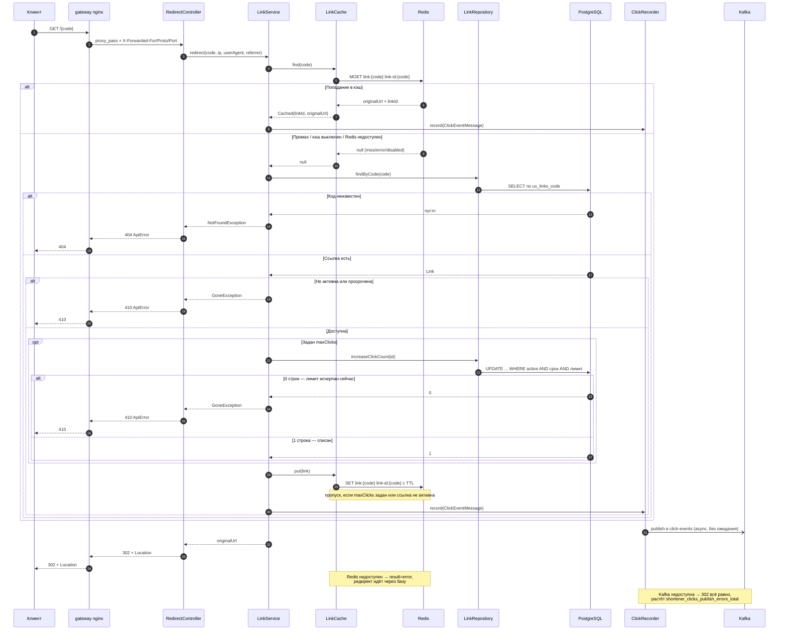

# Сценарий — Редирект GET /{code}

Диаграмма показывает полный путь публичного редиректа: от запроса через шлюз до ответа 302 с
заголовком `Location`. Пригодится, чтобы понять порядок «кэш → база → атомарный guard лимита →
запись клика», почему ссылки с `maxClicks` не кэшируются, и как ведут себя отказы Redis и Kafka.
Ветки 404 (код неизвестен) и 410 (удалена/просрочена/лимит исчерпан) показаны явно; запись клика в
режиме по умолчанию асинхронная и ответа не задерживает.

## Источники

- Вход `GET /{code}`, ответ 302 + Location — `shortener-service/src/main/java/com/example/shortener/link/RedirectController.java:41-48`; проброс заголовков шлюзом — `infra/nginx/nginx.conf:110-128`, `forward-headers-strategy: native` — `shortener-service/src/main/resources/application.yml:21-28`.
- Порядок «кэш → база → guard → клик» — `shortener-service/src/main/java/com/example/shortener/link/LinkService.java:157-177`.
- Кэш: `MGET link:{code} link-id:{code}`, теги hit/miss/error — `shortener-service/src/main/java/com/example/shortener/cache/LinkCache.java:68-86`; выключенный кэш (`app.cache.enabled=false`) не трогает Redis — `LinkCache.java:69-71`.
- Прогрев `put` с TTL, пропуск для `maxClicks`/неактивных — `LinkCache.java:105-119`; TTL = `min(ttl-seconds, секунд до expiresAt)` — `LinkCache.java:143-151`.
- 404 при неизвестном коде — `LinkService.java:165-166` (`NotFoundException`); 410 при неактивной/просроченной — `LinkService.java:167-169` (`GoneException`).
- Атомарный guard лимита — `LinkService.java:170-173`; SQL `UPDATE ... WHERE active AND (expires_at ...) AND (max_clicks ...)` — `shortener-service/src/main/java/com/example/shortener/link/LinkRepository.java:50-56`; 0 строк → GoneException — `LinkService.java:171-172`.
- Запись клика через ClickRecorder — `LinkService.java:179-181`; асинхронная публикация без ожидания — `shortener-service/src/main/java/com/example/shortener/clicks/ClickEventPublisher.java:57-77` (`max.block.ms` 500 — `application.yml:15-19`).
- Деградация Kafka: ошибка глотается, счётчик `shortener.clicks.publish.errors` — `ClickEventPublisher.java:38,62-76`; редирект остаётся успешным — `shortener-service/src/main/java/com/example/shortener/clicks/KafkaClickRecorder.java:13-15`.
- Коды 404/410 в обработчике — `shortener-service/src/main/java/com/example/shortener/common/ApiExceptionHandler.java:102-120`.