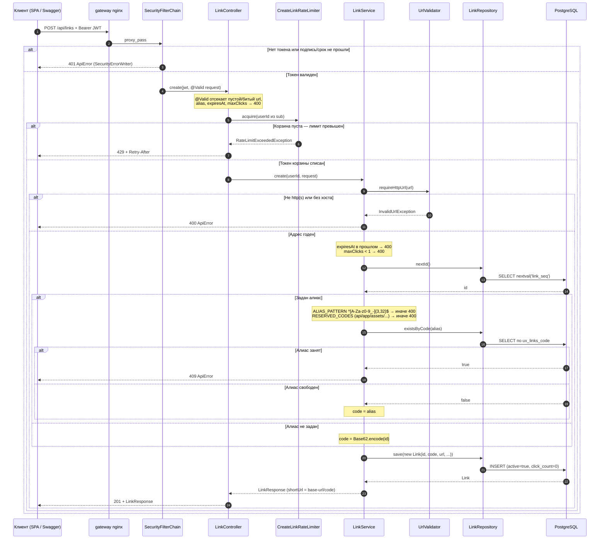

# Сценарий — Создание ссылки POST /api/links

Диаграмма показывает путь создания ссылки владельцем: проверка JWT, лимит создания на пользователя,
валидация адреса и параметров, выбор кода (алиас или Base62 от id из последовательности) и вставка.
Пригодится, чтобы увидеть, в каком порядке отказывают 401/429/400/409 и почему два параллельных
создания не могут получить один код. Код берётся из `link_seq` ДО вставки, занятость алиаса
проверяется по уникальному индексу.

## Источники

- Маршрут и коды создания — `shortener-service/src/main/java/com/example/shortener/link/LinkController.java:50-63`; владелец из `sub` — `LinkController.java:111-113`.
- JWT-проверка и 401 от SecurityErrorWriter — `shortener-service/src/main/java/com/example/shortener/config/SecurityConfig.java:127-143`.
- Лимит до создания — `LinkController.java:61`; корзина per-user, `Retry-After` — `shortener-service/src/main/java/com/example/shortener/ratelimit/CreateLinkRateLimiter.java:48-55`; 429 + заголовок — `shortener-service/src/main/java/com/example/shortener/common/ApiExceptionHandler.java:130-137`; лимит `app.rate-limit.create-per-minute` (по умолчанию 10) — `shortener-service/src/main/resources/application.yml:39-40`.
- Валидация адреса — `shortener-service/src/main/java/com/example/shortener/link/UrlValidator.java:28-44`; вызов — `shortener-service/src/main/java/com/example/shortener/link/LinkService.java:98`.
- expiresAt в будущем, maxClicks ≥ 1 — `LinkService.java:99-106`.
- id из последовательности до вставки — `LinkService.java:109`; `SELECT nextval('link_seq')` — `shortener-service/src/main/java/com/example/shortener/link/LinkRepository.java:38-39`; старт 100000 — `shortener-service/src/main/resources/db/migration/V1__create_links.sql:1`.
- Алиас: паттерн, резерв, занятость — `LinkService.java:108-124`; `ALIAS_PATTERN` — `LinkService.java:41`; `RESERVED_CODES` (api, actuator, swagger-ui, v3, app, assets) — `LinkService.java:50-51`; `existsByCode` — `LinkRepository.java:22`.
- Base62 от id — `LinkService.java:112`; алфавит и encode — `shortener-service/src/main/java/com/example/shortener/common/Base62.java:15,29-43`.
- Вставка активной ссылки — `LinkService.java:126-127`; конструктор (active=true, click_count=0) — `shortener-service/src/main/java/com/example/shortener/link/Link.java:71-82`; `shortUrl` из `app.base-url` — `LinkService.java:264-267`.
- 400/409 в обработчике — `ApiExceptionHandler.java:56-59,112-115`.