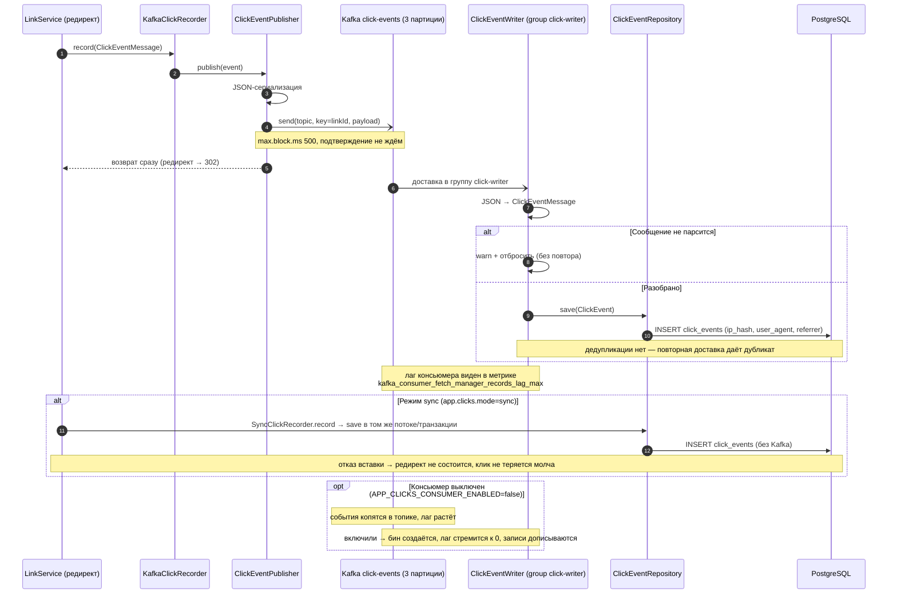

# Сценарий — Асинхронная запись кликов

Диаграмма показывает, как событие клика покидает путь редиректа и дописывается в базу фоновым
консьюмером. Пригодится, чтобы понять, почему статистика «догоняет» редирект с задержкой, что
ключ сообщения = id ссылки (клики одной ссылки попадают в одну партицию), и как ведут себя режим
`sync` и выключенный консьюмер. Публикация не ждёт подтверждения брокера; отказ Kafka не ломает
редирект, а событие теряется (дедупликации в консьюмере нет).

## Источники

- Запись клика из редиректа — `shortener-service/src/main/java/com/example/shortener/link/LinkService.java:179-181`; выбор реализации по `app.clicks.mode` — `shortener-service/src/main/java/com/example/shortener/clicks/ClickRecorder.java:3-11`.
- Async-бин по умолчанию — `shortener-service/src/main/java/com/example/shortener/clicks/KafkaClickRecorder.java:17-31` (`@ConditionalOnProperty ... matchIfMissing = true`).
- Публикация: топик `click-events`, ключ = `linkId`, без ожидания брокера, `max.block.ms` — `shortener-service/src/main/java/com/example/shortener/clicks/ClickEventPublisher.java:27,57-77`; `max.block.ms: 500` — `shortener-service/src/main/resources/application.yml:15-19`.
- Ошибки публикации глотаются, счётчик `shortener.clicks.publish.errors` — `ClickEventPublisher.java:38,62-76`.
- Топик 3 партиции / 1 реплика — `shortener-service/src/main/java/com/example/shortener/config/KafkaConfig.java:25-28`; ключ → одна партиция для ссылки — `ClickEventPublisher.java:54-55`.
- Консьюмер `groupId = "click-writer"`, бин при `app.clicks.consumer-enabled=true` — `shortener-service/src/main/java/com/example/shortener/clicks/ClickEventWriter.java:28-29,55`; разбор и отброс битого JSON — `ClickEventWriter.java:56-63`; вставка без дедупликации — `ClickEventWriter.java:24-26,64-65`.
- Поля события (ip_hash, user_agent, referrer) — `shortener-service/src/main/resources/db/migration/V4__create_click_events.sql:1-9`; хеш IP — `shortener-service/src/main/java/com/example/shortener/link/IpHasher.java:44-55`.
- Sync-режим: вставка в том же потоке/транзакции, отказ не глотается — `shortener-service/src/main/java/com/example/shortener/clicks/SyncClickRecorder.java:8-16,28-32`.
- Выключенный консьюмер копит события — `ClickEventWriter.java:19-22`; переменная `APP_CLICKS_CONSUMER_ENABLED` — `infra/docker-compose.yml:66`; concurrency слушателя — `infra/docker-compose.yml:73-76`.
- Лаг консьюмера в дашборде — `infra/grafana/dashboards/shortener.json` (`kafka_consumer_fetch_manager_records_lag_max`).