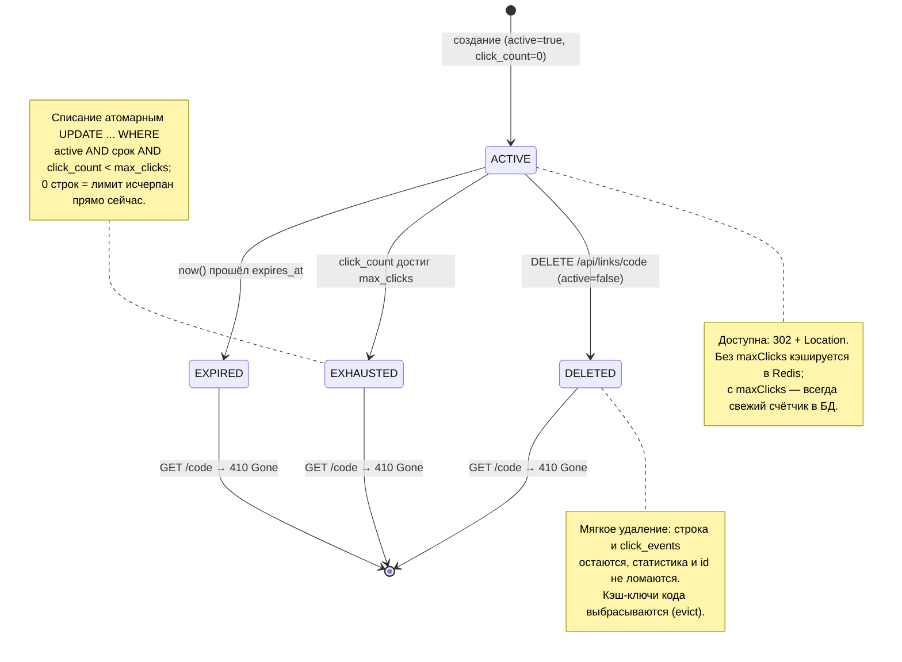

# Жизненный цикл ссылки

Диаграмма показывает логические состояния доступности короткой ссылки и переходы между ними.
Пригодится, чтобы объяснить, почему удалённая, просроченная и исчерпавшая лимит ссылка одинаково
отдают 410 на редирект, и чем мягкое удаление отличается от физического. Важно: отдельного поля
«состояние» в базе нет — доступность выводится из `active`, `expires_at` и `max_clicks`/`click_count`
в момент чтения. 404 (код никогда не существовал) и коды 400/409/429 состояниями не являются.

## Источники

- Состояние выводится, а не хранится; объект неизменяем после создания — `shortener-service/src/main/java/com/example/shortener/link/Link.java:11-17,42-59`.
- Создание активной ссылки с нулевым счётчиком — `shortener-service/src/main/java/com/example/shortener/link/Link.java:71-82`; `active DEFAULT TRUE`, `click_count DEFAULT 0` — `shortener-service/src/main/resources/db/migration/V3__links_owner_and_limits.sql:5-6`.
- Проверка доступности при редиректе (active и expiresAt) → GoneException — `shortener-service/src/main/java/com/example/shortener/link/LinkService.java:167-169`.
- Исчерпание лимита: атомарный guard, 0 строк → GoneException — `LinkService.java:170-173`; SQL — `shortener-service/src/main/java/com/example/shortener/link/LinkRepository.java:50-56`.
- Мягкое удаление (deactivate, active=false) и evict кэша — `LinkService.java:221-226`; JPQL `UPDATE Link l SET l.active = false` — `LinkRepository.java:64-66`.
- Все три состояния дают 410 — `shortener-service/src/main/java/com/example/shortener/common/ApiExceptionHandler.java:117-120` (GoneException → 410); описание 410 в редиректе — `shortener-service/src/main/java/com/example/shortener/link/RedirectController.java:39`.
- Ссылки с maxClicks не кэшируются — `shortener-service/src/main/java/com/example/shortener/cache/LinkCache.java:105-108`.
- 404 — код неизвестен (не состояние) — `LinkService.java:165-166`.