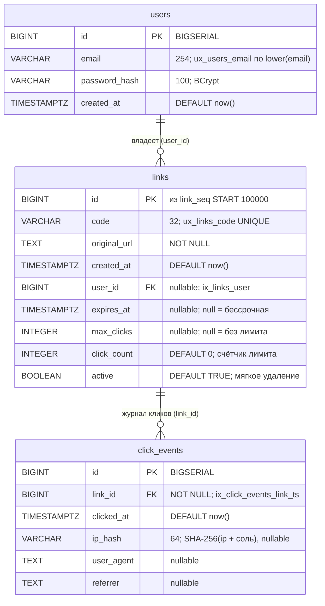

# Схема базы данных (ER)

Диаграмма показывает три таблицы PostgreSQL и их связи: `users` владеет ссылками `links`, по каждой
ссылке пишется журнал переходов `click_events`. Пригодится, чтобы увидеть, где хранятся владелец,
срок и лимит ссылки, почему IP в журнале только в виде хеша, и какие индексы поддерживают поиск по
коду и агрегацию статистики. Схема задаётся Flyway-миграциями V1–V4; id ссылки берётся из
последовательности `link_seq` (старт 100000), а не из автоинкремента таблицы.

Индексы и последовательность (вне диаграммы): `ux_links_code` — уникальный по `links.code`;
`ux_users_email` — уникальный по `lower(users.email)`; `ix_links_user` — по `links.user_id`;
`ix_click_events_link_ts` — по `click_events(link_id, clicked_at)`; `link_seq START WITH 100000
INCREMENT BY 1`. Статистика считается по `click_events` (`date_trunc` по дням в UTC, топ-10
referrer), а не по счётчику `links.click_count`.

## Источники

- `links` и последовательность — `shortener-service/src/main/resources/db/migration/V1__create_links.sql:1-10` (`link_seq START WITH 100000`, `ux_links_code`).
- `users` — `shortener-service/src/main/resources/db/migration/V2__create_users.sql:1-7` (`BIGSERIAL`, `ux_users_email ON lower(email)`).
- Владелец, срок, лимит, счётчик, активность — `shortener-service/src/main/resources/db/migration/V3__links_owner_and_limits.sql:1-7` (`user_id REFERENCES users(id)` nullable, `ix_links_user`).
- `click_events` — `shortener-service/src/main/resources/db/migration/V4__create_click_events.sql:1-9` (`link_id REFERENCES links(id)`, `ip_hash VARCHAR(64)`, `ix_click_events_link_ts (link_id, clicked_at)`).
- Связи в коде: владелец — `shortener-service/src/main/java/com/example/shortener/link/Link.java:39-40`; журнал по ссылке — `shortener-service/src/main/java/com/example/shortener/link/ClickEventRepository.java:17-46`.
- Хеш IP вместо адреса — `shortener-service/src/main/java/com/example/shortener/link/IpHasher.java:11-14,44-55`.
- Агрегаты статистики (date_trunc UTC, топ-10 referrer) — `shortener-service/src/main/java/com/example/shortener/link/ClickEventRepository.java:28-46`; счётчик лимита отдельно от статистики — `shortener-service/src/main/java/com/example/shortener/link/Link.java:50-56`.