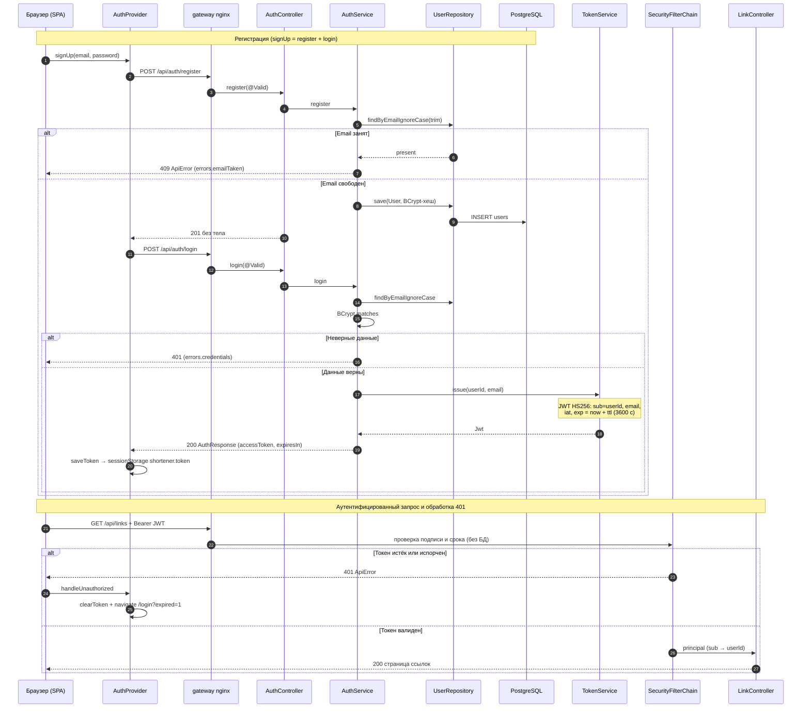

# Аутентификация и сессия (JWT + SPA)

Диаграмма показывает сквозной путь аутентификации: регистрация и вход на бэкенде, выдача JWT,
хранение токена в sessionStorage браузера и единая обработка 401 в SPA. Пригодится, чтобы понять,
почему регистрация — это два запроса (register без тела, затем login), где проверяется токен
(подпись и срок, без обращения к базе и без отзыва), и как истёкший сеанс выбрасывает пользователя
на вход с флагом `?expired=1`. Пароль хранится только как BCrypt-хеш; «неверные данные» не
различают «нет пользователя» и «не тот пароль».

## Источники

- Регистрация/вход, коды 201/400/409/401 — `shortener-service/src/main/java/com/example/shortener/auth/AuthController.java:44-73`; маршрут `/api/auth` открыт — `shortener-service/src/main/java/com/example/shortener/config/SecurityConfig.java:129`.
- Регистрация: trim + findByEmailIgnoreCase, BCrypt, 409 на занятый email — `shortener-service/src/main/java/com/example/shortener/auth/AuthService.java:48-55`; вход: единое InvalidCredentialsException — `AuthService.java:67-76`.
- Выдача JWT (sub, email, iat, exp) — `shortener-service/src/main/java/com/example/shortener/auth/TokenService.java:41-51`; HS256, ключ `app.jwt.secret` — `SecurityConfig.java:73-106`; TTL по умолчанию 3600 — `shortener-service/src/main/resources/application.yml:32-34`.
- Проверка токена ресурс-сервером (подпись/срок, без отзыва) — `SecurityConfig.java:137-140`; отзыв отсутствует — `AuthService.java:16-22`.
- SPA: signUp = register затем login — `shortener-web/src/auth/AuthProvider.tsx:34-41`; signIn сохраняет токен — `AuthProvider.tsx:25-32`; эндпоинты — `shortener-web/src/api/auth.ts:4-8`.
- Токен в sessionStorage `shortener.token` — `shortener-web/src/lib/session.ts:1-5`; почему sessionStorage, а не localStorage — `AuthProvider.tsx:9-12`.
- Единая обработка 401: clearToken + navigate `?expired=1` — `AuthProvider.tsx:48-62`; адрес `EXPIRED_REDIRECT` — `shortener-web/src/auth/sessionExpired.ts`.
- Гард маршрутов: без токена → /login — `shortener-web/src/auth/RequireAuth.tsx:7-10`; таблица маршрутов — `shortener-web/src/App.tsx:16-57`.
- Клиент: Bearer-заголовок, разбор 401/409 по ключам словаря — `shortener-web/src/api/client.ts:20-32`, `shortener-web/src/lib/errorKeys.ts:9-17`.
- 401/409 в обработчике бэкенда — `shortener-service/src/main/java/com/example/shortener/common/ApiExceptionHandler.java:97-100,112-115`.