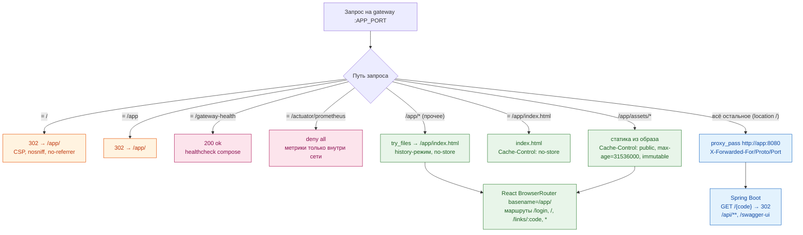
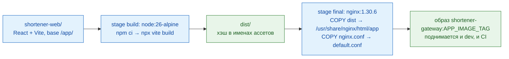

# Доставка SPA и маршрут запроса через шлюз

Диаграмма показывает, как gateway nginx раздаёт интерфейс `/app/` и проксирует остальное в
приложение, и как бандл React попадает в образ. Пригодится, чтобы понять единственную точку входа,
history-режим маршрутизации (фолбэк на `index.html`), политику кэша ассетов (`immutable` против
`no-store`), и почему `app`/`assets` зарезервированы под алиасы. Первый блок — дерево маршрутов
шлюза, второй — сборка образа gateway.

## Источники

- Корень и `/app` → 302 `/app/` — `infra/nginx/nginx.conf:55-78` (`absolute_redirect off`, CSP/nosniff/no-referrer).
- Ассеты с годовым `immutable` — `infra/nginx/nginx.conf:80-90`; `index.html` и history-фолбэк с `no-store` — `infra/nginx/nginx.conf:92-108` (`try_files $uri $uri/ /app/index.html`).
- Healthcheck шлюза — `infra/nginx/nginx.conf:37-41`; метрики наружу закрыты — `infra/nginx/nginx.conf:45-47`; проксирование прочего — `infra/nginx/nginx.conf:110-128`.
- Размер тела и таймауты прокси — `infra/nginx/nginx.conf:34,125-127`.
- Сборка образа: multi-stage, `npm ci` + `npx vite build`, копирование dist и конфига — `infra/web.Dockerfile:4-19`; контекст сборки — корень репозитория — `infra/docker-compose.yml:96-100`.
- `base: '/app/'` — `shortener-web/vite.config.ts:5`; `basename={import.meta.env.BASE_URL}` — `shortener-web/src/main.tsx:21`; маршруты SPA — `shortener-web/src/App.tsx:16-57`.
- Резерв `app`/`assets` под статику шлюза — `shortener-service/src/main/java/com/example/shortener/link/LinkService.java:43-51`; клиентская копия — `shortener-web/src/lib/validation.ts:32-33`.
- Порт приложения не публикуется, вход только через шлюз — `infra/docker-compose.yml:85-88,104-105`.