# Поток метрик и дашборд

Диаграмма показывает, как метрики снимаются с приложения и доходят до Grafana: эндпоинт
`/actuator/prometheus` → Prometheus (scrape каждые 5 с напрямую с `app:8080`, в обход шлюза) →
дашборд `shortener.json`. Пригодится, чтобы найти, какая метрика питает какую панель, и почему
метрики не отдаются наружу через gateway. Имена метрик и функций — ровно как в дашборде и коде;
полные PromQL-выражения панелей лежат в `infra/grafana/dashboards/shortener.json`.

```mermaid
flowchart LR
    subgraph APP["app:8080 — /actuator/prometheus (без токена)"]
        M1["shortener_cache_requests_total<br/>result = hit / miss / error"]
        M2["shortener_clicks_publish_errors_total"]
        M3["http_server_requests_seconds_*<br/>histogram (percentiles-histogram)"]
        M4["jvm_* / hikaricp_*<br/>process_cpu_usage"]
        M5["kafka_consumer_fetch_manager_records_lag_max"]
    end

    APP -->|"scrape каждые 5s<br/>target app:8080"| PROM["Prometheus v3.15.1<br/>TSDB, profile monitoring"]
    PROM -->|"datasource http://prometheus:9090"| GRAF["Grafana 13.3.0<br/>дашборд shortener.json"]
    GRAF --> DASH["10 панелей (таблица ниже)"]

    classDef metric fill:#E8F5E9,stroke:#2E7D32,color:#1B5E20;
    classDef mon fill:#E3F2FD,stroke:#1565C0,color:#0D47A1;
    class M1,M2,M3,M4,M5 metric;
    class PROM,GRAF,DASH mon;
```

Панели дашборда и питающие их метрики (выражения — в `shortener.json`):

| Панель | Метрика / функция |
|---|---|
| Редирект: RPS и 5xx | `rate(http_server_requests_seconds_count{uri="/{code}"})`, доля `status=~"5.."` |
| Редирект: p50 / p95 / p99 | `histogram_quantile(0.50/0.95/0.99, sum by (le) (rate(http_server_requests_seconds_bucket{uri="/{code}"})))` |
| Ошибки 5xx по эндпоинтам | `sum by (uri, status) (rate(http_server_requests_seconds_count{status=~"5.."}))` |
| Создание ссылки: RPS и p95 | `http_server_requests_seconds_*{uri="/api/links"}`, `histogram_quantile(0.95, ...)` |
| Кэш: доля попаданий | `shortener_cache_requests_total{result="hit"}` / (hit + miss) |
| JVM: куча | `jvm_memory_used_bytes{area="heap"}` / `jvm_memory_max_bytes{area="heap"}` |
| JVM: GC | `rate(jvm_gc_pause_seconds_sum)` / `rate(jvm_gc_pause_seconds_count)` |
| HikariCP: активные и ожидающие | `hikaricp_connections_active` / `hikaricp_connections_pending` / `hikaricp_connections_max` |
| Kafka: lag консьюмера и ошибки публикации | `kafka_consumer_fetch_manager_records_lag_max` + `rate(shortener_clicks_publish_errors_total)` |
| Процесс: CPU и дескрипторы | `process_cpu_usage` / `system_cpu_usage` / `process_files_open_files` |

## Источники

- Эндпоинт открыт без токена — `shortener-service/src/main/java/com/example/shortener/config/SecurityConfig.java:133`; экспозиция `health,prometheus` — `shortener-service/src/main/resources/application.yml:45-49`; гистограмма http-запросов — `application.yml:50-53`.
- Кастомные метрики: кэш — `shortener-service/src/main/java/com/example/shortener/cache/LinkCache.java:153-155` (`shortener.cache.requests`, тег `result`); ошибки публикации — `shortener-service/src/main/java/com/example/shortener/clicks/ClickEventPublisher.java:38` (`shortener.clicks.publish.errors`).
- Scrape каждые 5 с, target `app:8080` — `infra/prometheus/prometheus.yml:1-7`; Prometheus в профиле monitoring — `infra/docker-compose.yml:118-127`.
- Метрики наружу через шлюз закрыты — `infra/nginx/nginx.conf:43-47` (`deny all` на `/actuator/prometheus`).
- Datasource Grafana — `infra/grafana/provisioning/datasources/prometheus.yml:3-8`; дашборд по умолчанию — `infra/docker-compose.yml:134-135`; панели и PromQL — `infra/grafana/dashboards/shortener.json` (10 панелей, заголовок строки «URL shortener: нагрузка»).
- Лаг консьюмера Kafka — метрика `kafka_consumer_fetch_manager_records_lag_max` в `infra/grafana/dashboards/shortener.json`; Hikari/JVM/process — стандартные метрики Micrometer/Spring Boot Actuator.