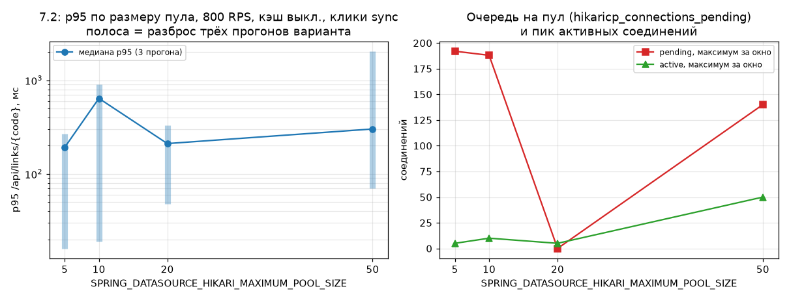

# Эксперимент 7.2: размер пула Hikari

Относится к этапу 7. Заполняется по результатам прогонов; пустых строк в таблице быть не
должно — если вариант не прогонялся, так и пишется, и чекбокс DoD остаётся неотмеченным.

## Гипотеза

Оптимум размера пула лежит ниже «чем больше, тем лучше»: слишком большой пул не уменьшает p95 и
может ухудшить задержки, потому что узкое место — не число соединений у клиента, а скорость
Postgres, и лишние соединения только переводят очередь из Hikari в Postgres, где она стоит
дороже (блокировки, планировщик, контекстные переключения).

Подтверждением считаем немонотонную зависимость: p95 падает при росте пула до некоторого значения,
а дальше либо не меняется, либо растёт. Если же p95 монотонно убывает до 50, значит узкое место на
выбранной нагрузке вообще не пул, и эксперимент надо повторить на более высокой интенсивности —
это тоже результат, и он будет записан.

Формулировка написана до прогонов (2026-11-01, до серии `pool*`).

## Выбор уровня нагрузки

Критерий, зафиксированный до пробников (коммит `4f38d65`): уровень подбирается пробником —
`MixedSimulation`, `constant`, кэш выключен, клики синхронные, пул 10; берётся максимальная ступень,
на которой `hikaricp_connections_pending > 0` или p95 хотя бы вдвое выше, чем на 200 RPS, но при этом
фактический `Cnt/s` не отстаёт от целевого (иначе упираемся в генератор, как в отменённой серии 7.1b
из [`01-redis-vs-no-cache.md`](01-redis-vs-no-cache.md)).

Пробники внесли в этот метод два уточнения — оба до измерительной серии, гипотеза не менялась.

1. **Порядок ступеней надо учитывать.** Первые ступени (400 / 700 / 1000 RPS) шли сразу после
   `scripts/reset-state.ps1`, то есть по холодному контейнеру, и картина получилась драматической:
   `pending` 187 при активных 10 и 13,7–43,6% KO уже на 400 RPS. Те же 400 RPS по прогретому
   приложению дают KO 0 и p50 4 мс (таблицы ниже). Значит «обрыв» между 300 и 400 RPS был артефактом
   холодного старта: что именно прогревалось (JIT приложения, shared buffers Postgres, планы
   подготовленных выражений) этими прогонами не разделяется — разделяется только «после перезапуска
   контейнера» и «по прогретому». Отсюда практическое следствие для метода: прогрев перед
   измерительными прогонами — не ритуал, а обязательная часть протокола, иначе три прогона меряют
   разгрев очереди.
2. **«Максимальная ступень» буквально — это 1000 RPS, взято 800.** На 1000 RPS критерий ещё
   формально выполняется (`pending` 185, `Cnt/s` ровно целевой), но там уже 2,42% KO, и это нижняя
   граница зоны, генератору в которой мы не доверяем (7.1b). При KO выше ~2% сравнение вариантов
   начинает определяться таймаутами, а не размером пула. На 800 RPS пул занят целиком (активных
   ровно 10 из 10, `pending` 77) при 0,16% KO — это и есть уровень, на котором переменная варианта
   связывает системе руки. `RPS72 = 800`, длительность измерительных прогонов 60 с.

Отрицательный сценарий, заранее описанный в гипотезе («узкое место на выбранной нагрузке вообще не
пул»), пробник частично подтверждает уже на уровне метода: при ≤500 RPS `pending` оставался нулевым,
а активных соединений было 1–5 из 10 — по закону Литтла при 4 мс на запрос и 500 RPS одновременных
обращений к Postgres бывает ~2, поэтому пулу из 10 соединений там нечего ограничивать. Отсюда
ожидание к серии: различия между пулами появятся в хвостах распределения (p95/p99) и в доле KO, но
не в p50.

## Условия (железо, версии, лимиты контейнера, профиль, переменные)

| | |
|---|---|
| Железо | Intel Core i5-10300H, 4 ядра / 8 потоков; 16 ГБ RAM хоста |
| Виртуализация | Docker Engine 29.9.2 (Docker Desktop), WSL2 2.7.13.0, ядро 6.18.33.2-microsoft-standard-WSL2 |
| Ресурсы Docker VM | 4 vCPU, 5.79 ГиБ |
| Лимиты контейнера `app` | `cpus: "2"`, `mem_limit: 1g`; `system_cpu_count = 2` внутри JVM |
| Сервис | Spring Boot 3.5.16, JDK в контейнере Temurin 21.0.13+9-LTS |
| Инфраструктура | Postgres 16, `current_setting('max_connections') = 100` (проверено `psql -tAc`, поэтому пул 50 оставляет запас серверу), Redis 7, Kafka `apache/kafka:3.9.1` |
| Генератор нагрузки | Gatling 3.16.0, `gatling-maven-plugin` 4.21.12, Maven 3.9.16, JDK хоста Temurin 25.0.4.1+1 — на той же машине |
| Профиль нагрузки | `MixedSimulation` (95% редиректов, 5% созданий), `constant`, `RPS72` — по пробнику, `DURATION_SEC=60` |
| Данные | `codes-hot.csv` (2000 кодов), засев этапа 6; `click_events` растёт от прогона к прогону — число строк на момент серии фиксируется в «Результатах» |
| Вход в сервис | gateway (nginx) на `http://localhost:28080` |
| Постоянные переменные вариантов | `APP_CACHE_ENABLED=false`, `APP_CLICKS_MODE=sync`, `RATE_LIMIT_CREATE_PER_MINUTE=1000000` (поднят по указанию PLAN §6.5; при 1000 серия забракована — см. поправку 3), `JAVA_TOOL_OPTIONS=` |
| Переменная варианта | `SPRING_DATASOURCE_HIKARI_MAXIMUM_POOL_SIZE` ∈ {5, 10, 20, 50} |
| Лимиты очереди (проверены по конфигам) | Tomcat: `server.tomcat.threads.max` не задан, значит 200 по умолчанию — `server_inflight_max` в насыщенных окнах равнялся ровно 200; HikariCP: `connection-timeout` не задан, значит 30 с по умолчанию; gateway: `proxy_connect_timeout 2s`, `proxy_read_timeout 10s`, `keepalive 32`; Prometheus: `scrape_interval: 5s`, таймаут скрейпа 10 с по умолчанию |

Кэш выключен и клики пишутся синхронно — это осознанно: при включённом кэше поток редиректа не берёт
соединение с Postgres для чтения ссылки (событие клика уходит в Kafka, и соединение держит уже
консьюмер), поэтому очередь на пул не образуется и сравнивать его размеры не на чём — в 7.1 на
1000 RPS с кэшем было 4 активных соединения и ноль ожидающих
([`01-redis-vs-no-cache.md`](01-redis-vs-no-cache.md), таблица прогонов). Строку `ramp 100→2000` из
той же таблицы используем только для этого наблюдения (очереди на пул нет и на разгоне); её
задержки и вывод о «потолке» по-прежнему не приняты.

Три лимита выше называются не для справочки: они определяют, как выглядит «пул мал». Поток запроса
ждет соединение до 30 с, а шлюз закрывает соединение с клиентом через 10 с без ответа от upstream —
значит при нехватке соединений прогон показывает не «медленные 201/302», а всплеск `Premature close`
и `504` (в логе gateway — `upstream timed out (110: Connection timed out) while reading response
header from upstream`), и вся очередь из 200 потоков Tomcat стоит на `getConnection()`. Второй
побочный эффект: в таких окнах `/actuator/prometheus` не успевает отрендериться за таймаут скрейпа,
в логе приложения это `AsyncRequestNotUsableException: … Broken pipe` на `GET /actuator/prometheus`,
а в наших замерах — провалы `hikaricp_connections_pending` именно в самые насыщенные секунды. То
есть gauge-метрики очереди в режиме коллапса занижать нечего: они уже занижены отсутствием скрейпов,
и судить о размере очереди надо по `server_inflight_max` и по распределению KO, а не по `pending`.

## Метод (шаги, число прогонов)

1. Пробник уровня (см. выше).
2. Для каждого пула: ожидание дренажа лага Kafka, `scripts/reset-state.ps1` с переменными варианта
   (пересоздаёт `app`, `FLUSHALL`, ждёт `UP`), проверка health, прогрев 60 с, затем
   **три** измерительных прогона по 60 с.
3. После каждого прогона: `docker stats --no-stream` в середине окна, время ответа и число запросов
   из отчёта Gatling, `hikaricp_connections_pending` / `hikaricp_connections_active` /
   `hikaricp_connections_acquire_seconds` / `process_cpu_usage` из Prometheus по окну прогона.
4. После каждого варианта: `SELECT count(*) FROM pg_stat_activity WHERE datname = 'shortener'`.

### Поправка к протоколу: ожидание покоя между прогонами

Первая попытка серии (2026-11-02, метки `pool5-*` и `pool10-*` без суффикса) показала, что шага
«прогрев 60 с» на этом уровне мало. Прогреться не получается: холодный контейнер на 800 RPS даёт в
прогреве 66–79% KO, а следующие за ним измерительные прогоны стартуют с неразобранной очередью —
`pool10-a` показал 36,6% KO и p50 3 479 мс там, где пробник на том же уровне дал 0,16% KO и p50 4 мс.
Причина в том, что клиентский таймаут Gatling (60 с — значение по умолчанию, в логе прогона
`Request timeout … after 60000 ms`) не отменяет работу на сервере: через пять минут после остановки
генератора сервис всё ещё сообщал `http_server_requests_active_seconds_gcount` = 197
и `hikaricp_connections_pending` = 172; очередь разгребается за 45–60 с после прекращения нагрузки.

Поэтому в протокол добавлено ожидание покоя: после прогрева и после каждого измерительного прогона
серия ждёт, пока число обрабатываемых запросов упадёт ниже 5 (не дольше 240 с), и ещё 15 с паузы.
Прогоны, полученные без этой паузы, в отчёт не входят и остаются под метками без суффикса `s`;
измеряемая переменная от поправки не изменилась — изменилось только состояние, из которого стартует
прогон. Поправка внесена до публикации чисел по вариантам, гипотеза не менялась.

### Поправка 2 к протоколу: прогрев до стационарного состояния и браковка по событиям инфраструктуры

Вторая попытка серии (2026-11-02, 06:49–07:05 UTC, метки `pool5s-*` и `pool10s-*`) тоже в отчёт не
вошла — по двум причинам.

Первая: критерий прогрева «Gatling оставил отчёт с ненулевым `OK`» стационарность не обеспечивает.
Прогревы дали 12,71% KO (`pool5s-warm1`) и 59,83% KO (`pool10s-warm1`), и первые замерные прогоны
варианта измеряли разгон, а не вариант: `pool10s-a` — 28,45% KO при p50 3 099 мс, `pool10s-b` —
22,30% KO при p50 2 709 мс, тогда как третьи прогоны тех же вариантов чистые: `pool5s-c` — 0,84% KO
при p50 7 мс, `pool10s-c` — 0,85% KO при p50 23 мс. Разброс внутри одного варианта (p50 от 7 до
3 099 мс) больше разницы, которую мы рассчитываем увидеть между размерами пула, поэтому сравнение
медиан теряет смысл.

Вторая: в том же варианте контейнер `app` перестал отвечать. `pool5s-a` не оставил строки результата
(сборщик отработал с ошибкой), в логе `pool5s-b` клиент получил 9 078 раз «Connection refused» и
6 288 раз «Premature close»; у текущего контейнера `RestartCount = 0`, а `StartedAt` = 06:57:19 —
это момент пересоздания под вариант пула 10, то есть контейнер варианта пула 5 был заменён, а не
перезапущен Docker'ом. В 07:13:54 тот контейнер завершился с кодом 137 вместе со всей инфраструктурой:
хост уснул до 18:30 UTC.

Отсюда два новых правила, оба внесены до публикации чисел по вариантам:

1. Прогрев повторяется до стационарного состояния — пока доля KO в прогревочном прогоне не станет
   меньше 1% (до пяти попыток, между попытками — ожидание покоя). Прогрев не является измерением,
   поэтому повторять его до выхода на плато корректно; отбирать так же замерные прогоны по величине
   p95 мы не считаем допустимым.
2. Замерный прогон бракуется и повторяется (до трёх попыток на слот) только по объективным событиям
   инфраструктуры: у контейнера изменился `StartedAt` в ходе прогона; в логе Gatling есть
   «Connection refused»; сборщик не оставил строку результата. Браковка помечается в
   `exp-quarantine.tsv` с указанием причины, журнал прогоны при этом не переписывается — строка
   остаётся читаемой. Отсутствие значения `http_server_requests_active_seconds_gcount` больше не
   считается покоем: это признак того, что приложение не скрейпится, то есть лежит.

Измеряемая переменная, уровень нагрузки (800 RPS) и длительность (60 с) от этого не изменились.

Меняется ровно одна переменная; всё остальное совпадает с прогоном 7.1 и baseline.

Драйвер серии — временный `exp72.sh` (вне репозитория), команды повтора приведены в конце отчёта.

### Поправка 3 к протоколу: плато KO — это 429 лимитера, лимит создающих запросов поднят

Третья попытка серии (2026-11-02, 18:34–19:16 UTC, метки `pool5s-*`… `pool50s-*`) уже шла по
исправленному протоколу: ожидание покоя между прогонами, прогрев до KO < 1%, браковка по событиям
инфраструктуры. И всё равно числа в отчёт не попадают — по третьей причине, которую протокол про
прогрев и покой не описывал.

Пул 5 и пул 50 не вышли на порог за пять прогревов (пул 5: 61,97% → 17,11% → 1,233% → 1,335% →
1,323%; пул 50: 68,54% → 37,05% → 8,61% → 1,329% → 1,327%), пулы 10 и 20 отмеряли по три прогона.
Доля KO во всех этих прогонах лежит в узкой полосе 1,23–1,36% и не уменьшается с прогревом.
Разложение по видам показывает, что это не отказы сервиса:

| Метка | KO | Из них `429` | Доля |
|---|---|---|---|
| `pool5s-warm3` | 592 | 592 | 100% |
| `pool5s-warm5` | 635 | 635 | 100% |
| `pool10s-a` | 639 | 639 | 100% |
| `pool20s-c` | 654 | 654 | 100% |
| `pool50s-warm5` | 637 | 637 | 100% |

Причина в конфигурации стенда, а не в варианте: `MixedSimulation` на 800 RPS делает 5% созданий —
40 запросов в секунду, 2 400 в минуту, а `RATE_LIMIT_CREATE_PER_MINUTE` в `infra/.env` стоит 1000.
Лимитер (Bucket4j, создание ссылки) отвечает `429` ровно на лишние, и Gatling засчитывает их в KO.
`scripts/run-load.ps1` печатает об этом предупреждение первой строкой каждого лога
(`WARNING: RATE_LIMIT_CREATE_PER_MINUTE=1000, а прогону нужно около 2400/мин`), я его видел и
продолжил серию — зря: PLAN §6.5 прямо требует на время нагрузочных тестов поднять лимит до
`1000000`.

Отсюда:

1. Критерий «прогрев до KO < 1%» при лимитере 1000 структурно недостижим ни для одного размера пула,
   поэтому вариант «не прошёл прогрев» ничего не говорит о пуле. Серия 18:34–19:16 UTC целиком
   остаётся в журнале как забракованная лимитером, её числа в таблицы не пишутся.
2. Новая серия (метки `pool5t-*`… `pool50t-*`) прогоняет все четыре варианта при
   `RATE_LIMIT_CREATE_PER_MINUTE=1000000`; значение переключателя фиксируется по выводу
   `scripts/reset-state.ps1`, он печатает то, что реально дошло до контейнера.
3. Правило прогрева «плато вместо порога», которое драйвер `exp72b.sh` пробовал как обходной путь,
   отменено: после поднятия лимита оно не нужно, а принимать вариант с KO выше порога — значит
   занижать планку честности отчёта.
4. После этапа 7 лимит возвращаем в `infra/.env` на 1000 — на этом значении держатся автотесты
   этапа 4 (PLAN: отдельный тест на 429 идёт с маленьким лимитом). `infra/.env` в git не входит,
   поэтому в репозитории это значение не меняется.

Измеряемая переменная, уровень нагрузки (800 RPS), длительность (60 с) и три других правила
протокола от этого не изменились.

## Результаты

### Пробник уровня нагрузки

`MixedSimulation`, `constant`, `APP_CACHE_ENABLED=false`, `APP_CLICKS_MODE=sync`, пул 10, 45 с на
ступень, метки отчётов Gatling `mixedsimulation-20261102043233367` … `mixedsimulation-20261102045202427`.
Задержка в миллисекундах; KO — доля неуспешных запросов; «CPU app» — среднее `process_cpu_usage` за
окно прогона, доля от двух ядер, доступных контейнеру.

Ступени сразу после `reset-state.ps1` (холодный контейнер):

| RPS | Запросов | KO | p50 | p95 | p99 | `Cnt/s` факт | Hikari active / pending | CPU app |
|---|---|---|---|---|---|---|---|---|
| 400 | 18 000 | 13,67% | 4 248 | 8 851 | 9 957 | 391,3 | 10 / 187 | 1,18 ядра |
| 700 | 31 500 | 15,67% | 2 869 | 5 273 | 5 958 | 670,2 | 10 / 187 | 1,32 ядра |
| 1000 | 45 000 | 43,56% | 2 230 | 6 104 | 8 709 | 957,5 | 9 / 187 | 0,97 ядра |

Ступени по уже прогретому приложению (без перезапуска между ними; строка «300 (прогрев)» — тот же
300 RPS перед подъёмом шкалы):

| RPS | Запросов | KO | p50 | p95 | p99 | `Cnt/s` факт | Hikari active / pending | CPU app |
|---|---|---|---|---|---|---|---|---|
| 100 | 4 500 | 0 | 4 | 6 | 77 | 100,0 | 0 / 0 | 0,13 ядра |
| 150 | 6 751 | 0 | 4 | 6 | 121 | 150,0 | 1 / 0 | 0,16 ядра |
| 200 | 9 000 | 0 | 4 | 5 | 141 | 200,0 | 2 / 0 | 0,22 ядра |
| 250 | 11 251 | 0 | 4 | 6 | 154 | 250,0 | 1 / 0 | 0,25 ядра |
| 300 | 13 500 | 0 | 4 | 6 | 184 | 300,0 | 1 / 0 | 0,27 ядра |
| 300 (прогрев) | 13 500 | 0 | 6 | 155 | 469 | 300,0 | 5 / 0 | 0,47 ядра |
| 320 | 14 400 | 0 | 5 | 24 | 292 | 320,0 | 1 / 0 | 0,43 ядра |
| 350 | 15 751 | 0 | 4 | 12 | 387 | 350,0 | 1 / 0 | 0,39 ядра |
| 400 | 18 000 | 0 | 4 | 102 | 771 | 400,0 | 2 / 0 | 0,50 ядра |
| 500 | 22 500 | 0 | 4 | 9 | 331 | 500,0 | 1 / 0 | 0,51 ядра |
| **800** | 36 000 | 0,16% | 4 | 429 | 1 020 | 800,0 | **10 / 77** | 0,66 ядра |
| 1000 | 45 000 | 2,42% | 5 | 406 | 813 | 1 000,0 | 8 / 185 | 0,90 ядра |

Что из этого следует для выбора уровня:

- До 500 RPS включительно размер пула сравнивать не на чём: `pending` = 0 при всех ступенях, активных
  соединений 1–5 из 10, p50 4 мс. Нулевой `pending` при nonzero p99 (154–771 мс) означает и то, что
  gauge снимается раз в 5 с (12 точек на 45-секундный прогон) и короткие ожидания соединения мимо них
  проходят; для серии это учтено — там критерием служит и p95, и доля KO.
- На 800 RPS активных соединений ровно 10 (весь пул) и 77 ожидающих — пул становится связывающим, а
  цена ошибки ещё низкая (56 KO из 36 000). Это и есть `RPS72`.
- На 1000 RPS `pending` 185, но 2,42% KO; выше — зона отменённой серии 7.1b, где показателям
  генератора уже нельзя верить.
- Ошибка съёмки `docker stats` на 45-секундных ступенях: смещение кадра было `длительность/2 + 32 с`,
  а инжекция при 45 с заканчивалась раньше, поэтому точечные проценты (`cpu_app` в журнале) для этих
  ступеней отброшены — в таблице выше CPU только из Prometheus. Для 60-секундных измерительных
  прогонов смещение исправлено на `+20 с`, и кадр снова попадает внутрь окна.

### Варианты по размеру пула

Серия 2026-11-02, 19:18–19:56 UTC, метки `pool5t-*`, `pool10t-*`, `pool20t-*`. Каждый вариант — пересоздание
контейнера с своим пулом, прогрев до стационарного состояния (пул 5 и пул 10 — 3-я попытка прогрева, пул 20 —
4-я) и три замерных прогона по 60 с на 800 RPS. Задержки в миллисекундах; `RPS факт` — `Cnt/s` из отчёта
Gatling; «Hikari active / pending» — максимум за окно прогона; «CPU app» — среднее `process_cpu_usage` за окно
(доля от двух ядер, доступных контейнеру). Лимитер создания ссылок при этом поднят до
`RATE_LIMIT_CREATE_PER_MINUTE=1000000` (правка 3), значение зафиксировано по выводу `reset-state.ps1`.

Вариант пула 50 домерян отдельно: 2 ноября серия остановлена на границе варианта по решению оператора (машину
нужно было выключить на ночь), три замерных прогона пула 50 сделаны утром 3 ноября тем же драйвером при тех же
постоянных переменных (`RPS72=800 POOLS="50" bash with-lock.sh exp72b.sh`). Контейнер на старте варианта
пересоздан, поэтому пул 50 прогревался с нуля и прогрелся только с четвёртой попытки.

| Пул | Прогон | RPS факт | Запросов | KO | p50 | p95 | p99 | Hikari active / pending | acquire mean, с | CPU app | Отчёт Gatling / замечание |
|---|---|---|---|---|---|---|---|---|---|---|---|
| 5 | a | 786,9 | 48 000 | 0,00% | 6 | 16 | 71 | 5 / 5 | 0,0064 | 0,37 | `mixedsimulation-20261102192451838` |
| 5 | b | 786,9 | 48 000 | 0,00% | 6 | 192 | 509 | 5 / 192 | 0,0694 | 0,40 | `mixedsimulation-20261102192637070` — очередь всю ступень, ошибок ноль|
| 5 | c | 786,9 | 48 000 | 0,00% | 9 | 269 | 557 | 5 / 1 | 0,0297 | 0,51 | `mixedsimulation-20261102192822490` — pending 192 в начале окна|
| **5 медиана** | | 786,9 | 48 000 | 0,00% | 6 | 192 | 509 | 5 / 5 | 0,0297 | 0,40 | разброс p95 16…269 |
| 10 | a | 786,9 | 48 000 | 0,00% | 11 | 901 | 1 326 | 10 / 188 | 0,0924 | 0,48 | `mixedsimulation-20261102193553046` — худший прогон варианта|
| 10 | b | 786,9 | 48 000 | 0,00% | 6 | 19 | 80 | 6 / 0 | 0,0058 | 0,38 | `mixedsimulation-20261102193741252` — лучший прогон варианта (p95 19 мс — минимум всей серии)|
| 10 | c | 800,0 | 48 000 | 0,00% | 10 | 641 | 955 | 10 / 52 | 0,0716 | 0,37 | `mixedsimulation-20261102193929375` |
| **10 медиана** | | 786,9 | 48 000 | 0,00% | 10 | 641 | 955 | 10 / 52 | 0,0716 | 0,38 | разброс p95 19…901 |
| 20 | a | 786,9 | 48 000 | 0,00% | 7 | 332 | 781 | 5 / 0 | 0,0359 | 0,49 | `mixedsimulation-20261102195019321` |
| 20 | b | 786,9 | 48 000 | 0,00% | 6 | 48 | 150 | 3 / 0 | 0,0040 | 0,38 | `mixedsimulation-20261102195205323` |
| 20 | c | 800,0 | 48 000 | 0,00% | 6 | 211 | 805 | 4 / 0 | 0,0472 | 0,42 | `mixedsimulation-20261102195350910` |
| **20 медиана** | | 786,9 | 48 000 | 0,00% | 6 | 211 | 781 | 4 / 0 | 0,0359 | 0,42 | разброс p95 48…332 |
| 50 | a | 786,9 | 48 000 | 0,00% | 7 | 302 | 777 | 9 / 0 | 0,0057 | 0,34 | `mixedsimulation-20261103065533660` |
| 50 | b | 786,9 | 48 000 | 0,00% | 7 | 70 | 306 | 5 / 0 | 0,0015 | 0,40 | `mixedsimulation-20261103065728166` — без очереди: из 50 соединений занято 5|
| 50 | c | 786,9 | 48 000 | **1,53%** | 8 | 2 045 | 3 205 | 50 / 140 | 0,0234 | 0,42 | `mixedsimulation-20261103065916582` — единственный прогон с KO: 476 `PrematureCloseException` + 257 504 от гейтвея|
| **50 медиана** | | 786,9 | 48 000 | 0,00% | 7 | 302 | 777 | 9 / 0 | 0,0057 | 0,40 | разброс p95 70…2 045 (в 29 раз) |

Столбец `acquire mean` — среднее время получения соединения из пула в **секундах**: сборщик берёт его как
`rate(hikaricp_connections_acquire_seconds_sum) / rate(hikaricp_connections_acquire_seconds_count)`, а Micrometer
отдаёт длительности в секундах. То есть 0,0064 = 6,4 мс, а 0,0924 = 92,4 мс.

Прогрев варианта 50 по попыткам (KO): **65,79% → 39,90% → 30,66% → 0,00%**, принята четвёртая попытка, замерные
прогоны начались с пятого подряд. Первые три — тот же коллапс, что описан в правке 2: активный пул 49–50 из 50,
`pending` 139–146, `server_inflight_max` 194–201. Для сравнения, пулы 5, 10 и 20 в этой же серии прогрелись до
KO < 1% с третьей, третьей и четвёртой попытки.

`pg_stat_activity` сразу после варианта (активные сессии базы, считая собственный `psql`): пул 5 — **6**,
пул 10 — **11**, пул 20 — **21**, пул 50 — **51**. Ни один вариант не превысил лимит сервера
(`max_connections = 100`), но у пула 50 до него остаётся меньше половины запаса.

## Графики



Слева — медиана p95 `/api/links/{code}` по трём прогонам варианта, вертикальная полоса — min…max этих же трёх
прогонов; справа — максимум `hikaricp_connections_pending` и максимум активных соединений по варианту (по всем
трём прогонам). Уровень нагрузки во всех двенадцати прогонах один и тот же (`constant(800)`, фактический
`Cnt/s` 786,9–800,0), поэтому вторая ось критерия PLAN — RPS — варианты не различает.

Картина на графике: левая панель не похожа на зависимость — медианы 192 / 641 / 211 / 302 мс стоят немонотонно, и
полосы min…max перекрываются целиком. Правая панель зависимость показывает: очередь на пул исчезает между 10 и 20
(192 / 188 / 0), на 50 возвращается, но только в одном прогоне из трёх (медиана 0, максимум 140). Пик активных
соединений при этом 5 / 10 / 5 / 50 — то есть до 20 включительно он далёк от размера пула, а на 50 в плохом прогоне
упирается в него целиком.

Это не снимок Grafana: картинка построена из журнала `exp-results.jsonl` скриптом `qoder-72-chart.py` (вне
репозитория, команда — в «Как повторить»). Серверный рендер PNG в этом стенде недоступен (в образе Grafana нет
`grafana-image-renderer`), а кадр из встроенного браузера берётся только когда панель браузера активна, поэтому
пункт PLAN про снимки Grafana остаётся незакрытым.

## Вывод (что подтвердилось, что нет, почему)

Итог по четырём вариантам: 12 замерных прогонов по 60 с, 576 000 запросов, уровень 800 RPS, кэш выключен, клики
синхронные, лимитер создающих поднят (правка 3). Одиннадцать прогонов из двенадцати — без ошибок.

**Подтвердилось: узкое место — не размер пула сам по себе, а всплески одновременности, и 20 соединений эти всплески
поглощают, 5 и 10 — нет.** Видно по `hikaricp_connections_pending` (число потоков, ждущих свободное соединение;
максимум за окно): 192 на пуле 5, 188 на пуле 10, **ноль во всех трёх прогонах на пуле 20**, на пуле 50 — ноль в
двух прогонах и 140 в третьем. При этом пик активных соединений за прогон — 5, 10, 5 и 50 соответственно: очередь
возникает не из среднего потребления, а из коротких пиков одновременности, и пул 20 их накрывает, а больше — уже
не нужно.

**Не подтвердилось то, что гипотеза обещала как «слишком большой пул ухудшает p95».** В ожидаемой форме — рост p95
после оптимума — этого нет: медиана пула 50 (302 мс) против медианы пула 20 (211 мс), а разница меньше разброса
внутри обоих вариантов. Ухудшение варианта 50 выглядит иначе по механизму. Единственный прогон серии, вышедший за
порог 1% KO (`pool50t-c`, 1,53%), — отказ по цепочке «том занят (200 активных запросов = `server.tomcat.threads.max`)
→ все 50 соединений пула удерживаются, ещё 140 ждут → nginx не успевает подключиться к upstream за свой
`proxy_connect_timeout 2s` → клиент получает 504, часть соединений рвётся как `PrematureCloseException`».
Собственных 5xx приложение в этом окне не зафиксировало: `http_server_requests_seconds_count` по статусам за окно
прогона даёт только 302 и 201, а лог гейтвея за ту же минуту — 273 записи `upstream timed out (110) ... while
connecting to upstream`. То есть 504 порождены гейтвеем, а не сервисом, и узкое место к этому моменту — не пул, а
потоки тома и CPU машины.

**Критерий успеха PLAN («найден оптимум, показан график зависимости p95/RPS от размера пула») закрыт частично, и
вот почему.** График приложен, оптимум назван — 20, но как выбор по механизму очереди, а не по монотонной кривой p95.
По p95 варианты не ранжируются: разброс внутри варианта — в 17 (пул 5), 47 (пул 10), 7 (пул 20) и 29 (пул 50) раз,
а медианы 192 / 641 / 211 / 302 мс стоят немонотонно, то есть их расставил шум. Разброс внутри варианта больше
разницы между вариантами, поэтому честная формулировка: **на этом уровне нагрузки p95 не является различающей
метрикой**; надёжно различаются `pending`, `acquire mean` и число сессий в базе. Вторая ось критерия — RPS — тоже
неинформативна: все 12 прогонов шли `constant(800)` при фактическом `Cnt/s` 786,9–800,0, нагрузка была разомкнутой,
и «зависимость p95/RPS» в этом стенде вырождается в «зависимость p95 от пула при одном RPS».

**Ответ на вторую половину гипотезы числом, если её всё-таки требовать: пул 50 не лучше пула 20.** По медианам он не
выигрывает (p95 302 против 211 мс, p50 7 против 6 мс), а расплачивается 51 сессией базы вместо 21
(`pg_stat_activity`, лимит `max_connections = 100` не превышен ни на одном варианте) и тем, что именно из его
прогонов один оказался в коллапсе. Рабочая рекомендация для этого стенда — **20**.

**Повторять серию на более высокой интенсивности, чтобы получить «красивую» кривую, я не стал, и это решение, а не
пропуск:** пробник на 1000 RPS (подраздел «Выбор уровня нагрузки») даёт 2,42% KO, а выше ~1000 RPS на этой машине
начинает измеряться сам Gatling — на этом основании отменена серия 7.1b и это записано в ограничениях 7.1. Кривая,
построенная на таком уровне, была бы кривой генератора, а не сервиса.

## Ограничения

Помимо уже подтверждавшихся в 7.1 ограничений (генератор на той же машине; точечный `docker stats`;
`scrape_interval = 5 с`; Postgres и приложение делят 4 ядра VM; `click_events` растёт от варианта к варианту):

- разброс p95 внутри варианта в десятки раз больше разницы между вариантами; при почти нулевых ошибках
  (11 прогонов из 12 без KO) это признак того, что уровень выбран ниже зоны, где очередь на пул постоянна;
- у варианта 50 один прогон из трёх вышел за порог 1% KO. Это событие результата, а не инфраструктуры, поэтому он
  не браковался и остался в медиане; из-за него p95 варианта двухмодальный (70 / 302 / 2045 мс), и медиана такого
  ряда вариант описывает плохо — смотреть надо на все три строки;
- прогрев варианта 50 занял четыре попытки (65,79% → 39,90% → 30,66% → 0,00% KO), три из них показали коллапс;
  в сравнение идут только прогоны a/b/c, прогревы в таблицу не внесены;
- `hikari_pending` и `active` — максимумы по 5-секундным скрейпам, короткие очереди между скрейпами не видны
  (в прогонах пулов 5, 10 и 20 коллапса не было и скрейпы шли полностью; в `pool50t-c` половина окна — уже
  насыщение, поэтому его `pending` 140 может быть занижен так же, как в бракованных прогонах правки 2);
- прогрев и замерные прогоны одного варианта идут подряд на одной и той же нарастающей таблице `click_events`,
  но между вариантами таблица отличается на десятки миллионов строк кликов — этого не убрать без пересоздания базы
  на каждый вариант, а пересоздание ломает сопоставимость с 7.1;
- коды берутся из `codes-hot.csv` (2000 горячих кодов), так что часть чтений может обслуживаться планировщиком
  Postgres из памяти, а не из индекса на диске.

## Как повторить

Из рабочей копии репозитория на `stage-7`, мониторинг поднян (`--profile monitoring`), база засеяна этапом 6.
Драйвер серии — временный `exp72b.sh` вне репозитория (`C:/Users/nikita/AppData/Local/Temp`), он же применяет
ожидание покоя, прогрев до KO < 1% и браковку по событиям инфраструктуры.

```bash
cd /c/Users/nikita/AppData/Local/Temp
RPS72=800 POOLS="5 10 20 50" bash with-lock.sh exp72b.sh > series72v.log 2>&1
```

Внутри драйвера на каждый вариант выполняется (переменные — ровно эти четыре, остальное из `infra/.env`):

```powershell
$env:APP_CACHE_ENABLED='false'; $env:APP_CLICKS_MODE='sync'
$env:SPRING_DATASOURCE_HIKARI_MAXIMUM_POOL_SIZE='<5|10|20|50>'
$env:RATE_LIMIT_CREATE_PER_MINUTE='1000000'   # правка 3; после этапа 7 вернуть 1000 в infra/.env
./scripts/reset-state.ps1                      # печатает значения, дошедшие до контейнера
```

а затем `bash runexp.sh pool<pool>t-<slot> Mixed constant 800 60` — то есть
`scripts/run-load.ps1 -Sim Mixed -Profile constant -Rps 800 -DurationSec 60` и снимок
`docker stats --no-stream` в середине окна. Метки прогонов этой серии: `pool5t-warm3`, `pool5t-a/b/c`,
`pool10t-warm3`, `pool10t-a/b/c`, `pool20t-warm4`, `pool20t-a/b/c`; отчёты Gatling —
`shortener-loadtests/target/gatling/mixedsimulation-2026110219*`. Числа таблицы собраны из журнала
`exp-results.jsonl` (медиана и min…max по трём прогонам варианта), браковок в этой серии нет. Метки варианта 50:
`pool50t-warm1..4` (прогревы), `pool50t-a/b/c`; отчёты Gatling — `mixedsimulation-20261103065533660`,
`mixedsimulation-20261103065728166`, `mixedsimulation-20261103065916582`.

Серия завершена 3 ноября той же командой с `POOLS="50"`. После неё контейнер возвращён к значениям `infra/.env`, и
это проверено выводом `reset-state.ps1`, а не на глаз:

```text
RATE_LIMIT_CREATE_PER_MINUTE=1000
SPRING_DATASOURCE_HIKARI_MAXIMUM_POOL_SIZE=10
APP_CACHE_ENABLED=true
APP_CLICKS_MODE=async
JAVA_TOOL_OPTIONS=
Сервис UP: {"status":"UP"}
```

То есть лимитер, поднятый по правке 3, нигде больше не светится: автотесты этапа 4 считают ровно 1000 созданий в
минуту.

График пересобирается из журнала без прогонов:

```bash
cd /c/Users/nikita/AppData/Local/Temp
python qoder-72-chart.py D:/URL_Shortener/docs/experiments/assets/72-hikari-pool.png
```

Скрипт печатает те же сводки, что и таблица (медиана, min…max, `pending`, `acquire`), поэтому служит проверкой
переписывания чисел: если строка таблицы и вывод скрипта расходятся, ошибка в таблице.
