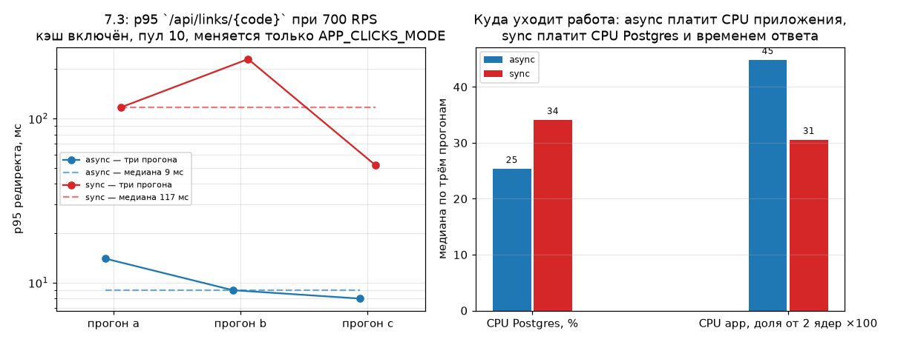
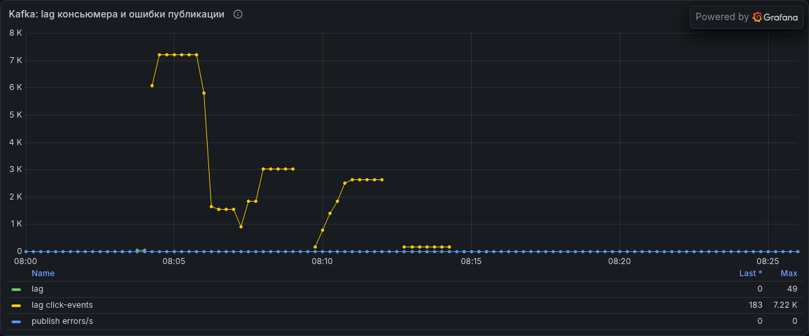
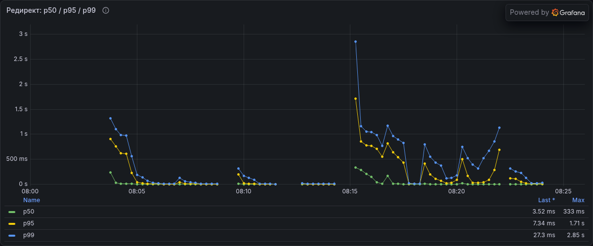
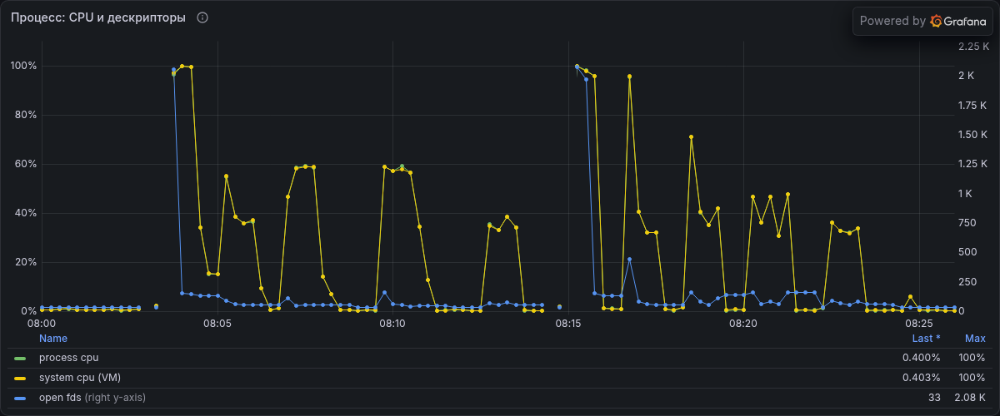

# Эксперимент 7.3: синхронная и асинхронная запись кликов

Относится к этапу 7. Серия `async*` / `sync*` прогнана полностью: прогрев и три измерительных
прогона на вариант, 2026-11-03, `async` 08:03–08:13 и `sync` 08:14–08:23 UTC. Все шесть
измерительных прогонов годны (KO = 0); ни один не браковался — в журнале серии у каждого варианта
ровно две попытки прогрева и по три метки `a`/`b`/`c`, файла карантина серии нет.

## Гипотеза

Асинхронная запись кликов (в Kafka) снижает p95 редиректа и убирает зависимость времени ответа от
записи в Postgres, потому что поток редиректа заканчивается на отправке сообщения, а не на
`INSERT`. Ценой этой экономии является задержка и возможная потеря событий: после прогона в
`click_events` окажется меньше строк, чем успешных редиректов, ровно на величину неотдрайненного лага.

Подтверждением считаем: (а) p95 варианта `sync` выше варианта `async` на одной и той же нагрузке;
(б) `hikaricp_connections_pending` и CPU Postgres выше в варианте `sync`; (в) при `async` после
ожидания `LAG = 0` число строк в `click_events`, добавленных прогоном, совпадает с числом успешных
редиректов (потерь нет) — либо расхождение задокументировано как конкретный механизм, а не как
«где-то потерялось».

Формулировка написана до прогонов (2026-11-01, до серии `mode*`).

## Условия (железо, версии, лимиты контейнера, профиль, переменные)

| | |
|---|---|
| Железо | Intel Core i5-10300H, 4 ядра / 8 потоков; 16 ГБ RAM хоста |
| Виртуализация | Docker Engine 29.9.2 (Docker Desktop), WSL2 2.7.13.0, ядро 6.18.33.2-microsoft-standard-WSL2 |
| Ресурсы Docker VM | 4 vCPU, 5.79 ГиБ |
| Лимиты контейнера `app` | `cpus: "2"`, `mem_limit: 1g`; `system_cpu_count = 2` внутри JVM |
| Сервис | Spring Boot 3.5.16, JDK в контейнере Temurin 21.0.13+9-LTS |
| Инфраструктура | Postgres 16 (`max_connections = 100`), Redis 7, Kafka `apache/kafka:3.9.1` |
| Генератор нагрузки | Gatling 3.16.0, `gatling-maven-plugin` 4.21.12, Maven 3.9.16, JDK хоста Temurin 25.0.4.1+1 — на той же машине |
| Профиль нагрузки | `RedirectSimulation`, `constant`, `RPS73` ≈ 70% от уровня, на котором сервис в 7.1 ещё не браковал (см. ниже), `DURATION_SEC=60` |
| Фид | `codes-hot.csv` — 2000 кодов, `random()` |
| Данные | засев этапа 6; `click_events` на момент серии — фиксируется в «Результатах» |
| Вход в сервис | gateway (nginx) на `http://localhost:28080` |
| Постоянные переменные вариантов | `APP_CACHE_ENABLED=true`, `SPRING_DATASOURCE_HIKARI_MAXIMUM_POOL_SIZE=10`, `RATE_LIMIT_CREATE_PER_MINUTE=1000` |
| Переменная варианта | `APP_CLICKS_MODE` ∈ {`async`, `sync`} |

Кэш включён в обоих вариантах, чтобы редирект не тратил соединение с Postgres на чтение: тогда
единственный путь сервиса к базе в момент ответа — это запись события клика, и именно её мы и
сравниваем. В варианте `async` этот путь становится асинхронным продюсером Kafka.

Фактическое значение `RPS73` — 700 (`constant(700)` × 60 с = 42 000 запросов на прогон). Основание
выбора: в 7.1 `RedirectSimulation` на 1000 RPS давал нулевой `KO` в обоих вариантах (p95 14 против
43 мс), а выше этой ступени на этой машине начинает измеряться сам генератор — серия 1500–2500 RPS
в 7.1 забракована, и пробник 7.2 на 1000 RPS с `MixedSimulation` дал 2,42% `KO`. 700 — это ровно те
70% от 1000 RPS, о которых говорилось в условиях до прогонов: уровень, на котором ни один вариант не
обязан отказывать, поэтому различие видно по времени ответа, а не по отказам. Так и вышло: во всех
шести измерительных прогонах `KO` = 0.

## Метод (шаги, число прогонов)

1. Для каждого варианта: ожидание дренажа лага Kafka (`NaN` у `kafka_consumer_fetch_manager_records_lag_max`
   означает, что консьюмер бездельничает, то есть лага нет), `scripts/reset-state.ps1` с
   переменными варианта, проверка health, прогрев 60 с с проверкой, что Gatling оставил отчёт с
   ненулевым `OK`.
2. Три измерительных прогона по 60 с. Перед первым прогоном варианта — снимок
   `SELECT count(*) FROM click_events`, после третьего — ожидание `LAG = 0` и второй снимок.
3. После каждого прогона: `docker stats --no-stream` в середине окна; из отчёта Gatling — RPS,
   p50/p95/p99, число запросов и `OK`; из Prometheus по окну — `hikaricp_connections_pending`,
   `process_cpu_usage`, доля попаданий кэша.
4. Проверка консистентности: прирост `click_events` за вариант против суммы `OK` трёх прогонов
   (прогрев в сумму не входит, его события тоже попадают в таблицу — поэтому считаем и «с
   прогревом», и «без него»).

Меняется ровно одна переменная; остальное совпадает с прогоном 7.1.

### Поправка к протоколу: порог дренажа, критерий прогрева и момент снимка «до»

Все три свойства заданы в драйвере до серии (правка 2 `exp73.sh` датирована 2026-11-02), но в этот
раздел они попали уже после прогонов — это описание того, как мерилось, а не четвёртая
предварительная регистрация. Каждое из трёх повлияло на формулировку вывода.

- **Шаг 2: дренаж ждался до `лаг < 200`, а не до `LAG = 0`.** Драйвер серии (`exp73.sh`, правка 2 от
  2026-11-02) обрывает ожидание на пороге 200 записей и дополнительно спит 15 с, потому что `NaN`
  либо отсутствие серии метрик означает «консьюмер не работает». Значение `0` у этого gauge
  наблюдается только пока консьюмер ещё читает: как только чтение прекращается, метрика уходит в
  `NaN`, поэтому буквально ждать `0` — значит ждать состояния, которого в покое не бывает
  (в таблице прогонов: у `sync-warm1` максимум по окну равен 0,0, а все мгновенные чтения после
  прогонов — `NaN`). Фактическое мгновенное чтение после
  дренажа в варианте `async` — 183 записей. Ниже показано, почему при этом прирост таблицы всё
  равно совпал с `OK` ровно.
- **Шаг 1: критерий годности прогрева — по доле KO, а не по времени ответа.** Прогрев варианта
  `sync` прошёл со второго раза при KO = 0,00%, но его p95 (904 мс) выше всех трёх замерных
  прогонов. Значит «прогрет по ошибкам» не то же самое, что «прогрет по задержке», и этот разрыв
  надо учитывать, читая хвосты варианта `sync`.
- **Шаг 4: предостережение про события прогрева не сработало.** В «Ограничениях» было заранее
  написано, что события прогрева неотличимы от событий замерных прогонов и точное совпадение
  возможно только «вместе с прогревом». На деле драйвер берёт снимок «до» *после* завершения
  прогрева, поэтому события прогрева остались в базовом числе, и прирост сравнивается с `OK` трёх
  прогонов напрямую. Строку «с прогревом» в таблице даём как справочную.

## Результаты

### Консистентность событий

| Вариант | `click_events` до | `click_events` после | Прирост | Сумма `OK` трёх прогонов | Сумма `OK` вместе с прогревом | Лаг на момент замера | Потери |
|---|---|---|---|---|---|---|---|
| async | 4 402 935 | 4 528 935 | 126 000 | 126 000 | 200 955 (прогревы добавили 74 955 = 32 955 + 42 000) | 183 записей при мгновенном чтении; пик внутри окон прогонов 1 847 / 1 836 / 168 | 0 |
| sync | 4 604 219 | 4 730 219 | 126 000 | 126 000 | 200 571 (прогревы добавили 74 571 = 32 571 + 42 000) | `NaN` — консьюмер в этом варианте не запускается | 0 |

Совпадение точное, не «примерное»: 126 000 = 3 × 42 000 = сумма `OK` трёх измерительных прогонов, и
это верно для обоих вариантов. Попрогонная сверка (`clicks.tsv`) тоже сходится: каждый из шести
прогонов добавил ровно 42 000 строк — `4 402 935 → 4 444 935 → 4 486 935 → 4 528 935` и
`4 604 219 → 4 646 219 → 4 688 219 → 4 730 219`.

Отдельно про «183 при полном приросте». Метрика
`kafka_consumer_fetch_manager_records_lag_max` считается по **закоммиченным офсетам**, а не по
строкам таблицы: консьюмер вставляет строку, затем коммитит офсет. Значит 183 «лага» — это уже
записанные в `click_events` строки с ещё не закоммиченным офсетом. Следствие для метода: метрика
лага не является мерой потерь, и проверка «строки = `OK`» её не заменяет, а дополняет.

### Время ответа

| Вариант | Прогон | RPS факт | Запросов | OK | KO | p50 | p95 | p99 | Hikari active / pending | acquire mean, с | CPU app | CPU PG | Доля попаданий | Отчёт Gatling |
|---|---|---|---|---|---|---|---|---|---|---|---|---|---|---|
| async | a | 700,0 | 42 000 | 42 000 | 0 | 3 | 14 | 52 | 2 / 0 | 0,0007 | 134,92% (0,449) | 25,40% | 1,00 | `redirectsimulation-20261103080647302` |
| async | b | 700,0 | 42 000 | 42 000 | 0 | 2 | 9 | 369 | 2 / 0 | 0,0072 | 115,62% (0,464) | 26,36% | 1,00 | `redirectsimulation-20261103080937332` |
| async | c | 700,0 | 42 000 | 42 000 | 0 | 3 | 8 | 29 | 4 / 0 | 0,0002 | 65,12% (0,285) | 24,85% | 1,00 | `redirectsimulation-20261103081226170` |
| **async медиана** | | 700,0 | 42 000 | 42 000 | 0 | 3 | **9** | 52 | 2 / 0 | 0,0007 | 115,62% (0,449) | 25,40% | 1,00 | разброс p95 8…14 (в 1,75 раза) |
| sync | a | 688,52 | 42 000 | 42 000 | 0 | 7 | 117 | 488 | 0 / 0 | 0,0142 | 71,34% (0,306) | 29,37% | 1,00 | `redirectsimulation-20261103081816156` |
| sync | b | 688,52 | 42 000 | 42 000 | 0 | 6 | 230 | 985 | 3 / 0 | 0,0352 | 61,27% (0,322) | 37,92% | 1,00 | `redirectsimulation-20261103082006897` |
| sync | c | 688,52 | 42 000 | 42 000 | 0 | 6 | 52 | 476 | 9 / 0 | 0,0152 | 67,80% (0,257) | 34,14% | 1,00 | `redirectsimulation-20261103082210648` |
| **sync медиана** | | 688,52 | 42 000 | 42 000 | 0 | 6 | **117** | 488 | 3 / 0 | 0,0152 | 67,80% (0,306) | 34,14% | 1,00 | разброс p95 52…230 (в 4,4 раза) |

Как читать колонки:

- `RPS факт` — requests/sec из отчёта Gatling, то есть `42 000 / длительность измерения`. Значения
  700,0 и 688,52 соответствуют 60 и 61 с: разница — хвост в одну секунду, а не разница в пропускной
  способности. К тому же 688,52 встречается и в варианте `async` (прогон `async-warm2`), поэтому
  этот столбец варианты не различает и вывод на нём не основан.
- `CPU app` — два числа: CPUPerc из `docker stats --no-stream` (точечный снимок в середине окна,
  проценты от одного ядра) и в скобках среднее `process_cpu_usage` за окно — доля от разрешённых
  контейнеру **двух** ядер.
- `acquire mean, с` — `rate(hikaricp_connections_acquire_seconds_sum) /
  rate(hikaricp_connections_acquire_seconds_count)`, в секундах (0,0152 = 15,2 мс). В варианте
  `async` это время тратят потоки-консьюмеры вне пути ответа; в `sync` — поток редиректа.
- `Hikari active / pending` — максимумы по 15-секундным мгновенным выборкам, поэтому короткие
  удержания соединения не видны: `sync-a` показывает 0 активных при том, что каждый запрос делает
  `INSERT`. На этот столбец опираться нельзя; надёжнее `acquire mean` и p95.

Прогревы (в сравнение не входят): `async` — 21,536% KO, затем 0,00%; `sync` — 22,45% KO, затем
0,00%. В обоих первых прогонах `hikaricp_connections_pending` = 186 и `server_inflight_max` = 200 —
это холодный старт после перезапуска контейнера, а не эффект варианта; у второго прогрева `sync`
остались pending 55 и p95 904 мс.

## Графики



Картинка построена из журнала `exp-results.jsonl` скриптом `qoder-73-chart.py` (вне репозитория,
команда — в «Как повторить»). Слева — p95 каждого прогона по вариантам
(логарифмическая шкала) с пунктирными медианами 9 и 117 мс: интервалы вариантов не пересекаются.
Справа — медианы CPU Postgres (25,40% против 34,14%) и CPU приложения (0,449 против 0,306 доли от
двух ядер): база в асинхронном варианте загружена меньше, а приложение — больше.

### Снимки Grafana (сырое окно серии)







Снимки отрендерены серверным рендерером Grafana (`grafana-image-renderer`) по копии исторической TSDB
того же стенда: окно 3 ноября 08:00–08:26 UTC, панели `shortener-load` «Kafka: lag консьюмера и ошибки
публикации», «Редирект: p50 / p95 / p99» и «Процесс: CPU и дескрипторы». В стенде, где шла серия,
рендерера не было; снимки сделаны отдельным стеком (Grafana + renderer + копия Prometheus), читающим
ту же историю скрейпов.

Что на них видно и как это читать:

- Лаг `click-events` (жёлтая линия) нарастает только в первой половине окна — варианте `async`:
  пик ~7,2 тыс. записей приходится на прогревы, внутри замерных окон лаг держится порядка тысяч и
  дренируется между прогонами; хвост ~183 записей перед переходом к `sync` — тот самый неотдрайненный
  лаг закоммиченных офсетов. После ~08:14 (вариант `sync`) консьюмер не запускается и серия лага
  обрывается. Ошибки публикации (синяя линия) нулевые во всём окне — потерь на продюсере нет.
- На панели задержек высокие пики p99 (до 2,85 с) — прогревы обоих вариантов; замерные прогоны —
  низкие горбы: у `async` (08:06–08:13) они заметно ниже, чем у `sync` (08:18–08:23), что и есть
  подтверждение (а). Легенда «Max» (p95 1,71 с, p99 2,85 с) считается по всему окну с прогревами и
  числами замерных прогонов не является.
- Панель CPU показывает CPU процесса, CPU всей VM и открытые дескрипторы: всплески до 100% CPU и
  ~2 тыс. дескрипторов — холодные старты вариантов. Различие CPU приложения между вариантами
  (0,449 против 0,306) по этой панели на глаз не читается — зелёная кривая процесса малоамплитудна;
  оно взято из медиан таблицы, а панель документирует прогревы и загрузку VM.

## Вывод (что подтвердилось, что нет, почему)

**(а) Подтверждена, и это первое измерение этапа 7, где p95 различает варианты.** Медианы p95 — 9 мс
(`async`) против 117 мс (`sync`), в 13 раз. Важнее не медиана, а непересечение интервалов: максимум
`async` (14 мс) меньше минимума `sync` (52 мс), то есть ни один прогон не дал бы повода перепутать
варианты. В 7.2 разброс внутри варианта (×7…×47) превышал разницу между вариантами, и там p95
пришлось объявить неразличающей метрикой; здесь разброс — ×1,75 у `async` и ×4,4 у `sync`, и он не
съедает эффект. По остальным перцентилям: p50 3 против 6 мс (×2), среднее 6 против 27 мс (×4,5),
p99 52 против 488 мс (×9,4). При этом хвост у `async` неустойчив: прогон `async-b` дал p99 = 369 мс
при p95 = 9 мс. Асинхронность удешевляет медиану, но не гарантирует хвост — продюсер изредка
блокирует поток на flush, и это попадает в p99.

**(б) Подтверждена наполовину.** Загруженность Postgres — да: медианы 25,40% против 34,14%,
интервалы 24,85…26,36% и 29,37…37,92% тоже не пересекаются. `hikaricp_connections_pending` — нет:
ноль во всех шести замерных прогонах обоих вариантов. Очередь за соединением на этом уровне нагрузки
не возникала вообще; она появилась только в прогревах (pending 186 при холодном старте, 55 у второго
прогрева `sync`), то есть к режиму записи кликов не относится. Значит предсказанный гипотезой
механизм «в `sync` потоки стоят в очереди к пулу из-за `INSERT`» на 700 RPS не наблюдался: `INSERT`
упирался не в пул, а в сам Postgres, и ждать он заставлял внутри времени ответа,
а не в Hikari-очереди. Косвенное свидетельство того же пути — `acquire mean`: 0,0007 с у `async` против 0,0152 с
у `sync` (×22); в `sync` эти ~15 мс лежат на пути ответа, в `async` их платят консьюмеры.

**(в) Подтверждена: потерь нет.** Прирост `click_events` за вариант равен сумме `OK` трёх прогонов
(126 000 = 3 × 42 000) в обоих вариантах, и покомпонентно каждый прогон добавил ровно 42 000 строк.
Вторая половина формулировки («расхождение задокументировано как конкретный механизм») тоже закрыта,
но с другой стороны: расхождения не было, а неотдрайненный лаг 183 при полном приросте объясняется
тем, что лаг считается по закоммиченным офсетам и вставка опережает коммит. То есть ожидание
«LAG = 0», записанное в методе, проверкой потерь не было бы и при другом пороге — проверкой
является только сверка строк с `OK`.

**Что гипотеза не предсказывала: асинхронный вариант дороже по CPU приложения.** Медиана
`process_cpu_usage` 0,449 против 0,306 (доля от двух разрешённых ядер), `docker stats` — 115,62%
против 67,80%. Отношения двух колонок не совпадают (×1,47 и ×1,71), потому что `docker stats` —
один мгновенный снимок на прогон; направление эффекта дают обе. `async` не отменяет работу, а
переносит её с потока редиректа на продюсера и консьюмера **в том же контейнере под тем же
`cpus: "2"`**, и между прогонами консьюмер дозаписывает не успевшее: пики лага внутри окон
1 847 / 1 836 / 168 записей — по времени это 2,64 / 2,62 / 0,24 с потока при 700 RPS. Итог сравнения одной
фразой: `sync` ставит пик на базу и на хвост времени ответа, `async` размазывает запись по времени,
платит за это CPU приложения и оставляет хвост незакоммиченных офсетов.

**Где вывод был бы неверен.** `sync` на 700 RPS не падает и не теряет событий (KO = 0, потери = 0,
pending = 0), поэтому формулировка «синхронная запись не выдерживает нагрузку» числами этого
эксперимента не поддерживается — поддерживается только «у синхронной записи хвосты времени ответа
в разы длиннее». Работоспособность `sync` на более высокой интенсивности — отдельный вопрос, он
уходит в 7.5.

## Ограничения

Помимо уже подтверждавшихся в 7.1 и 7.2 (генератор на той же машине; `docker stats` — точечный
снимок; `scrape_interval = 5 с` и шаг запроса сборщика 15 с; Postgres и приложение делят 4 ядра VM;
`click_events` растёт от варианта к варианту):

- **дренаж ждался до `лаг < 200`, а не до `LAG = 0`** (см. «Поправку к протоколу»). На результат (в)
  это не влияет — прирост совпал с `OK` ровно, — но формально условие, записанное в методе до
  прогонов, выполнено не было;
- **варианты сравниваются на таблицах разного размера**: `async` начинал с 4 402 935 строк, `sync` —
  с 4 604 219 (+4,6%). Смещение работает против `sync`, и всё равно именно `sync` показал худшие
  хвосты. Пересоздание базы на каждый вариант сломало бы сопоставимость с 7.1 и 7.2, поэтому оставлено
  как есть;
- **метрика лага — по закоммиченным офсетам**, поэтому она отстаёт от таблицы, а не опережает её:
  «лаг > 0» не означает «строк не хватает»;
- **`hikari_active` и `pending` — максимумы по мгновенным 15-секундным выборкам**: короткие удержания
  соединения не видны (`sync-a` показал 0 активных при `INSERT` на каждый запрос), поэтому по этим
  колонкам нельзя ни подтверждать, ни опровергать механизм; для механизма использованы `acquire
  mean` и p95;
- **критерий годности прогрева — по доле KO**, и он не гарантирует стационарности по задержке:
  второй прогрев `sync` дал p95 904 мс, а замерные прогоны того же варианта — 52…230 мс;
- **кэш даёт 100% попаданий в обоих вариантах** (доля попаданий 1,00 во всех шести прогонах), то есть
  чтение полностью исключено из сравнения. Это делает эксперимент чистым по записи, но не
  воспроизводит реальный микс с промахами кэша;
- **продюсер и консьюмер живут в контейнере `app`**, поэтому перенос нагрузки никуда не уходит за
  пределы сервиса: и `docker stats`, и `process_cpu_usage` считают её внутри тех же двух ядер;
- `p95`/`p99` — перцентили отчёта Gatling по всем 42 000 запросов прогона, профиль `constant`
  (разомкнутая схема), окно 60 с. На уровне 700 RPS оба варианта успевают за окно, поэтому очередь
  неотвеченных запросов генератора в этом эксперименте не измерялась.

## Как повторить

Драйвер серии — временный `exp73.sh` вне репозитория (`C:/Users/nikita/AppData/Local/Temp`);
из-за общего стенда серия идёт только под блокировкой:

```bash
# мониторинг поднят (docker compose --profile monitoring up -d), база засеяна этапом 6
RPS73=700 bash with-lock.sh exp73.sh
```

Драйвер для каждого варианта делает: `scripts/reset-state.ps1` с `APP_CLICKS_MODE` варианта →
проверка health → прогрев до `KO < 1%` (до трёх попыток) → снимок `click_events` → три прогона
`Redirect constant 700` по 60 с с дренажом лага между прогонами → финальный дренаж и второй снимок.
Постоянное для обоих прогонов: `APP_CACHE_ENABLED=true`,
`SPRING_DATASOURCE_HIKARI_MAXIMUM_POOL_SIZE=10`, `RATE_LIMIT_CREATE_PER_MINUTE=1000`,
`CODES_FILE=codes-hot.csv`, `DURATION_SEC=60`, `BASE_URL=http://localhost:28080`.

Проверенное состояние входа в вариант `async` (для `sync` отличается только `APP_CLICKS_MODE`):

```
APP_CACHE_ENABLED                        = true
SPRING_DATASOURCE_HIKARI_MAXIMUM_POOL_SIZE = 10
APP_CLICKS_MODE                          = async
RATE_LIMIT_CREATE_PER_MINUTE             = 1000
Сервис UP: {"status":"UP"}
```

Метки отчётов Gatling — в таблице «Время ответа» (колонка «Отчёт Gatling»); лежат в
`shortener-loadtests/target/gatling/<метка>/`. Прогревы: `redirectsimulation-20261103080311807` и
`...080459737` (async), `redirectsimulation-20261103081441808` и `...081627171` (sync).

График пересобирается из журнала прогонов: `python qoder-73-chart.py` (пишет
`docs/experiments/assets/73-clicks-mode.png` и печатает медианы и разбросы, по которым сверялись
строки). Сверка всех числовых ячеек таблицы с журналом: `python qoder-73-verify.py` →
`строк проверено: 10 | расхождений: 0`.
