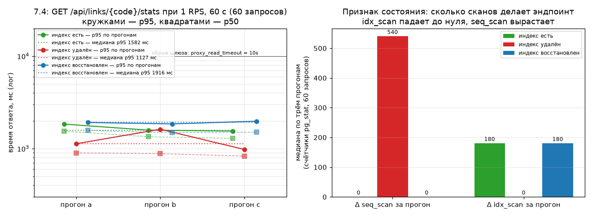

# Эксперимент 7.4: намеренный дефект — потерянный индекс

Относится к этапу 7. Заполняется по результатам прогонов; если вариант не прогонялся, так и
пишется, и чекбокс DoD остаётся неотмеченным.

Это флагманский эксперимент этапа: проверяется не сервис, а методика — умеет ли диагностика по
метрикам и плану запроса найти дефект, о котором знаешь только то, что он где-то есть.

## Гипотеза

Удаление индекса `ix_click_events_link_ts` (`click_events (link_id, clicked_at)`) превращает
агрегирующий запрос `GET /api/links/{code}/stats` в последовательное сканирование всей таблицы, и
это видно по метрикам до того, как мы заглянем в миграцию: p95 растёт только у эндпоинта
`/api/links/{code}/stats` (в симуляции он один), CPU Postgres растёт, а CPU контейнера `app` и
метрики пула Hikari почти не меняются, потому что поток приложения ждёт один запрос и держит одно
соединение.

Подтверждением считаем четыре факта:

- (а) медиана p95 состояния «с дефектом» выше медианы baseline не менее чем в 5 раз на одном и том
  же профиле и уровне нагрузки;
- (б) `EXPLAIN (ANALYZE, BUFFERS)` в состоянии «с дефектом» содержит `Seq Scan on click_events`, а
  в baseline — `Index Scan` или `Bitmap Heap Scan` по `ix_click_events_link_ts`, и число прочитанных
  блоков (`Blocks`) отличается примерно во столько же раз, во сколько разница p95;
- (в) диагноз назван по метрикам и плану запроса, до того как открыт файл миграции: название таблицы
  и признак «нет поддержки по `(link_id, clicked_at)`» записаны в отчёт до чтения `V90__*.sql`.
  Вспомогательное свидетельство, независимое от лога запросов — прирост счётчика
  `pg_stat_user_tables.seq_scan` для `click_events` за прогон;
- (г) после восстановления индекса (`V91__*.sql`) p95 возвращается к значениям baseline в пределах
  разброса трёх прогонов этого состояния — то есть деградация была именно следствием дефекта, а не
  дренажа кэша, роста таблицы или шума машины.

Отрицанием гипотезы считаем: p95 вырос меньше чем в 2 раза — тогда либо объём данных не позволяет
различить способы доступа (агрегат целиком лежит в `shared_buffers`, и разницы почти нет), либо
запрос обслуживает что-то помимо индекса; в этом случае эксперимент повторяют с бо́льшим засевом, и
в отчёте это зафиксировано отдельно.

Формулировка написана до прогонов (2026-11-02, до серии `idx*`).

## Условия (железо, версии, лимиты контейнера, профиль, переменные)

| | |
|---|---|
| Железо | Intel Core i5-10300H, 4 ядра / 8 потоков; 16 ГБ RAM хоста |
| Виртуализация | Docker Engine 29.9.2 (Docker Desktop), WSL2 2.7.13.0, ядро 6.18.33.2-microsoft-standard-WSL2 |
| Ресурсы Docker VM | 4 vCPU, 5.79 ГиБ |
| Лимиты контейнера `app` | `cpus: "2"`, `mem_limit: 1g`; `system_cpu_count = 2` внутри JVM |
| Сервис | Spring Boot 3.5.16, JDK в контейнере Temurin 21.0.13+9-LTS |
| Инфраструктура | Postgres 16 (`max_connections = 100`), Redis 7, Kafka `apache/kafka:3.9.1` |
| Генератор нагрузки | Gatling 3.16.0, `gatling-maven-plugin` 4.21.12, Maven 3.9.16, JDK хоста Temurin 25.0.4.1+1 — на той же машине |
| Профиль нагрузки | `StatsSimulation`, `constant`, `RPS74` (см. «Выбор уровня» ниже), `DURATION_SEC=60` |
| Данные | `scripts/prepare-stats.ps1`: 20 ссылок и 5 000 000 событий клика (по 250 000 на ссылку), маркер посева `user_agent = 'gatling-stats-seed'`; фид `shortener-loadtests/src/test/resources/stats.csv` (`token,code`), который тот же скрипт и пишет |
| Вход в сервис | gateway (nginx) на `http://localhost:28080` |
| Переключатели варианта | фиксируются по выводу `scripts/reset-state.ps1` перед первым прогоном; ожидаемые: `APP_CACHE_ENABLED=true`, `APP_CLICKS_MODE=async`, пул 10, `RATE_LIMIT_CREATE_PER_MINUTE=1000` |
| Меняемое состояние | наличие индекса `ix_click_events_link_ts`: baseline → `V90__drop_click_events_index.sql` → `V91__restore_click_events_index.sql` |

Кэш ссылки в этом эксперименте не мешает: `LinkCache` кэширует поиск ссылки по коду, а `stats()` в
`LinkService` агрегацию не кэширует, так что каждый запрос идёт в Postgres. Уровень засева важен:
агрегат с индексом читает 250 000 строк по одному ключу, без индекса — все 5 000 000, и соотношение
работы должно быть видно в задержке.

### Выбор уровня нагрузки

Правило зафиксировано до прогонов: уровень выбирается таким, чтобы состояние baseline имело
(а) долю KO < 1% и (б) p95 не ниже 20 мс — иначе измеряемая стоимость агрегации тонет в шуме
петли «генератор → шлюз → сервис», и восьмикратный росттрудно отличить от флуктуации. Если после
трёх прогонов baseline (б) не выполняется, уровень удваивается (20 → 40 → 80) и пробуются те же
два критерия; менять уровень после того, как получено число «с дефектом», запрещено.

Стартовое предположение — 20 RPS: при 250 000 строк на ссылку даже индексный доступ стоит десятки
миллисекунд, а 20 RPS — это ~20 одновременных агрегатов, что не насыщает Postgres на 4 vCPU и
оставляет запас на ухудшение в состоянии «с дефектом». Фактический уровень фиксируется в таблице
результатов по итогам baseline-прогонов.

### Поправка к протоколу: уровень выбирается вниз, а не вверх (2026-11-03, до получения числа «с дефектом»)

Правило выше оставляет только ветку «уровень мал — удваивать» и молча предполагает, что baseline на
20 RPS проходной. Замеры baseline показали обратное: один запрос `/api/links/{code}/stats` стоит
сотни миллисекунд чистым агрегатом и секунды под нагрузкой, и 20 RPS — это десятки одновременных
агрегатов при пуле Hikari 10.

Разведка уровня (состояние baseline, индекс на месте, `StatsSimulation`, `constant`, 60 с,
прогоны 16:18–16:27 UTC 2026-11-03):

| Уровень | Запросов | KO | p50 | p95 | `hikaricp_connections_pending` (макс) | CPU postgres (`docker stats`) |
|---|---|---|---|---|---|---|
| 20 RPS | 1200 | 98,58% | 10 002 | 10 005 | 159 | 365,61% |
| 10 RPS | 600 | 96,00% | 10 002 | 10 007 | 166 | 361,66% |
| 5 RPS | 300 | 91,00% | 10 003 | 10 008 | 150 | 350,51% |
| **2 RPS** | 120 | **0,00%** | 5 001 | 5 859 | 2 | 365,43% |

`p50 = 10 002 мс` — это не стоимость запроса, а обрыв соединения шлюзом: `proxy_read_timeout = 10s`
(`infra/nginx/nginx.conf:62`). Во всех трёх верхних уровнях пул Hikari занят целиком
(`hikari_active_max = 10`), в очереди ждут 150–166 потоков, а CPU контейнера `app` при этом 3–5%
(5,44 / 3,48 / 3,30%): сервис стоит и ждёт Postgres. Среднее время получения соединения растёт от 2,7 с
на 20 RPS до 6,98 с на 10 RPS и 20,13 с на 5 RPS, а на 5 RPS к этому добавляются ~55 таймаутов ожидания
соединения за прогон (`hikaricp_connections_timeout_total`, `connection-timeout = 30s`) — там 91% KO это
уже не только 504 от шлюза, но и 500 от сервиса. На 2 RPS очередь почти пуста: `pending` 2, средняя
выдача соединения 0,168 с, таймаутов нет, — хотя `hikari_active_max` там тоже 10: пул заполняется
целиком, но мгновенно, без накопления очереди.

Фактический уровень — **2 RPS** (`RPS74 = 2`, `DURATION_SEC = 60`, 120 запросов на прогон): наибольший
из перебранных, на котором baseline выполняет оба исходных критерия (KO < 1% и p95 ≥ 20 мс). Разведка
сделана только на baseline; запрет менять уровень после получения числа «с дефектом» остаётся в силе.

### Поправка 2 к протоколу: уровень ещё ниже — 1 RPS (2026-11-03, тоже до получения числа «с дефектом»)

Вывод абзаца выше («2 RPS») оказался неверным, и ошибка видна только по измерительным прогонам, не по
разведке. Разведка перебирала уровни подряд без перерыва, и каждый следующий уровень замерялся на
очереди, оставшейся от предыдущего; между прогревом и замерными прогонами очередь успевает разойтись,
поэтому критерий «KO < 1% на уровне» по разведке слишком оптимистичен.

Три измерительных прогона baseline на 2 RPS (16:38–16:42 UTC 2026-11-03, индекс на месте, `p99` — мс):

| Прогон | KO | p50 | p95 | p99 | Hikari active (макс) | pending (макс) | выдача соединения, средняя | Δ `seq_scan` | Δ `idx_scan` | CPU app | CPU postgres |
|---|---|---|---|---|---|---|---|---|---|---|---|
| a | 6,67% | 7 060 | 10 003 | 10 009 | 10 | 6 | 1,68 с | 249 | 270 | 6,68% | 370,11% |
| b | 0,00% | 6 658 | 8 321 | 8 881 | 10 | 5 | 1,27 с | 0 | 360 | 4,83% | 363,44% |
| c | 0,00% | 5 639 | 8 018 | 8 288 | 10 | 6 | 0,74 с | 0 | 360 | 2,54% | 360,33% |

Три причины, по которым этот уровень не годится:

1. прогон `a` даёт KO 6,67% — критерий выбора уровня «в baseline доля KO < 1%» не выполнен уже на
   замерных прогонах, а не только на прогревах;
2. медиана p95 = 8 321 мс стоит вплотную к капу шлюза (10 000 мс), и критерий гипотезы (а) «p95
   дефекта ≥ 5× baseline» требовал бы 41 606 мс — числа, которое через этот шлюз получить нельзя ни
   при каком дефекте. Критерий (а) стал бы непроверяемым, а не «не подтверждённым»;
3. при пуле 10/10, очереди 5–6 потоков и ожидании соединения порядка секунды прогон измеряет очередь
   пула, а не стоимость агрегата: `Δseq_scan` прыгает от 249 до 0 при одинаковых `Δidx_scan` 270–360.

Разведка ниже (1 RPS, состояние baseline, прогревочные прогоны `probe1-1` и `probe1-2`, 16:46–16:48
UTC 2026-11-03, по 60 запросов на прогон):

| Уровень | Запросов | KO | p50 | p95 | p99 | active (макс) | pending (макс) | выдача соединения | Δ `seq_scan` | Δ `idx_scan` | CPU postgres |
|---|---|---|---|---|---|---|---|---|---|---|---|
| 1 RPS (1) | 60 | 0,00% | 1 457 | 1 632 | 1 671 | 2 | 0 | 0,34 мс | 0 | 180 | 132,81% |
| 1 RPS (2) | 60 | 0,00% | 1 439 | 1 651 | 1 685 | 2 | 0 | 0,40 мс | 0 | 180 | 134,68% |

Здесь очередь пуста, пул занят на два соединения из десяти, Postgres использует треть своих 4 vCPU, а
`Δidx_scan = 180` на 60 запросов — ровно три индексных обращения на запрос, то есть все три агрегата
эндпоинта обслуживаются индексом и ни один не сканирует таблицу. p95 1 651 мс × 5 = 8 255 мс — всё ещё
под капом шлюза, так что критерий (а) на этом уровне проверяем.

Фактический уровень — **1 RPS** (`RPS74 = 1`, `DURATION_SEC = 60`, 60 запросов на прогон). Метка
состояний в журнале — `baseline1` / `missing1` / `fixed1`; прогоны на 2 RPS (`baseline-*`) остаются в
журнале как основание этой правки и в отчёт замерными не входят. Цена понижения — 60 запросов вместо
120, поэтому 99-й процентиль на этом профиле груб (один запрос сдвигает его на 1,7 п.п.), и в выводах сопоставляются
медианы трёх прогонов, а не единичный p99. Запрет менять уровень после получения числа «с дефектом»
действует и дальше: разведка сделана только на baseline.

Два следствия для критериев гипотезы, тоже зафиксированные до состояния «с дефектом».

Первое: критерий (б) в исходной формулировке («в baseline — `Index Scan` или `Bitmap Heap Scan`,
в дефекте — `Seq Scan`») выполняется не для всех трёх агрегатов эндпоинта. `EXPLAIN (ANALYZE, BUFFERS)`
на засеянной ссылке (16:16 UTC 2026-11-03, `code = 1RGa`, `id = 343144`, 250 000 строк на ссылку,
индекс на месте):

- `countByLinkId` → `Parallel Index Only Scan using ix_click_events_link_ts`, 50,4 мс,
  `Buffers: shared hit=163342 read=1172`;
- `clicksByDay` → `Index Only Scan using ix_click_events_link_ts` плюс `Sort Method: external merge
  Disk: 2944kB`, 121,2 мс, `Buffers: shared hit=164541`;
- `topReferrers` → `Parallel Seq Scan on click_events`, 292,8 мс,
  `Buffers: shared hit=14828 read=135007`, `Rows Removed by Filter: 3160865` на процесс.

Третий агрегат сканирует таблицу целиком и при индексе: `ix_click_events_link_ts (link_id, clicked_at)`
не накрывает `referrer`, и планировщику дешевле прочитать всё. При этом сам план неустойчив: на
разведочном прогоне 2 RPS (16:26 UTC, кэш прогрет) за прогон получилось `Δseq_scan = 6` при
`Δidx_scan = 358` на 120 запросов — а это ровно три агрегата на запрос, почти все по индексу. Значит
признак «есть/нет `Seq Scan`» в одной строке не годится, и различие состояний читается по:

- `Δidx_scan` за прогон: в baseline порядка трёх на запрос, с дефектом должен упасть почти до нуля при
  том же числе запросов;
- `Δseq_scan` за прогон и `Rows Removed by Filter` в планах;
- стоимости одного запроса, измеренной в обход шлюза, и доле запросов, уложившихся в его лимит.

Второе: `proxy_read_timeout = 10s` цензурирует хвост распределения в состоянии «с дефектом» — p95 прогона
упрётся в 10 000 мс и перестанет отражать реальную стоимость агрегата. Шлюз ради эксперимента
не переконфигурируется (иначе вместе с дефектом поменялась бы ещё и измерительная петля), поэтому рядом
с каждой серией фиксируется замер в обход него: три последовательных `GET /api/links/{code}/stats` через
`curl` из контейнера `gateway` на `http://app:8080/…` — тот же путь внутрь сервиса, но без ограничения по
времени ответа. Сравнение состояний по не обрезанной лимитом стоимости одного запроса идёт в отчёте
отдельной строкой.

## Метод (шаги, число прогонов)

1. `scripts/prepare-stats.ps1` (посев 5 000 000 строк) — занимает заметное время; после посева —
   `ANALYZE click_events`, чтобы план запроса не зависел от устаревшей статистики. Число строк до
   и после посева фиксируется (`SELECT count(*) FROM click_events`).
2. Состояние **baseline**: `scripts/reset-state.ps1`, проверка health, прогрев до стационарного
   состояния (доля KO в прогреве < 1%, до 5 попыток — правило принято по правке 2 к протоколу 7.2),
   ожидание покоя, затем **три** измерительных прогона по 60 с с ожиданием покоя между ними.
   Перед прогоном и после него — снимок `seq_scan` из `pg_stat_user_tables`.
   `EXPLAIN (ANALYZE, BUFFERS)` интересующего запроса — один раз, на `id` засеянной ссылки.
3. Состояние **с дефектом**: ветка `exp/missing-index` с миграцией `V90__drop_click_events_index.sql`
   (`DROP INDEX ix_click_events_link_ts;`), пересборка образа, тот же порядок прогонов. Файл
   миграции до момента диагноза не открывается: состояние описывается по метрикам и `EXPLAIN`.
4. Состояние **после исправления**: `V91__restore_click_events_index.sql`
   (`CREATE INDEX ix_click_events_link_ts ON click_events (link_id, clicked_at);`) плюс `REINDEX`
   не требуется, индекс создаётся заново; снова прогрев и три прогона.
5. Для каждого прогона: RPS, p50/p95/p99 и доля KO из отчёта Gatling, `docker stats --no-stream`
   для контейнеров `app` и `postgres`, из Prometheus — `hikaricp_connections_active` /
   `process_cpu_usage`, и отдельно `pg_stat_statements` если расширение доступно в образе.

Меняется ровно одно состояние БД (наличие индекса); переменные сервиса, профиль и данные совпадают.
Ветка `exp/missing-index` не вливается в `main`: в `main` попадают только отчёт и `StatsSimulation`.

## Результаты

Три состояния по три замерных прогона, уровень 1 RPS (см. «Поправку 2»), `DURATION_SEC = 60`,
60 запросов на прогон. Числа сверены с журналом прогонов (`qoder-74-verify.py`, вывод — в «Как
повторить»); сырые замеры лежат рядом с отчётом в `assets/`.

### Baseline (индекс есть)

Уровень 1 RPS (см. «Поправку 2»), `DURATION_SEC = 60`, 60 запросов на прогон. Состояние входа по
выводу `scripts/reset-state.ps1` (16:51 UTC 2026-11-03): `APP_CACHE_ENABLED=true`,
`APP_CLICKS_MODE=async`, `APP_CLICKS_CONSUMER_ENABLED=true`, пул 10, `RATE_LIMIT_CREATE_PER_MINUTE=1000`,
`JAVA_TOOL_OPTIONS` пуст. Прогрев — одна попытка (`baseline1-warm1`, 16:52:59 UTC, KO 0,00%);
забракованных прогонов нет, файла карантина серии нет.

| Прогон | RPS факт | Запросов | KO | p50 | p95 | p99 | Hikari active | CPU app | CPU postgres | Δ `seq_scan` | Δ `idx_scan` |
|---|---|---|---|---|---|---|---|---|---|---|---|
| a | 0,98 | 60 | 0,00% | 1 543 | 1 840 | 1 970 | 2 | 2,53% | 143,72% | 0 | 180 |
| b | 0,98 | 60 | 0,00% | 1 342 | 1 582 | 1 715 | 2 | 2,67% | 125,94% | 0 | 180 |
| c | 0,98 | 60 | 0,00% | 1 290 | 1 546 | 1 731 | 2 | 3,19% | 116,58% | 0 | 180 |
| **медиана** | 0,98 | 60 | 0,00% | 1 342 | 1 582 | 1 731 | 2 | 2,67% | 125,94% | 0 | 180 |

Разброс трёх прогонов: p50 1 290–1 543, p95 1 546–1 840, p99 1 715–1 970 мс. `Hikari active` — максимум
за прогон; `hikari_pending` во всех трёх = 0, средняя выдача соединения 0,21–0,40 мс,
`hikaricp_connections_timeout_total` = 0. Медиана p95 = 1 582 мс — от неё считается критерий (а):
5× = 7 910 мс, что под капом шлюза 10 000 мс, то есть усиление дефекта различимо и не упирается в обрыв.

`Δidx_scan = 180` на 60 запросов — ровно три индексных обращения на запрос, `Δseq_scan = 0`: в этом
состоянии все три агрегата эндпоинта обслуживаются индексом.

Замер одного запроса в обход шлюза (`curl` из контейнера `gateway` на `http://app:8080`, 16:59:57 UTC):
1,200 / 1,391 / 1,202 с, медиана 1,202 с — стоимость агрегата без `proxy_read_timeout`; совпадает с p50
прогона (1,342 с) с точностью до очереди, то есть на 1 RPS очередь к запросу почти ничего не добавляет.

Метки отчётов Gatling: a `statssimulation-20261103165452359`, b `statssimulation-20261103165635239`,
c `statssimulation-20261103165818719`; прогрев `statssimulation-20261103165305882`.

### С дефектом (индекс удалён)

Ветка `exp/missing-index`, коммит `f05e944` с миграцией `V90__drop_click_events_index.sql`, образ
пересобран, `scripts/reset-state.ps1`. Состояние входа то же, что в baseline (`APP_CACHE_ENABLED=true`,
`APP_CLICKS_MODE=async`, пул 10); `pg_indexes` после старта сервиса: `ix_click_events_link_ts`
отсутствует (`index_present = false` во всех строках журнала). Прогрев — одна попытка
(`missing1-warm1`, 17:06:03 UTC, KO 0,00%); забракованных прогонов нет.

| Прогон | RPS факт | Запросов | KO | p50 | p95 | p99 | Hikari active | CPU app | CPU postgres | Δ `seq_scan` | Δ `idx_scan` |
|---|---|---|---|---|---|---|---|---|---|---|---|
| a | 1,00 | 60 | 0,00% | 898 | 1 127 | 1 286 | 1 | 2,30% | 219,31% | 537 | 0 |
| b | 1,00 | 60 | 0,00% | 881 | 1 619 | 1 677 | 2 | 1,88% | 224,76% | 540 | 0 |
| c | 1,00 | 60 | 0,00% | 829 | 976 | 1 112 | 1 | 1,88% | 223,86% | 540 | 0 |
| **медиана** | 1,00 | 60 | 0,00% | 881 | 1 127 | 1 286 | 1 | 1,88% | 223,86% | 540 | 0 |

Разброс трёх прогонов: p50 829–898, p95 976–1 619, p99 1 112–1 677 мс. Ожидание соединения 0,26–0,55 мс,
pending 0, таймаутов выдачи нет. Замер одного запроса в обход шлюза (17:13:01 UTC): 0,820 / 0,885 /
0,882 с, медиана 0,882 с.

Метки отчётов Gatling: a `statssimulation-20261103170754240`, b `statssimulation-20261103170940214`,
c `statssimulation-20261103171124760`; прогрев `statssimulation-20261103170609617`.

### Диагноз состояния «с дефектом» — записан до вскрытия файла миграции

Пять фактов, все из метрик и плана запроса (17:07–17:13 UTC 2026-11-03).

1. По индексу не идёт ничего: `Δidx_scan` за прогон = 0 при 60 запросах, тогда как в baseline он ровно
   180 — три обращения на запрос, и оба индексируемых агрегата в плане baseline названы
   `Index Only Scan using ix_click_events_link_ts`.
2. Доступ к таблице стал полным сканом: `Δseq_scan` = 537–540 на 60 запросов, то есть девять сканов на
   запрос, и в `EXPLAIN (ANALYZE, BUFFERS)` все три агрегата эндпоинта начинаются с
   `Parallel Seq Scan on click_events`.
3. Скан отбирает одну ссылку из всей таблицы: `Rows Removed by Filter: 3 160 865` на процесс при
   83 333 возвращённых строк на процесс (250 000 на три). Значит отсутствующая поддержка — предикат
   по `link_id`, и дополнительно упорядоченность по `clicked_at`, нужная агрегату по дням.
4. Таблица одна: эндпоинт читает только `click_events`, и именно она стоит в планах обоих состояний.
5. Работа добавляется внутри Postgres, а не в сервисе: CPU контейнера `app` 1,88–2,30% (в baseline
   2,53–3,19%), пул занят 1–2 соединениями из 10, pending 0, таймаутов выдачи нет — а CPU Postgres при
   тех же 0,98–1,00 RPS и тех же 60 запросах вырос до 219,31–224,76% с 116,58–143,72%.

Диагноз: у таблицы `click_events` отсутствует доступ по `(link_id, clicked_at)` — то есть потерян
единственный индекс, который базовый план называет для этой пары колонок, `ix_click_events_link_ts`.
По гипотезе следствием должно быть кратное увеличение задержки `GET /api/links/{code}/stats`.

Следствие по задержке не подтвердилось уже в этих же прогонах, и это надо зафиксировать до вскрытия
миграции, чтобы потом не объяснять его удачей: p50 состояния «с дефектом» 829–898 мс против 1 290–1 543
в baseline, p95 976–1 619 против 1 546–1 840, стоимость одного запроса в обход шлюза 0,882 с против
1,202 с. Дефект обнаруживается по `pg_stat` и по CPU-стоимости, но не по времени ответа.

### Вскрытие миграции — проверка диагноза

Текст `V90__drop_click_events_index.sql` открыт сразу после коммита диагноза `7df09ab` (17:19:22Z
по `git log --format=%cI`), то есть метрики и план были записаны вслепую. Внутри одна команда:
`DROP INDEX ix_click_events_link_ts;`.

Диагноз подтверждён по всем пяти пунктам: таблица — `click_events`, объект — индекс
`ix_click_events_link_ts`, колонки — `(link_id, clicked_at)`, место работы — Postgres (план
состояния «с дефектом» действительно читает её полным сканом). Ошибок в слепой части нет.
Не подтвердилось только следствие, вынесенное в гипотезу заранее: время ответа не выросло, а упало.

### После исправления (индекс восстановлен)

Тот же коммит ветки `exp/missing-index` (`aef2999`) с миграцией `V91__restore_click_events_index.sql`
(`CREATE INDEX ix_click_events_link_ts ON click_events (link_id, clicked_at);`), образ пересобран,
`scripts/reset-state.ps1` (переключатели входа — по её же выводу). Переключатели совпадают с baseline:
`APP_CACHE_ENABLED=true`, `APP_CLICKS_MODE=async`, `APP_CLICKS_CONSUMER_ENABLED=true`, пул 10,
`RATE_LIMIT_CREATE_PER_MINUTE=1000`, `JAVA_TOOL_OPTIONS` пуст. Снимок перед первым прогоном:
`seq_scan = 3337`, `idx_scan = 0`, `index_present = true` — счётчик индексных сканов обнулился вместе
с пересозданием индекса. Прогрев — одна попытка (`fixed1-warm1`, 17:21:35 UTC, KO 0,00%);
забракованных прогонов нет, файла карантина серии нет.

| Прогон | RPS факт | Запросов | KO | p50 | p95 | p99 | Hikari active | CPU app | CPU postgres | Δ `seq_scan` | Δ `idx_scan` |
|---|---|---|---|---|---|---|---|---|---|---|---|
| a | 0,98 | 60 | 0,00% | 1 568 | 1 916 | 2 234 | 2 | 2,77% | 150,24% | 0 | 180 |
| b | 0,98 | 60 | 0,00% | 1 485 | 1 849 | 1 914 | 2 | 1,92% | 140,81% | 0 | 180 |
| c | 0,98 | 60 | 0,00% | 1 503 | 1 977 | 2 690 | 2 | 1,77% | 139,00% | 0 | 180 |
| **медиана** | 0,98 | 60 | 0,00% | 1 503 | 1 916 | 2 234 | 2 | 1,92% | 140,81% | 0 | 180 |

Разброс трёх прогонов: p50 1 485–1 568, p95 1 849–1 977, p99 1 914–2 690 мс. Ожидание соединения
0,21–0,35 мс, pending 0, таймаутов выдачи нет, максимум 3 запроса в полёте. Замер одного запроса в
обход шлюза (17:28:34 UTC): 1,762 / 1,550 / 1,417 с, медиана 1,550 с.

Признак доступа вернулся ровно baseline-овский: `Δidx_scan = 180` на 60 запросов (три индексных
обращения на запрос) и `Δseq_scan = 0` во всех трёх прогонах; CPU Postgres 139,00–150,24% против
116,58–143,72% в baseline и 219,31–224,76% с дефектом.

Метки отчётов Gatling: a `statssimulation-20261103172327635`, b `statssimulation-20261103172512404`,
c `statssimulation-20261103172657254`; прогрев `statssimulation-20261103172143846`.

### План запроса

По одному замеру `EXPLAIN (ANALYZE, BUFFERS)` на состояние, ссылка `1RGa`, полный текст без
сокращений. Сырые копии — `docs/experiments/assets/explain-*.txt`; таблица ниже собрана скриптом
из этих же файлов, числа не перепечатывались.

#### baseline1 — индекс есть (2026-11-03T17:00:02Z)

```text
# EXPLAIN (ANALYZE, BUFFERS) — состояние baseline1
# время 2026-11-03T17:00:02Z
# код ссылки 1RGa, id 343144
# индекс ix_click_events_link_ts присутствует: True
# точное число строк click_events: 9732594
# n_live_tup (оценка, после перезапуска БД не обновлё autovacuum'ом): 2375
# seq_scan / idx_scan до: 1130 / 5121 (само это измерение добавляет скан — он в счётчике «после»)

## countByLinkId
                                                                                    QUERY PLAN                                                                                     
-----------------------------------------------------------------------------------------------------------------------------------------------------------------------------------
 Finalize Aggregate  (cost=9617.27..9617.28 rows=1 width=8) (actual time=24.590..26.138 rows=1 loops=1)
   Buffers: shared hit=163363 read=1172
   ->  Gather  (cost=9617.05..9617.26 rows=2 width=8) (actual time=24.497..26.132 rows=3 loops=1)
         Workers Planned: 2
         Workers Launched: 2
         Buffers: shared hit=163363 read=1172
         ->  Partial Aggregate  (cost=8617.05..8617.06 rows=1 width=8) (actual time=22.668..22.669 rows=1 loops=3)
               Buffers: shared hit=163363 read=1172
               ->  Parallel Index Only Scan using ix_click_events_link_ts on click_events  (cost=0.43..8350.83 rows=106488 width=0) (actual time=0.065..19.348 rows=83333 loops=3)
                     Index Cond: (link_id = 343144)
                     Heap Fetches: 24
                     Buffers: shared hit=163363 read=1172
 Planning:
   Buffers: shared hit=87
 Planning Time: 0.218 ms
 Execution Time: 26.231 ms
(16 rows)

## clicksByDay
                                                                              QUERY PLAN                                                                              
----------------------------------------------------------------------------------------------------------------------------------------------------------------------
 GroupAggregate  (cost=38209.52..44598.80 rows=255571 width=12) (actual time=92.355..119.340 rows=91 loops=1)
   Group Key: ((date_trunc('day'::text, (clicked_at AT TIME ZONE 'UTC'::text)))::date)
   Buffers: shared hit=164541, temp read=368 written=369
   ->  Sort  (cost=38209.52..38848.45 rows=255571 width=4) (actual time=92.166..105.843 rows=250000 loops=1)
         Sort Key: ((date_trunc('day'::text, (clicked_at AT TIME ZONE 'UTC'::text)))::date)
         Sort Method: external merge  Disk: 2944kB
         Buffers: shared hit=164541, temp read=368 written=369
         ->  Index Only Scan using ix_click_events_link_ts on click_events  (cost=0.43..11758.45 rows=255571 width=4) (actual time=0.042..74.706 rows=250000 loops=1)
               Index Cond: (link_id = 343144)
               Heap Fetches: 24
               Buffers: shared hit=164538
 Planning:
   Buffers: shared hit=115 read=3
 Planning Time: 0.303 ms
 Execution Time: 119.711 ms
(15 rows)

## topReferrers
                                                                              QUERY PLAN                                                                              
----------------------------------------------------------------------------------------------------------------------------------------------------------------------
 Limit  (cost=202030.87..202030.90 rows=10 width=40) (actual time=244.963..249.405 rows=1 loops=1)
   Buffers: shared hit=14871 read=134964
   ->  Sort  (cost=202030.87..202030.92 rows=20 width=40) (actual time=240.135..244.577 rows=1 loops=1)
         Sort Key: (count(*)) DESC
         Sort Method: quicksort  Memory: 25kB
         Buffers: shared hit=14871 read=134964
         ->  Finalize GroupAggregate  (cost=202025.37..202030.44 rows=20 width=40) (actual time=240.106..244.548 rows=1 loops=1)
               Group Key: (COALESCE(referrer, ''::text))
               Buffers: shared hit=14868 read=134964
               ->  Gather Merge  (cost=202025.37..202030.04 rows=40 width=40) (actual time=240.089..244.530 rows=3 loops=1)
                     Workers Planned: 2
                     Workers Launched: 2
                     Buffers: shared hit=14868 read=134964
                     ->  Sort  (cost=201025.35..201025.40 rows=20 width=40) (actual time=228.061..228.062 rows=1 loops=3)
                           Sort Key: (COALESCE(referrer, ''::text))
                           Sort Method: quicksort  Memory: 25kB
                           Buffers: shared hit=14868 read=134964
                           Worker 0:  Sort Method: quicksort  Memory: 25kB
                           Worker 1:  Sort Method: quicksort  Memory: 25kB
                           ->  Partial HashAggregate  (cost=201024.72..201024.92 rows=20 width=40) (actual time=228.016..228.016 rows=1 loops=3)
                                 Group Key: COALESCE(referrer, ''::text)
                                 Batches: 1  Memory Usage: 24kB
                                 Buffers: shared hit=14852 read=134964
                                 Worker 0:  Batches: 1  Memory Usage: 24kB
                                 Worker 1:  Batches: 1  Memory Usage: 24kB
                                 ->  Parallel Seq Scan on click_events  (cost=0.00..200492.28 rows=106488 width=32) (actual time=100.821..214.225 rows=83333 loops=3)
                                       Filter: (link_id = 343144)
                                       Rows Removed by Filter: 3160865
                                       Buffers: shared hit=14852 read=134964
 Planning:
   Buffers: shared hit=118
 Planning Time: 0.309 ms
 JIT:
   Functions: 28
   Options: Inlining false, Optimization false, Expressions true, Deforming true
   Timing: Generation 1.395 ms, Inlining 0.000 ms, Optimization 0.914 ms, Emission 14.351 ms, Total 16.659 ms
 Execution Time: 262.553 ms
(37 rows)

# seq_scan / idx_scan после: 1136 / 5125
```

#### missing1 — индекс удалён (2026-11-03T17:13:06Z)

```text
# EXPLAIN (ANALYZE, BUFFERS) — состояние missing1
# время 2026-11-03T17:13:06Z
# код ссылки 1RGa, id 343144
# индекс ix_click_events_link_ts присутствует: False
# точное число строк click_events: 9732594
# n_live_tup (оценка, после перезапуска БД не обновлё autovacuum'ом): 2375
# seq_scan / idx_scan до: 3323 / 0 (само это измерение добавляет скан — он в счётчике «после»)

## countByLinkId
                                                                   QUERY PLAN                                                                    
-------------------------------------------------------------------------------------------------------------------------------------------------
 Finalize Aggregate  (cost=201758.71..201758.72 rows=1 width=8) (actual time=285.771..290.129 rows=1 loops=1)
   Buffers: shared hit=16071 read=133745
   ->  Gather  (cost=201758.50..201758.71 rows=2 width=8) (actual time=285.365..290.102 rows=3 loops=1)
         Workers Planned: 2
         Workers Launched: 2
         Buffers: shared hit=16071 read=133745
         ->  Partial Aggregate  (cost=200758.50..200758.51 rows=1 width=8) (actual time=273.964..273.965 rows=1 loops=3)
               Buffers: shared hit=16071 read=133745
               ->  Parallel Seq Scan on click_events  (cost=0.00..200492.28 rows=106488 width=0) (actual time=3.007..269.080 rows=83333 loops=3)
                     Filter: (link_id = 343144)
                     Rows Removed by Filter: 3160865
                     Buffers: shared hit=16071 read=133745
 Planning:
   Buffers: shared hit=62 read=1
 Planning Time: 0.478 ms
 JIT:
   Functions: 14
   Options: Inlining false, Optimization false, Expressions true, Deforming true
   Timing: Generation 0.576 ms, Inlining 0.000 ms, Optimization 0.457 ms, Emission 8.615 ms, Total 9.648 ms
 Execution Time: 302.805 ms
(20 rows)

## clicksByDay
                                                                      QUERY PLAN                                                                       
-------------------------------------------------------------------------------------------------------------------------------------------------------
 Finalize GroupAggregate  (cost=211182.88..243965.17 rows=255571 width=12) (actual time=279.373..286.729 rows=91 loops=1)
   Group Key: ((date_trunc('day'::text, (clicked_at AT TIME ZONE 'UTC'::text)))::date)
   Buffers: shared hit=16176 read=133714
   ->  Gather Merge  (cost=211182.88..238427.80 rows=212976 width=12) (actual time=279.266..286.663 rows=273 loops=1)
         Workers Planned: 2
         Workers Launched: 2
         Buffers: shared hit=16176 read=133714
         ->  Partial GroupAggregate  (cost=210182.86..212845.06 rows=106488 width=12) (actual time=260.851..267.890 rows=91 loops=3)
               Group Key: ((date_trunc('day'::text, (clicked_at AT TIME ZONE 'UTC'::text)))::date)
               Buffers: shared hit=16176 read=133714
               ->  Sort  (cost=210182.86..210449.08 rows=106488 width=4) (actual time=260.778..263.835 rows=83333 loops=3)
                     Sort Key: ((date_trunc('day'::text, (clicked_at AT TIME ZONE 'UTC'::text)))::date)
                     Sort Method: quicksort  Memory: 3073kB
                     Buffers: shared hit=16176 read=133714
                     Worker 0:  Sort Method: quicksort  Memory: 3073kB
                     Worker 1:  Sort Method: quicksort  Memory: 3073kB
                     ->  Parallel Seq Scan on click_events  (cost=0.00..201290.94 rows=106488 width=4) (actual time=4.631..252.909 rows=83333 loops=3)
                           Filter: (link_id = 343144)
                           Rows Removed by Filter: 3160865
                           Buffers: shared hit=16102 read=133714
 Planning:
   Buffers: shared hit=83 read=3
 Planning Time: 0.251 ms
 JIT:
   Functions: 27
   Options: Inlining false, Optimization false, Expressions true, Deforming true
   Timing: Generation 1.324 ms, Inlining 0.000 ms, Optimization 0.659 ms, Emission 13.188 ms, Total 15.171 ms
 Execution Time: 300.803 ms
(28 rows)

## topReferrers
                                                                             QUERY PLAN                                                                             
--------------------------------------------------------------------------------------------------------------------------------------------------------------------
 Limit  (cost=202030.87..202030.90 rows=10 width=40) (actual time=260.182..264.148 rows=1 loops=1)
   Buffers: shared hit=16134 read=133701
   ->  Sort  (cost=202030.87..202030.92 rows=20 width=40) (actual time=255.227..259.192 rows=1 loops=1)
         Sort Key: (count(*)) DESC
         Sort Method: quicksort  Memory: 25kB
         Buffers: shared hit=16134 read=133701
         ->  Finalize GroupAggregate  (cost=202025.37..202030.44 rows=20 width=40) (actual time=255.197..259.162 rows=1 loops=1)
               Group Key: (COALESCE(referrer, ''::text))
               Buffers: shared hit=16131 read=133701
               ->  Gather Merge  (cost=202025.37..202030.04 rows=40 width=40) (actual time=255.179..259.144 rows=3 loops=1)
                     Workers Planned: 2
                     Workers Launched: 2
                     Buffers: shared hit=16131 read=133701
                     ->  Sort  (cost=201025.35..201025.40 rows=20 width=40) (actual time=243.854..243.855 rows=1 loops=3)
                           Sort Key: (COALESCE(referrer, ''::text))
                           Sort Method: quicksort  Memory: 25kB
                           Buffers: shared hit=16131 read=133701
                           Worker 0:  Sort Method: quicksort  Memory: 25kB
                           Worker 1:  Sort Method: quicksort  Memory: 25kB
                           ->  Partial HashAggregate  (cost=201024.72..201024.92 rows=20 width=40) (actual time=243.829..243.830 rows=1 loops=3)
                                 Group Key: COALESCE(referrer, ''::text)
                                 Batches: 1  Memory Usage: 24kB
                                 Buffers: shared hit=16115 read=133701
                                 Worker 0:  Batches: 1  Memory Usage: 24kB
                                 Worker 1:  Batches: 1  Memory Usage: 24kB
                                 ->  Parallel Seq Scan on click_events  (cost=0.00..200492.28 rows=106488 width=32) (actual time=3.449..229.989 rows=83333 loops=3)
                                       Filter: (link_id = 343144)
                                       Rows Removed by Filter: 3160865
                                       Buffers: shared hit=16115 read=133701
 Planning:
   Buffers: shared hit=89
 Planning Time: 0.354 ms
 JIT:
   Functions: 28
   Options: Inlining false, Optimization false, Expressions true, Deforming true
   Timing: Generation 1.288 ms, Inlining 0.000 ms, Optimization 0.653 ms, Emission 14.347 ms, Total 16.288 ms
 Execution Time: 277.879 ms
(37 rows)

# seq_scan / idx_scan после: 3335 / 0
```

#### fixed1 — индекс восстановлен (2026-11-03T17:28:41Z)

```text
# EXPLAIN (ANALYZE, BUFFERS) — состояние fixed1
# время 2026-11-03T17:28:41Z
# код ссылки 1RGa, id 343144
# индекс ix_click_events_link_ts присутствует: True
# точное число строк click_events: 9732594
# n_live_tup (оценка, после перезапуска БД не обновлё autovacuum'ом): 2375
# seq_scan / idx_scan до: 3337 / 729 (само это измерение добавляет скан — он в счётчике «после»)

## countByLinkId
                                                                                    QUERY PLAN                                                                                     
-----------------------------------------------------------------------------------------------------------------------------------------------------------------------------------
 Finalize Aggregate  (cost=8308.93..8308.94 rows=1 width=8) (actual time=28.887..30.702 rows=1 loops=1)
   Buffers: shared hit=163356 read=971
   ->  Gather  (cost=8308.71..8308.92 rows=2 width=8) (actual time=28.801..30.697 rows=3 loops=1)
         Workers Planned: 2
         Workers Launched: 2
         Buffers: shared hit=163356 read=971
         ->  Partial Aggregate  (cost=7308.71..7308.72 rows=1 width=8) (actual time=26.851..26.851 rows=1 loops=3)
               Buffers: shared hit=163356 read=971
               ->  Parallel Index Only Scan using ix_click_events_link_ts on click_events  (cost=0.43..7042.42 rows=106518 width=0) (actual time=0.057..22.670 rows=83333 loops=3)
                     Index Cond: (link_id = 343144)
                     Heap Fetches: 24
                     Buffers: shared hit=163356 read=971
 Planning:
   Buffers: shared hit=88
 Planning Time: 0.207 ms
 Execution Time: 30.762 ms
(16 rows)

## clicksByDay
                                                                              QUERY PLAN                                                                              
----------------------------------------------------------------------------------------------------------------------------------------------------------------------
 GroupAggregate  (cost=36909.05..43300.13 rows=255643 width=12) (actual time=105.651..137.516 rows=91 loops=1)
   Group Key: ((date_trunc('day'::text, (clicked_at AT TIME ZONE 'UTC'::text)))::date)
   Buffers: shared hit=164339, temp read=368 written=369
   ->  Sort  (cost=36909.05..37548.16 rows=255643 width=4) (actual time=105.441..122.208 rows=250000 loops=1)
         Sort Key: ((date_trunc('day'::text, (clicked_at AT TIME ZONE 'UTC'::text)))::date)
         Sort Method: external merge  Disk: 2944kB
         Buffers: shared hit=164339, temp read=368 written=369
         ->  Index Only Scan using ix_click_events_link_ts on click_events  (cost=0.43..10450.99 rows=255643 width=4) (actual time=0.037..83.477 rows=250000 loops=1)
               Index Cond: (link_id = 343144)
               Heap Fetches: 24
               Buffers: shared hit=164336
 Planning:
   Buffers: shared hit=116 read=3
 Planning Time: 0.278 ms
 Execution Time: 138.158 ms
(15 rows)

## topReferrers
                                                                                    QUERY PLAN                                                                                     
-----------------------------------------------------------------------------------------------------------------------------------------------------------------------------------
 Limit  (cost=201104.20..201104.22 rows=10 width=40) (actual time=297.689..305.682 rows=1 loops=1)
   Buffers: shared hit=2707 read=75200
   ->  Sort  (cost=201104.20..201104.25 rows=20 width=40) (actual time=291.226..299.218 rows=1 loops=1)
         Sort Key: (count(*)) DESC
         Sort Method: quicksort  Memory: 25kB
         Buffers: shared hit=2707 read=75200
         ->  Finalize GroupAggregate  (cost=201098.70..201103.77 rows=20 width=40) (actual time=291.192..299.184 rows=1 loops=1)
               Group Key: (COALESCE(referrer, ''::text))
               Buffers: shared hit=2704 read=75200
               ->  Gather Merge  (cost=201098.70..201103.37 rows=40 width=40) (actual time=291.176..299.168 rows=3 loops=1)
                     Workers Planned: 2
                     Workers Launched: 2
                     Buffers: shared hit=2704 read=75200
                     ->  Sort  (cost=200098.68..200098.73 rows=20 width=40) (actual time=266.970..266.971 rows=1 loops=3)
                           Sort Key: (COALESCE(referrer, ''::text))
                           Sort Method: quicksort  Memory: 25kB
                           Buffers: shared hit=2704 read=75200
                           Worker 0:  Sort Method: quicksort  Memory: 25kB
                           Worker 1:  Sort Method: quicksort  Memory: 25kB
                           ->  Partial HashAggregate  (cost=200098.04..200098.24 rows=20 width=40) (actual time=266.918..266.920 rows=1 loops=3)
                                 Group Key: COALESCE(referrer, ''::text)
                                 Batches: 1  Memory Usage: 24kB
                                 Buffers: shared hit=2688 read=75200
                                 Worker 0:  Batches: 1  Memory Usage: 24kB
                                 Worker 1:  Batches: 1  Memory Usage: 24kB
                                 ->  Parallel Bitmap Heap Scan on click_events  (cost=5921.67..199565.45 rows=106518 width=32) (actual time=41.758..244.233 rows=83333 loops=3)
                                       Recheck Cond: (link_id = 343144)
                                       Rows Removed by Index Recheck: 681713
                                       Heap Blocks: exact=15026 lossy=11284
                                       Buffers: shared hit=2688 read=75200
                                       ->  Bitmap Index Scan on ix_click_events_link_ts  (cost=0.00..5857.76 rows=255643 width=0) (actual time=55.128..55.128 rows=250000 loops=1)
                                             Index Cond: (link_id = 343144)
                                             Buffers: shared hit=964
 Planning:
   Buffers: shared hit=119
 Planning Time: 0.275 ms
 JIT:
   Functions: 28
   Options: Inlining false, Optimization false, Expressions true, Deforming true
   Timing: Generation 1.830 ms, Inlining 0.000 ms, Optimization 0.981 ms, Emission 17.831 ms, Total 20.643 ms
 Execution Time: 319.059 ms
(41 rows)

# seq_scan / idx_scan после: 3340 / 734
```

### Сравнение планов по агрегатам

| Агрегат | Состояние | Узел доступа | `Execution Time`, мс | `shared hit` | `shared read` | temp read/write |
|---|---|---|---|---|---|---|
| `countByLinkId` | baseline1 | `Parallel Index Only Scan using ix_click_events_link_ts on click_events` | 26.231 | 163363 | 1172 | - |
| `countByLinkId` | missing1 | `Parallel Seq Scan on click_events` | 302.805 | 16071 | 133745 | - |
| `countByLinkId` | fixed1 | `Parallel Index Only Scan using ix_click_events_link_ts on click_events` | 30.762 | 163356 | 971 | - |
| `clicksByDay` | baseline1 | `Index Only Scan using ix_click_events_link_ts on click_events` | 119.711 | 164541 | 0 | 368/369 |
| `clicksByDay` | missing1 | `Parallel Seq Scan on click_events` | 300.803 | 16176 | 133714 | - |
| `clicksByDay` | fixed1 | `Index Only Scan using ix_click_events_link_ts on click_events` | 138.158 | 164339 | 0 | 368/369 |
| `topReferrers` | baseline1 | `Parallel Seq Scan on click_events` | 262.553 | 14871 | 134964 | - |
| `topReferrers` | missing1 | `Parallel Seq Scan on click_events` | 277.879 | 16134 | 133701 | - |
| `topReferrers` | fixed1 | `Parallel Bitmap Heap Scan on click_events` | 319.059 | 2707 | 75200 | - |

### Суммы `Execution Time` по трём агрегатам

| Состояние | Σ мс |
|---|---|
| baseline1 | 408.495 |
| missing1 | 881.487 |
| fixed1 | 487.979 |

## Графики (скриншоты Grafana)



Это не снимок Grafana: серверный рендер PNG в этом стенде недоступен (в образе нет
`grafana-image-renderer`), а кадр из встроенного браузера получается только когда панель браузера
активна, поэтому пункт PLAN про снимки Grafana и здесь остаётся незакрытым. Картинка построена из
журнала `exp-results-74.jsonl` скриптом `qoder-74-chart.py` (вне репозитория, команда — в «Как
повторить»).

Слева — p50 (квадраты) и p95 (кружки) каждого из девяти прогонов на логарифмической шкале, пунктиром
— медианы p95: 1 582 мс (индекс есть), 1 127 мс (индекс удалён), 1 916 мс (индекс восстановлен).
Состояние с дефектом лежит НИЖЕ baseline, а не выше: по p50 интервалы прогонов не пересекаются вовсе
(829–898 против 1 290–1 543), а по p95 пересекаются лишь частично — прогон `b` с дефектом дал 1 619
мс, прогон `c` baseline — 1 546 мс. Горизонтальная линия — 10 000 мс, обрыв шлюза по
`proxy_read_timeout`; ни один прогон до капа не дошёл (KO 0,00% во всех девяти).

Справа — медианы `Δseq_scan` и `Δidx_scan` за прогон: 540 против 0 и 0 против 180. Это и есть тот
признак, по которому дефект читается, тогда как время ответа читается в обратную сторону.

## Вывод (что подтвердилось, что нет, почему)

**(а) — не подтверждён, причём знаком в другую сторону.** Медиана p95 состояния «с дефектом» 1 127 мс
против 1 582 мс в baseline — в 0,71 раза ниже, а не «не менее чем в 5 раз выше». То же по p50 (881
против 1 342, 0,66 раза), p99 (1 286 против 1 731) и по стоимости одного запроса в обход шлюза (0,882
с против 1,202 с). Все девять замерных прогонов дают KO 0,00% и 60 выполненных запросов, так что это
не различие «сытых» и «голодных» прогонов и не очередь пула: `hikari_active_max` 1–2 из 10, pending 0,
таймаутов выдачи нет ни в одном состоянии.

**(б) — подтверждён в заменённой форме** («Поправка 2»): `Δidx_scan` 180 → 0 и `Δseq_scan` 0 →
537–540 при тех же 60 запросах на прогон. В исходной формулировке («`Seq Scan` в дефекте против
`Index Scan`/`Bitmap Heap Scan` в baseline») он невыполним: baseline сам содержит
`Parallel Seq Scan on click_events` — агрегат `topReferrers` не накрывается индексом, и план
переключается от прогона к прогону. Про «блоки отличаются во столько же раз, во сколько p95»: в
единичном `EXPLAIN` индексный путь трогает 164 541 блок на агрегат (почти всё `shared hit`), полный
скан — 149 890 (из них `read` 133 714), то есть разница в объёме есть, но кратность ~1,1, а p95
изменился в обратную сторону.

**(в) — подтверждён.** Диагноз записан вслепую и попал: таблица `click_events`, объект — индекс,
колонки `(link_id, clicked_at)`, работа ушла в Postgres. Порядок проверяется по коммитам: `7df09ab`
(диагноз) предшествует `37d763d` (вскрытие `V90`).

**(г) — подтверждён частично.** Признак доступа вернулся ровно baseline-овский: `Δidx_scan = 180`,
`Δseq_scan = 0` во всех трёх прогонах, `index_present = true`. Медиана p50 1 503 мс лежит внутри
разброса baseline (1 290–1 543), CPU Postgres 140,81% — внутри 116,58–143,72%. А p95 (1 916 мс) и
p99 (2 234 мс) оказались на 4% и 13% выше верхней границы разброса baseline (1 840 и 1 970). Причина
видна в плане: после пересоздания индекса `topReferrers` выбрал `Parallel Bitmap Heap Scan`
(77 907 блоков) вместо `Parallel Seq Scan` (149 835), и сумма `Execution Time` по трём агрегатам
стала 487,979 мс против 408,495 мс в baseline. То есть расхождение «baseline против исправленного» —
это дрейф плана после пересоздания индекса, а не остаток дефекта: направление совпадает и в загрузке
(+12% p50), и в единичном замере (+19% суммы).

**Почему дефект ускорил эндпоинт.** Три факта, каждый из журнала или плана:

1. с индексом `clicksByDay` идёт однопоточно — `Index Only Scan` без воркеров, плюс сортировка,
   которая не влезает в память: `Sort Method: external merge  Disk: 2944kB`,
   `temp read=368 written=369`;
2. без индекса все три агрегата получают `Parallel Seq Scan` с двумя воркерами, то есть три процесса
   на агрегат вместо одного — Postgres занимает 2,24 ядра из четырёх (медиана 223,86% против
   125,94%), и wall-clock выигрывает за счёт распараллеливания, проигрывая в стоимости;
3. объём работы при этом сопоставим: 164 541 блок на агрегат по индексу против 149 890 полным
   сканом. На 250 000 строк из 9 732 594 (2,6% таблицы) индекс экономит не порядок величины, а
   десятки процентов, и параллелизм перекрывает эту экономию.

**Отрицание гипотезы по её же формулировке.** В гипотезе записано: «p95 вырос меньше чем в 2 раза —
тогда либо объём данных не позволяет различить способы доступа, либо запрос обслуживает что-то помимо
индекса». Реализовались обе ветки сразу: один из трёх агрегатов эндпоинта не накрывается индексом
даже в baseline, а различаемая доля работы слишком мала. Повтор с бо́льшим засевом, который требует та
же формулировка, не выполнялся: он добавил бы вторую переменную к идущей серии (объём данных) и
потребовал бы пересев и трёх новых серий. Вместо этого в отчёте оставлены обе цены — блоки из
`EXPLAIN` и CPU по `docker stats`, — и вывод формулируется по ним.

**Что это меняет в методике.** Ради этого эксперимент и затевался: алерт по p95 этот дефект не поймал
бы — он показал бы улучшение. Поймали его `pg_stat_user_tables` (`Δidx_scan` → 0, `Δseq_scan` → 9 на
запрос) и CPU базы (×1,78). Значит на «потерянный индекс» пороги надо вешать на счётчики сканов и CPU
Postgres, а задержка — вторичный признак, который к тому же цензурируется шлюзом.

## Ограничения

Известные заранее: генератор на той же машине; `docker stats` — точечный
снимок; `scrape_interval = 5 с`, и в насыщенных окнах `/actuator/prometheus` не успевает отрендериться
(наблюдение из 7.2), поэтому gauge-метрики надо сверять с долей KO; размер таблицы растёт от
посева, но не от прогонов, потому что в этом профиле события не пишутся; токен из `stats.csv` живёт
один час, поэтому пересборка ветки и перерывы требуют повторного запуска `prepare-stats.ps1`.

Что ограничивает вывод уже по факту серии:

1. Цена двух способов доступа сопоставима по объёму работы, поэтому задержка не различает состояния
   однонаправленно. В единичном `EXPLAIN` на ссылку `1RGa` индексный путь трогает 164 541 блок
   (`clicksByDay`, почти всё `shared hit`), полный скан — 149 890 (`shared read` 133 714): разница в
   разы есть в счётчиках блоков, но её направление не совпадает с направлением разницы в задержке.
2. Уровень 1 RPS и 60 запросов на прогон — цена тихой петли из «Поправки 2». 99-й процентиль здесь
   держится на одном запросе, поэтому сравниваются медианы трёх прогонов, а не p99.
3. `pg_stat_user_tables` считает сканы параллельных воркеров: `Δseq_scan = 540` на 60 запросов — это
   девять сканов на запрос, то есть три агрегата по три процесса, а не девять разных запросов.
   Пересчёт «сканов на агрегат» требует знания степени параллельности, которую планировщик выбирает
   заново в каждом состоянии.
4. `EXPLAIN` — один снимок на состояние, а планы нестабильны: `topReferrers` в baseline показан как
   `Parallel Seq Scan`, при этом замерные прогоны baseline дали `Δseq_scan = 0`. Признак состояния в
   этом эксперименте — счётчики за прогон, единичный план приведён как иллюстрация.
5. `docker stats --no-stream` — по четыре выборки на прогон (`cpu_samples = 4`), это точки, а не
   среднее по окну; CPU приложения в состояниях различается в разы меньше, чем CPU Postgres, поэтому
   колебание снимка на одно ядро для него значимо.
6. Замер в обход шлюза (`curl` из `gateway` на `app:8080`) делается в покое, после прогона: он
   свободен от очереди пула, но и от фоновой нагрузки — это стоимость агрегата, а не стоимость
   запроса под нагрузкой.
7. Состояния идут в фиксированном протоколом порядке (baseline → дефект → исправление), без
   перемешивания и без повтора baseline в конце. Единственный контроль дрейфа среды — критерий (г):
   возврат после `V91` должен попасть в разброс исходного baseline.
8. Индекс, созданный `V91`, новее исходного, и `ANALYZE` после него не запускался; что план вернулся
   к индексному доступу, проверяется по `Δidx_scan` и `index_present`, а не по тексту плана.
9. Стенд один: 4 vCPU Docker VM, `shared_buffers = 128 МБ` при таблице 1,7 ГБ. Абсолютные времена
   к этому стенду и привязаны; переносить их на другой объём памяти нельзя.
10. Сам замер `EXPLAIN` тоже двигает счётчики: в baseline он добавляет 6 `seq_scan` и 4 `idx_scan`,
    в состоянии «с дефектом» — 12 и 0. Поэтому в таблицах результатов стоит `Δ` за прогон: счётчики
    читаются до запуска Gatling и после него, а замер плана идёт после серии и в эти `Δ` не входит.
11. Шаг метода «`pg_stat_statements`, если расширение доступно» не выполнен: в образе Postgres
    расширение есть (`pg_available_extensions`), но не загружено — `shared_preload_libraries` пуст,
    в `pg_extension` только `plpgsql`. Включение потребовало бы менять конфиг базы, то есть вторую
    переменную, поэтому сравнение запросов держится на `pg_stat_user_tables` и единичных `EXPLAIN`.

## Как повторить

Все серии — только через блокировку (`bash with-lock.sh …`, mkdir-замок `exp74.lock.d`): убитая
фоновая серия часто оставляет живой генератор, и следующая серия начинает замерять чужую очередь.

1. Данные: `pwsh -NoProfile -File scripts/prepare-stats.ps1` — 20 ссылок по 250 000 событий
   (`user_agent = 'gatling-stats-seed'`), затем `ANALYZE click_events` и перезапись фида
   `shortener-loadtests/src/test/resources/stats.csv`. Фактическое число строк в таблице на момент
   серии — 9 732 594 (зафиксировано в шапке каждого `explain-*.txt`).
2. Разведка уровня (её нельзя делать после получения числа «с дефектом»):
   `bash with-lock.sh qoder_74_baseline.sh` (2 RPS — дала «Поправку 2»),
   `bash with-lock.sh qoder_74_probe1.sh` (два прогона по 1 RPS).
3. Baseline: `bash with-lock.sh qoder_74_b1.sh`, внутри — `pwsh -NoProfile -File
   scripts/reset-state.ps1`, `python qoder_74.py snap`, `python qoder_74.py state baseline1 1 60`
   (`RPS74 = 1`, `DURATION_SEC = 60`; прогрев до KO < 1%, затем три прогона с ожиданием покоя,
   замер в обход шлюза и `EXPLAIN`).
4. Дефект: `bash with-lock.sh qoder_74_defect.sh` — `git checkout -b exp/missing-index`, heredoc-ом
   пишется `V90__drop_click_events_index.sql` (`DROP INDEX ix_click_events_link_ts;`), коммит,
   `docker compose -f infra/docker-compose.yml --env-file infra/.env build app`, `reset-state.ps1`,
   `python qoder_74.py state missing1 1 60`. Файл миграции этим скриптом только создаётся, не
   читается: диагноз пишется по метрикам и плану.
5. Исправление: `bash with-lock.sh qoder_74_fixed.sh` — то же с
   `V91__restore_click_events_index.sql` (`CREATE INDEX ix_click_events_link_ts ON click_events
   (link_id, clicked_at);`) и `python qoder_74.py state fixed1 1 60`.
6. Возврат стенда на `stage-7`: `git checkout stage-7`, затем
   `docker compose -f infra/docker-compose.yml --env-file infra/.env exec -T postgres psql
   -U shortener -d shortener -c "DELETE FROM flyway_schema_history WHERE version IN ('90','91')"`
   (иначе Flyway отказывается стартовать: применённые скрипты отсутствуют в дереве) и
   `pwsh -NoProfile -File scripts/reset-state.ps1`.
7. Сверка отчёта: `python qoder-74-verify.py` — вывод `строк проверено: 24 | расхождений: 0`
   (сверяет каждую ячейку трёх таблиц, каждую метку отчётов Gatling и медианные строки с журналом
   `exp-results-74.jsonl`; верификатор сам проверен мутациями — подменой p95, CPU Postgres и метки
   прогрева, каждая даёт `exit=1` с именем ячейки). `python qoder-74-plan.py` вставляет полные тексты
   `EXPLAIN` и собирает таблицы планов из тех же файлов, `python qoder-74-chart.py` строит график.
   Все три скрипта вне репозитория; журнал и сырые замеры лежат в
   `docs/experiments/assets/` (`exp-results-74.jsonl`, `explain-*.txt`, `single-*.txt`).

Метки прогонов Gatling (`StatsSimulation`): baseline1 — a `statssimulation-20261103165452359`,
b `statssimulation-20261103165635239`, c `statssimulation-20261103165818719`, прогрев
`statssimulation-20261103165305882`; missing1 — a `statssimulation-20261103170754240`,
b `statssimulation-20261103170940214`, c `statssimulation-20261103171124760`, прогрев
`statssimulation-20261103170609617`; fixed1 — a `statssimulation-20261103172327635`,
b `statssimulation-20261103172512404`, c `statssimulation-20261103172657254`, прогрев
`statssimulation-20261103172143846`.
