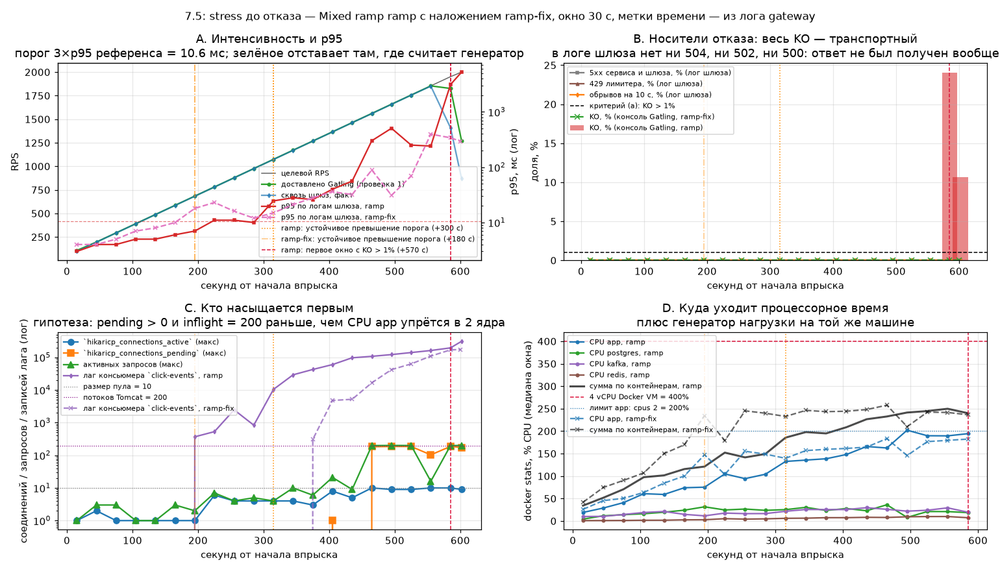

# Эксперимент 7.5: stress до отказа

Относится к этапу 7. Заполняется по результатам прогонов; если вариант не прогонялся, так и
пишется, и чекбокс DoD остаётся неотмеченным.

Сюда перенесён вопрос «потолка», который был в отменённой серии 7.1b: числовые ступени той серии
не приняты, и здесь они снимаются по правилу, которое отличает отказ сервиса от отказа генератора.

## Гипотеза

Первым узким местом на этом стенде станет не CPU контейнера `app` и не Postgres, а связка
«поток Tomcat ждёт соединение с пула + шлюз закрывает соединение раньше сервиса»: при росте нагрузки
доля неуспешных запросов превысит 1% раньше, чем `process_cpu_usage` достигнет 2 ядер, и точка
деградации будет сопровождаться `hikaricp_connections_pending > 0` и `server_inflight_max = 200`
(потолок потоков Tomcat по умолчанию).

Подтверждением считаем: (а) названа точка деградации — RPS, на котором впервые либо p95 вырос втрое
относительно baseline того же профиля, либо доля KO превысила 1%; (б) в этот момент записаны
одновременно `docker stats` для `app` и `postgres`, `hikaricp_connections_active` /
`_connections_pending`, `server_inflight_max` и `process_cpu_usage` — и ровно один из кандидатов
(пул, потоки Tomcat, CPU app, Postgres, Redis, лаг Kafka-консьюмера, GC) имеет признак насыщения,
то есть является первым; (в) улучшение, предложенное для этого узкого места, проверено повторным
прогоном и дало сдвиг точки деградации в большую сторону — либо не дало, и это зафиксировано как
опровержение.

Отрицанием считается случай, когда насыщается что-то перечисленное кроме пула и потоков (например,
CPU Postgres первым уходит в 100%), — тогда гипотеза не подтверждается, а результат формулируется
как «первое узкое место — X» с теми же доказательствами.

Формулировка написана до прогонов (2026-11-02, до серии `st*`).

## Отличие от отменённой серии 7.1b (правило доверия к числам)

В 7.1b ступени выше 1000 RPS были отменены, потому что на них измерялся генератор, а не сервис.
Здесь то же ограничение снято не молчанием, а проверкой, которая фиксируется для каждой ступени:

1. фактическая интенсивность `Cnt/s` из отчёта Gatling не ниже 95% от целевой — иначе ступень
   считается «генератор не дотягивает» и в вывод о потолке не входит;
2. доля KO разбирается по видам (таймауты клиента против `504`/`502` от шлюза против `500` сервиса)
   — отказ сервиса и отказ генератора выглядят по-разному, и смешивать их нельзя;
3. рядом с каждой ступенью записан `server_inflight_max`: если при целевых 1500 RPS на сервере
   одновременно обрабатывается 200 запросов (потолок потоков), а очередь держится у шлюза, это
   отказ сервиса, а не генератора.

Ступень, не прошедшая проверку 1, в таблицу вывода попадает с пометкой и не участвует в определении
точки деградации.

## Условия (железо, версии, лимиты контейнера, профиль, переменные)

| | |
|---|---|
| Железо | Intel Core i5-10300H, 4 ядра / 8 потоков; 16 ГБ RAM хоста |
| Виртуализация | Docker Engine 29.9.2 (Docker Desktop), WSL2 2.7.13.0, ядро 6.18.33.2-microsoft-standard-WSL2 |
| Ресурсы Docker VM | 4 vCPU, 5.79 ГиБ |
| Лимиты контейнера `app` | `cpus: "2"`, `mem_limit: 1g`; `system_cpu_count = 2` внутри JVM |
| Сервис | Spring Boot 3.5.16, JDK в контейнере Temurin 21.0.13+9-LTS |
| Инфраструктура | Postgres 16 (`max_connections = 100`), Redis 7, Kafka `apache/kafka:3.9.1` |
| Генератор нагрузки | Gatling 3.16.0, `gatling-maven-plugin` 4.21.12, Maven 3.9.16, JDK хоста Temurin 25.0.4.1+1 — на той же машине |
| Профиль нагрузки | `MixedSimulation`, `ramp`: `RPS_FROM=50` → `RPS_TO=2000`, `DURATION_SEC=600` (по PLAN) |
| Данные | засев этапа 6 + прирост от серий 7.1–7.4; `codes-hot.csv`; фактическое число строк в `links` и `click_events` фиксируется до прогона |
| Вход в сервис | gateway (nginx) на `http://localhost:28080` |
| Переключатели | `APP_CACHE_ENABLED=true`, `APP_CLICKS_MODE=async`, пул 10, `RATE_LIMIT_CREATE_PER_MINUTE=1000` (в смешанном профиле 5% созданий при 2000 RPS = 100 созданий/с; вывод «лимит 1000/мин не должен мешать» ошибочен — см. поправку к протоколу). Фактические значения переключателей — по выводу `scripts/reset-state.ps1`, он печатает окружение контейнера |

Профиль и переменные совпадают с baseline из `docs/baseline.md` и прогоном 7.1; в отличие от 7.2 здесь
сознательно не отключают кэш: вопрос — «что насыщается первым при естественном профиле», а не «как
ведёт себя пул».

### Поправка к протоколу (2026-11-04, написана до первого прогона)

Три уточнения потребовались до серии; ни одно не меняет проверяемую гипотезу.

**1. Лимит создания ссылок поднят на время серии — иначе ответом был бы сам лимитер.**

В таблице «Условия» стояло «5% созданий при 2000 RPS = 100 созданий/с, лимит 1000/мин не должен
мешать». Это предложение противоречит сама себе: 100 созданий в секунду — это 6000 созданий в минуту,
а лимит — 1000 в минуту.

Лимит считается на пользователя: `CreateLinkRateLimiter.acquire(userId)` берёт корзину из
`Map<Long, Bucket>` по id пользователя, а прогон идёт под одной учёткой (`sim.Auth`,
`load-runner@example.com`). Ёмкость корзины и её пополнение равны `RATE_LIMIT_CREATE_PER_MINUTE`,
пополнение `greedy` за минуту, то есть расходный темп — 16,7 создания в секунду. При доле созданий 5%
это 333 RPS общей нагрузки: штатный лимит начал бы отвечать `429` примерно на шестой части разгона и
испортил верхние четыре пятых.

Тогда «первым узким местом» серии оказался бы лимитер против спама — не ответ на вопрос «что
насыщается первым при естественном профиле», потому что `429` здесь штатное поведение, а не предел
пропускной способности. Поэтому на время серии `RATE_LIMIT_CREATE_PER_MINUTE=12000` — двукратный запас
от 6000/мин, нужных на вершине разгона. Так же поступала серия 7.2, и это предписывает javadoc
`sim.Auth` («для `CreateSimulation` лимит в `infra/.env` поднимают»). После серии значение возвращается
на 1000, возврат фиксируется выводом `scripts/reset-state.ps1`.

Находка, которая остаётся в отчёте независимо от замера: при штатном лимите 1000/мин и смешанном
профиле с 5% созданий предел по созданию ссылок — ≈333 RPS общей нагрузки, и лежит он ниже любой
осмысленной точки деградации этого стенда.

**2. В лог шлюза добавлена метка времени.**

Шаг 4 метода требует разложить показатели по окнам, а формат `gateway` времени не содержал:
`$remote_addr - $request "$status" $request_time s upstream=… upstream_time=…`. Без метки строку
нельзя отнести ни к одному окну, и «доля KO по окнам» недостижима. Добавлен `$time_iso8601`
(`infra/nginx/nginx.conf`, `log_format gateway`), конфигурация перечитана через `nginx -s reload`,
лог обнулён (`truncate -s 0`): до перечитывания в `/var/log/nginx/gateway.log` лежало 4 911 041 строки
прежних серий — без меток времени и без возможности их восстановить.

Меняется только формат записи лога. Поведение прокси остаётся тем же, что в baseline и в 7.4:
`proxy_read_timeout = 10s`, `proxy_connect_timeout = 2s`, `upstream shortener_app … keepalive 32`.
Строка лога становится длиннее примерно на 25 байт — это единственный канал, которым правка может
повлиять на замер; он отмечен в «Ограничениях».

**3. Порог «p95 ×3» привязан к окну и к тому же инструменту, что и замер.**

Критерий (а) сформулирован как «p95 вырос втрое относительно baseline того же профиля», но
`docs/baseline.md` даёт для `Mixed`, `constant`, 200 RPS агрегат за весь прогон (p50 4 / p95 7 /
p99 13 мс), а у непрерывного разгона агрегата по интенсивности нет: одна цифра за 600 с смешала бы
50 и 2000 RPS. Поэтому p95 окна считается по `$request_time` лога шлюза — это время, которое реально
видит клиент и которое цензурировано тем же капом в 10 с, — и сравнивается с референсным прогоном,
сделанным тем же инструментом: `Mixed`, `constant`, 200 RPS, 120 с. От его окна и берётся утроенный порог.
Агрегат Gatling записывается рядом, но порог по нему не считается.

**Порядок серии и метки.** `ref-200` — референс из правки 3; `probe-*` — проверка драйвера и того,
держит ли генератор заданный темп; `ramp` — шаг 2 метода (50→2000 RPS за 600 с); `below-*` и
`above-*` — шаг 3 метода, по три прогона на двух фиксированных уровнях, значения уровней фиксируются
после `ramp` и до публикации вывода; `ramp-fix` — шаг 5, повтор шага 2 с одним изменением для
названного узкого места. Журнал замеров — `exp-results-75.jsonl`, пооконный — `exp-windows-75.jsonl`.

## Метод (шаги, число прогонов)

1. `scripts/reset-state.ps1`, проверка health, прогрев 60 с на 50 RPS, ожидание покоя.
2. Один непрерывный разгон `ramp` 50 → 2000 RPS за 600 с. Это единственный способ увидеть точку
   деградации как внутреннюю точку одного процесса, а не как разницу между отдельными прогонами.
3. Дополнительно — по три прогона на двух фиксированных уровнях: сразу под точкой деградации и сразу
   над ней (значения фиксируются после шага 2 и до публикации вывода). Нужны, чтобы сравнение
   «до/после» не зависело от того, где именно разгон пересёк границу.
4. Каждые 30 с разгона: снимок `docker stats --no-stream`; по окнам — p95, доля KO,
   `hikaricp_connections_active` / `_pending`, `server_inflight_max`, `process_cpu_usage`,
   `shortener_cache_requests_total`, лаг консьюмера Kafka.
5. Проверка гипотезы об улучшении: для названного узкого места выбирается одно изменение (например,
   размер пула из 7.2 или `server.tomcat.threads.max`), и шаг 2 повторяется с ним.

### Решения после шага 2 (записаны 2026-11-04, до публикации вывода)

Шаг 2 снят прогоном `ramp` (21 окно по 30 с). Здесь зафиксированы три вещи, которые метод требует
решить до вывода: откуда берётся доля KO по окнам, какое чтение критерия (а) принимается и какие
числа идут в шаги 3 и 5.

**Доля KO по окнам берётся из консоли Gatling, а не из лога шлюза.**
В срезе лога шлюза за весь разгон нет ни одной строки с `502`, `504` или `500` и ни одной строки с
`$request_time >= 9,9 s`: 601 411 строка — это 571 251 × `302`, 30 160 × `201`, по одной `409` и `200`.
При этом Gatling даёт 13 589 KO (2,21%), и в разбивке по ошибкам это
`i.g.h.c.i.PrematureCloseException: Premature close` — 9 481 (69,77%) и
`java.net.ConnectException: Connection refused: getsockopt` — 4 108 (30,23%). То есть оборванные
запросы до `504` шлюза не доходят: соединение либо не установлено, либо закрыто без ответа. Лог
шлюза физически не может показать эти окна, поэтому проверка 2 строится на блоках статистики Gatling
(печатаются каждые 5 с; накопительные счётчики OK/KO), а лог шлюза отвечает за распределение
`$request_time` и за то, что отказ был именно транспортным. Разбивка KO по видам есть только по всему
прогону: блоки Gatling её не печатают, а `simulation.log` в 3.16.0 бинарный.

**Критерий (а) читается как «первое окно, после которого p95 держится ≥ 3× референса до конца
прогона».** Буквальное «впервые» срабатывает раньше и на одиночном окне: порог считается по полным
окнам референса `ref-200` (по 30 с; последнее окно длительностью 1 с с 143 запросами отброшено) —
p95 = 4,0 / 4,0 / 3,1 / 3,0 мс, медиана 3,55, утроенный порог 10,65 мс. Он пересекается на +210 с
(цель 781,2 RPS, факт шлюза 779,9, p95 11,0), затем +240 с p95 11,0 и +270 с p95 10,0 — то есть окно
781,2 RPS стоит на самой границе порога и следующее под него проваливается. Устойчивое пересечение —
окно **+300…+330 с: цель 1073,8 RPS, факт шлюза 1072,3, p95 24,6 мс, p99 193 мс при p50 4,0 мс**
(то есть деградация на этом шаге — только в хвосте распределения), и дальше p95 только растёт.
Точкой деградации принимается 1074 RPS; 781 RPS называется в выводе отдельно, как первое касание
порога. Вторая ветка критерия (KO > 1%) срабатывает гораздо позже — на ~1976 RPS, и она же совпадает
с отказом транспорта, поэтому в выводе это «точка отказа», а не «точка деградации».

**Проверка 1 по окнам (Cnt/s ≥ 95% цели).** До +570 с генератор держит цель: окна 50→1943 RPS дают
98,5–100,0% (например +540 с — 1853,6 доставлено из 1853,8 цели; +580 с — 1893,4 из 1943,1 в
пятисекундном разрезе). Отсекаются два окна по 30 с: **+570 с — 93,6%** (доставлено 1826,2 из
1951,2) и **+600 с — 63,4%** (1268,3 из 2000,0). В пятисекундном разрезе отсекаются 585–590 с
(93,9%), 590–595 с (50,3%) и 600–605 с (63,4%); кроме них — одиночный провал 490–495 с (86,6%),
который восполнен следующим отрезком 495–500 с (113,6%): в окне 480–510 с свёртка даёт 100,0%
без KO, то есть это граница buckets, а не нехватка темпа, и в вывод оно не входит.
Сквозная интенсивность по логу шлюза падает сильнее (72,2% и 43,4% в этих же двух окнах): ответы
запросов, оставшихся незавершёнными к концу впрыска, в лог не попали.

**Вторая ветка критерия (а) — KO > 1%.** Первое окно с долей KO выше 1% — +570…+600 с: цель 1951,2
RPS, доставлено 1826,2 (93,6%), KO 13 183 из 54 786 (24,06%). В пятисекундном разрезе первый KO
появляется в отрезке 590–595 с: цель 1975,6 RPS, доставлено 993,4, KO 3222 (64,87%); в предыдущем
отрезке 585–590 с KO ещё ноль, а доставка 93,9%. Оба этих окна отсекаются проверкой 1, поэтому
точкой деградации они не становятся — они и есть «отказ тракта»: при ~1950 RPS не выдерживает
установки соединений путь Gatling → шлюз (см. состав ошибок выше), и сервис перестаёт получать
запросы, не успев ответить ошибкой.

**Уровни для шага 3.** «Сразу под» и «сразу над» принятой точкой деградации 1074 RPS:
`below` = **1000 RPS**, `above` = **1150 RPS**, по три прогона `constant` 60 с на уровень
(+ прогрев до KO < 1%), метки `below-a/b/c`, `above-a/b/c`.

**Изменение для шага 5.** Первое узкое место по данным окна +300…+330 с — потребление
`click-events`: лаг растёт с этого окна и дальше только растёт (835 → 10 414 → 29 163 → … → 310 029),
при этом пул Hikari ещё не выбран (`active` 4 из 10, `pending` 0), потоки Tomcat заняты на 4 из 200,
CPU Postgres 25%, а CPU app 132% из 200% лимита. Слушатель `ClickEventWriter` один поток на три
партиции топика и пишет по одной строке `clicks.save(...)` на запись. Выбираемое **одно** изменение —
поднять параллельность слушателя до числа партиций: `spring.kafka.listener.concurrency=3`
(переменная `SPRING_KAFKA_LISTENER_CONCURRENCY` в `infra/docker-compose.yml`, дефолт 1 = текущее
поведение). Конфигурационное, без правки кода: образ `shortener-service:dev` не пересобирается,
сравнение остаётся сравнением одного фактора. Пакетная запись (`@KafkaListener(batch = "true")` +
`saveAll`) остаётся предложенной, но не проверенной — проверка двух изменений сразу нарушила бы
правило «одно изменение».

## Результаты

Числа этого раздела — из журналов `exp-windows-75.jsonl` (окна 30 с: лог шлюза + Prometheus +
`docker stats`) и `exp-gatling-75.jsonl` (пятисекундные блоки консоли Gatling, свёрнутые в те же
окна); обе таблицы напечатаны скриптом `qoder_75_table.py` и вставлены в отчёт без ручного
переписывания.

### Инцидент посреди шага 3 (15:41 UTC) и решение по нему

В 15:41 UTC Docker VM перезапустилась — на хосте ставилось обновление приложения, и вместе с VM
упал и весь стек `infra-*`, и процесс генератора. Строка `above-warm1` в журнале осталась с
`exit=1` и KO 29,62% — это не измерение, а прогон, оборванный на середине окна; рядом лежит
обрезанный срез `gw-above-warm1.log` (5,78 МБ против 7,12 МБ у полноценных окон). Три прогона
`below-*` (1000 RPS) успели закончиться до падения, все `above-*` — нет.

Сравнивать `below`, снятый на JVM до перезапуска, с `above` на JVM после перезапуска — значит
сравнивать два поколения процесса с разной историей прогрева JIT и кэшей. Поэтому шаг 3 повторяется
целиком на поднявшемся стенде, с метками `below2-a/b/c` и `above2-a/b/c`; прежние `below-*`
остаются в журнале нетронутыми и в вывод не входят. Решение записано до публикации вывода, лаг
Kafka перед повтором проверен нулём (`sum(kafka_consumer_fetch_manager_records_lag) = 0`): смещения
консьюмера лежат в самом Kafka и перезапуск VM переживают, поэтому события, не дописанные к моменту
падения, были дописаны после подъёма стека, и лаг снова стал нулевым.

### Референс `ref-200` (`Mixed`, `constant`, 200 RPS, 120 с)

От него считается порог «p95 × 3» (правка 3 к протоколу). Медиана полных окон p95 по логу шлюза =
**3,55 мс**, утроенный порог = **10,65 мс**. Пятое окно — хвост длительностью 1 с со 143 запросами,
в медиану не входит.

| Окно, с | Цель RPS | Покрытие блоков, с | `Cnt/s` Gatling | Доставлено | Проверка 1 | p50 | p95 | p99 | KO Gatling | KO, % | active / pending | inflight max | CPU `app`, % | CPU Postgres, % | лаг Kafka | GC, число пауз |
|---|---|---|---|---|---|---|---|---|---|---|---|---|---|---|---|---|
| +0 | 200.0 | 25.0 | 200.0 | 100.0% | да | 1.0 | 4.0 | 8.0 | 0 | 0.0 | 1.0 / 0.0 | 2.0 | 40.51 | 11.43 | 0.0 | 18.0 |
| +30 | 200.0 | 30.0 | 200.0 | 100.0% | да | 1.0 | 4.0 | 5.0 | 0 | 0.0 | 1.0 / 0.0 | 1.0 | 30.05 | 10.43 | 0.0 | 16.8 |
| +60 | 200.0 | 30.0 | 200.0 | 100.0% | да | 1.0 | 3.1 | 5.0 | 0 | 0.0 | 1.0 / 0.0 | 3.0 | 29.96 | 8.06 | 0.0 | 18.0 |
| +90 | 200.0 | 30.0 | 200.1 | 100.0% | да | 1.0 | 3.0 | 5.0 | 0 | 0.0 | 1.0 / 0.0 | 1.0 | 33.8 | 14.43 | 0.0 | 18.0 |

Сумма по прогону: 24 000 запросов, KO 0, `Cnt/s` 200. Для сравнения — прогрев того же уровня
(`ref-200-warm`, снятый до прогрева) дал p95 785 мс и p99 2469 мс при том же числе запросов: на
холодной JIT и холодном кэше разброс в сотни раз, и это причина, по которой в методе есть прогрев.

### Разгон `ramp` (50 → 2000 RPS за 600 с)

| Окно, с | Цель RPS | Покрытие блоков, с | `Cnt/s` Gatling | Доставлено | Проверка 1 | p50 | p95 | p99 | KO Gatling | KO, % | active / pending | inflight max | CPU `app`, % | CPU Postgres, % | лаг Kafka | GC, число пауз |
|---|---|---|---|---|---|---|---|---|---|---|---|---|---|---|---|---|
| +0 | 98.8 | 25.0 | 106.8 | 99.9% | да | 1.0 | 3.0 | 5.0 | 0 | 0.0 | 1.0 / 0.0 | 1.0 | 19.09 | 4.22 | 0.0 | 8.4 |
| +30 | 196.2 | 30.0 | 196.2 | 100.0% | да | 1.0 | 4.0 | 6.0 | 0 | 0.0 | 2.0 / 0.0 | 3.0 | 28.87 | 11.57 | 0.0 | 14.4 |
| +60 | 293.8 | 30.0 | 293.8 | 100.0% | да | 1.0 | 4.0 | 7.0 | 0 | 0.0 | 1.0 / 0.0 | 3.0 | 40.92 | 14.06 | 0.0 | 20.4 |
| +90 | 391.2 | 30.0 | 391.1 | 100.0% | да | 2.0 | 5.0 | 10.0 | 0 | 0.0 | 1.0 / 0.0 | 1.0 | 60.79 | 16.12 | 0.0 | 28.8 |
| +120 | 488.8 | 30.0 | 488.6 | 100.0% | да | 2.0 | 5.0 | 9.0 | 0 | 0.0 | 1.0 / 0.0 | 1.0 | 59.09 | 19.58 | 0.0 | 34.8 |
| +150 | 586.2 | 30.0 | 586.3 | 100.0% | да | 2.0 | 6.0 | 12.0 | 0 | 0.0 | 1.0 / 0.0 | 3.0 | 74.05 | 24.11 | 0.0 | 38.4 |
| +180 | 683.8 | 30.0 | 683.8 | 100.0% | да | 2.0 | 7.0 | 12.0 | 0 | 0.0 | 1.0 / 0.0 | 2.0 | 75.28 | 31.58 | 368.0 | 44.4 |
| +210 | 781.2 | 30.0 | 780.9 | 100.0% | да | 3.0 | 11.0 | 26.0 | 0 | 0.0 | 6.0 / 0.0 | 7.0 | 104.77 | 24.61 | 530.0 | 49.2 |
| +240 | 878.8 | 30.0 | 878.6 | 100.0% | да | 3.0 | 11.0 | 25.0 | 0 | 0.0 | 4.0 / 0.0 | 4.0 | 94.33 | 26.64 | 2465.0 | 55.2 |
| +270 | 976.2 | 30.0 | 976.0 | 100.0% | да | 3.0 | 10.0 | 24.0 | 0 | 0.0 | 4.0 / 0.0 | 5.0 | 104.04 | 23.77 | 835.0 | 60.0 |
| +300 | 1073.8 | 30.0 | 1073.9 | 100.0% | да | 4.0 | 24.6 | 193.0 | 0 | 0.0 | 4.0 / 0.0 | 4.0 | 132.57 | 25.34 | 10414.0 | 66.0 |
| +330 | 1171.2 | 30.0 | 1171.4 | 100.0% | да | 4.0 | 28.0 | 165.0 | 0 | 0.0 | 4.0 / 0.0 | 10.0 | 135.59 | 30.39 | 29163.0 | 81.6 |
| +360 | 1268.8 | 30.0 | 1268.5 | 100.0% | да | 4.0 | 26.0 | 60.0 | 0 | 0.0 | 3.0 / 0.0 | 6.0 | 138.56 | 23.47 | 42464.0 | 87.6 |
| +390 | 1366.2 | 30.0 | 1365.9 | 100.0% | да | 5.0 | 40.0 | 84.0 | 0 | 0.0 | 8.0 / 1.0 | 21.0 | 147.97 | 27.81 | 59945.0 | 93.6 |
| +420 | 1463.8 | 30.0 | 1463.5 | 100.0% | да | 6.0 | 56.0 | 227.0 | 0 | 0.0 | 5.0 / 0.0 | 9.0 | 165.81 | 22.84 | 96755.0 | 91.2 |
| +450 | 1561.2 | 30.0 | 1561.1 | 100.0% | да | 10.0 | 301.0 | 559.0 | 0 | 0.0 | 10.0 / 183.0 | 198.0 | 162.54 | 36.17 | 107238.0 | 94.8 |
| +480 | 1658.8 | 30.0 | 1659.1 | 100.0% | да | 14.0 | 505.0 | 920.8 | 0 | 0.0 | 9.0 / 186.0 | 200.0 | 202.08 | 8.02 | 121313.0 | 97.2 |
| +510 | 1756.2 | 30.0 | 1756.1 | 100.0% | да | 15.0 | 251.0 | 469.0 | 0 | 0.0 | 9.0 / 186.0 | 199.0 | 189.76 | 21.07 | 139964.0 | 97.2 |
| +540 | 1853.8 | 30.0 | 1853.6 | 100.0% | да | 16.0 | 241.0 | 426.0 | 0 | 0.0 | 10.0 / 103.0 | 16.0 | 189.51 | 21.03 | 161737.0 | 98.4 |
| +570 | 1951.2 | 30.0 | 1826.2 | 93.6% | не прошла | 71.0 | 3119.2 | 5199.3 | 13183 | 24.06 | 10.0 / 187.0 | 198.0 | 194.41 | 18.66 | 194673.0 | 81.6 |
| +600 | 2000.0 | 3.0 | 1268.3 | 63.4% | не прошла | 2438.0 | 5244.8 | 6621.2 | 406 | 10.67 | 9.0 / 174.0 | 200.0 | — | — | 310029.0 | 4.8 |

Как читать три колонки доставки. «Покрытие блоков, с» — сколько секунд закрыто пятисекундными
блоками консоли внутри окна: у первого окна 25 с, потому что блока с отметкой 0 с в консоли нет
(неатрибутированными остаются 290 запросов старта), у последнего 3 с, потому что впрыск
остановился на 600 с. «Доставлено» считается по этой же продолжительности, а не по жёстким 30 с:
иначе первое и последнее окно выглядели бы провалом генератора, которого не было.

Проверку 1 не прошли ровно два окна — +570 с (93,6%) и +600 с (63,4%). Это те же два окна, что
отброшены из вывода в решении после шага 2.

Количество пауз GC в последних двух строках — `increase()` за окно, поэтому дробное; в последних
окнах видно, что GC почти встал (4,8 паузы за окно против 98,4 в середине): процесс был занят не
сборкой мусора, а ожиданием.

### Состав KO и консистентность событий

KO по окнам — только из консоли Gatling (в «Решениях после шага 2» объяснено почему): в логе шлюза
за весь разгон нет ни одной строки с `429`, `500`, `502`, `503`, `504`, ни одной с
`$request_time >= 9,9 s`, то есть сервис и шлюз не отдали ни одной ошибки и ничего не отрезали по
таймауту. Весь KO — транспорт между генератором и шлюзом.

Срез лога шлюза за прогон: 601 413 строк, из них 571 251 × `302`, 30 160 × `201`, по одной `409` и
`200`. Две последних — аутентификация самого генератора в начале прогона (`POST /api/auth/register`
и `POST /api/auth/login`); парсер окон относит их к `kind = other` и выбрасывает, поэтому в
окнах 601 411 строк, и статусов `409`/`200` в оконной статистике нет.

Консистентность (шаг 5 метода): прирост `click_events` за прогон = **571 251** строк, что ровно
равно числу `302` в логе шлюза; прирост `links` = **30 160**, что равно числу `201`. Ни одного
события не потеряно и не задвоено. Лаг консьюмера на конце прогона — 310 029, после остановки
впрыска он сошёл к нулю (проверка `settle`), то есть отставание было очередью, а не потерей.

### Шаг 3: уровни вокруг точки деградации

`below2` = 1000 RPS и `above2` = 1150 RPS, по три прогона `constant` 60 с на уровень плюс прогрев до
KO < 1% (метод, шаг 3). Обе таблицы — печатный вывод `qoder_75_levels_table.py below2 above2`,
строки прогрева показаны для полноты и в медиану не входят.

| Прогон | Профиль | Цель RPS | Старт UTC | `Cnt/s` Gatling | Доставлено шлюзом, RPS | KO Gatling, % | p50 шлюз | p95 шлюз | p99 шлюз | обрывы шлюза | p95 `app`, мс | inflight max | pending Hikari | лаг Kafka | GC, число пауз | CPU `app`, % |
|---|---|---|---|---|---|---|---|---|---|---|---|---|---|---|---|---|
| below2-warm1 | constant | 1000 | 16:09:31Z | 967.74 | 508.2 | 51.30 | 3180.0 | 9998.0 | 11040.0 | 1591 | 967.4 | 200.0 | 190.0 | 39.0 | 40.0 | 185.72 |
| below2-warm2 | constant | 1000 | 16:11:47Z | 983.61 | 894.3 | 9.62 | 463.0 | 3277.4 | 4137.0 | 0 | 642.4 | 200.0 | 189.0 | 5599.0 | 74.2 | 180.89 |
| below2-warm3 | constant | 1000 | 16:14:11Z | 1000.00 | 983.6 | 0.00 | 3.0 | 15.0 | 65.0 | 0 | 7.6 | 13.0 | 5.0 | 2606.0 | 84.0 | 121.50 |
| below2-a | constant | 1000 | 16:16:22Z | 983.61 | 983.6 | 0.00 | 3.0 | 10.0 | 77.0 | 0 | 5.4 | 2.0 | 0.0 | 2144.0 | 87.3 | 105.55 |
| below2-b | constant | 1000 | 16:18:17Z | 1000.00 | 983.6 | 0.00 | 3.0 | 14.0 | 87.0 | 0 | 6.8 | 8.0 | 0.0 | 2200.0 | 88.4 | 110.34 |
| below2-c | constant | 1000 | 16:20:27Z | 983.61 | 983.6 | 0.00 | 3.0 | 14.0 | 60.0 | 0 | 6.9 | 17.0 | 6.0 | 327.0 | 82.9 | 103.44 |
| **below2: медиана abc** | constant | 1000 | — | 983.61 | 983.6 | 0.00 | 3.0 | 14.0 | 77.0 | 0 | 6.8 | 8.0 | 0.0 | 2144.0 | 87.3 | 105.55 |

| Прогон | Профиль | Цель RPS | Старт UTC | `Cnt/s` Gatling | Доставлено шлюзом, RPS | KO Gatling, % | p50 шлюз | p95 шлюз | p99 шлюз | обрывы шлюза | p95 `app`, мс | inflight max | pending Hikari | лаг Kafka | GC, число пауз | CPU `app`, % |
|---|---|---|---|---|---|---|---|---|---|---|---|---|---|---|---|---|
| above2-warm1 | constant | 1150 | 16:26:46Z | 1131.15 | 1131.1 | 0.00 | 3.0 | 15.0 | 117.0 | 0 | 7.1 | 6.0 | 0.0 | 2271.0 | 99.3 | 117.59 |
| above2-a | constant | 1150 | 16:28:58Z | 1131.15 | 1131.1 | 0.00 | 3.0 | 13.0 | 131.0 | 0 | 6.2 | 5.0 | 0.0 | 5150.0 | 100.4 | 112.33 |
| above2-b | constant | 1150 | 16:31:07Z | 1131.15 | 1131.1 | 0.00 | 3.0 | 15.0 | 90.0 | 0 | 6.8 | 5.0 | 0.0 | 1076.0 | 97.1 | 111.10 |
| above2-c | constant | 1150 | 16:33:16Z | 1131.15 | 1131.1 | 0.00 | 3.0 | 22.0 | 161.0 | 0 | 8.3 | 19.0 | 7.0 | 5252.0 | 99.3 | 122.69 |
| **above2: медиана abc** | constant | 1150 | — | 1131.15 | 1131.1 | 0.00 | 3.0 | 15.0 | 131.0 | 0 | 6.8 | 5.0 | 0.0 | 5150.0 | 99.3 | 112.33 |

**Прогрев после подъёма VM стоил трёх попыток.** `below2-warm1` (первый прогон на поднявшемся стенде)
дал KO 51,30% и p95 шлюза 9998 мс при 1591 обрыве на 10 с — то есть держатель соединения упирался в
`proxy_read_timeout`, `inflight` был выбран под 200, а `pending` пула — под 190. `below2-warm2` —
ещё KO 9,62% и p95 3277 мс. Только `below2-warm3` вышел чистым (KO 0,00%, p95 15 мс). К `above2`
стенд подошёл после шести прогонов `below2` на том же JVM — и там хватило одной попытки прогрева. Разница между этими состояниями одного и
того же образа — то, ради чего в методе есть прогрев и `settle` между прогонами.

**Оба уровня проходят проверку 1, и проходят её по числу ответов, а не по знаменателю.** В каждом
из шести измерительных прогонов `requests` = `ok` = числу строк лога шлюза: 60 000 для 1000 RPS и
69 000 для 1150 RPS, KO 0,00% и ни одного обрыва. Колонка «Доставлено шлюзом, RPS» (983,6 и 1131,1)
меньше цели из-за деления на 61 с: `rps_gw = n_gw / (t_max − t_min + 1)`, а границы прогона лежат
ровно через 60 с друг от друга (`gw_first`/`gw_last` в журнале). Это формальность знаменателя, а не
недостающие запросы.

**1150 RPS неотличим от 1000 RPS.** p95 шлюза: 10,0 / 14,0 / 14,0 против 13,0 / 15,0 / 22,0 —
медианы 14,0 и 15,0 мс при разбросе внутри уровней 10–14 и 13–22. Разница между уровнями (1,0 мс)
меньше разброса между прогонами одного уровня, а оба уровня выше порога 10,65 мс: от референсных
3,55 мс это ×3,9 и ×4,2. KO на обоих уровнях ноль, `inflight` ≤ 19 из 200 потоков Tomcat,
`pending` пула ≤ 7 из 10 соединений, CPU `app` 103–123% из 200% лимита, лаг консьюмера за 60 с
327–5252 сообщений и после `settle` всегда сходит к нулю.

**Это не противоречит разгону, а ограничивает его вывод.** В `ramp` окно +300…+330 с на цели 1073,8
RPS даёт p95 24,6 и p99 193 мс — выше, чем изолированный прогон на 1150 RPS (15 и 131). К этому
моменту разгон уже 300 с держит очередь: лаг 835 на входе в окно и 10 414 на выходе, и дальше он
только растёт. Изолированный прогон стартует с нулевым лагом (после `settle`) и 60 с не успевает
накопить очередь. Поэтому 1074 RPS — это точка, после которой разгон перестаёт догонять собственную
нагрузку, а не «ступенька» в отклике сервиса: на фиксированных уровнях рост p95 непрерывен и порог
`p95 ×3` берётся уже при 1000 RPS.

**Прерванный шаг 3 остаётся в журнале и в вывод не входит.** Прежние `below-*` (JVM до перезапуска)
дали p95 шлюза 25,0 / 14,0 / 84,0 мс при медиане 25,0 и KO 0,00–0,02%: разброс 14–84 мс на одном
уровне 1000 RPS — сам по себе причина, почему уровень надо мерить на одном поколении процесса. В
`below-c` всплеск стоит на `inflight` 192 из 200 и KO 0,02% — это уже не шум измерений, а событие,
которое повтор на чистом стенде не воспроизвёл ни разу. `above-warm1` (15:40 UTC, убит перезапуском)
вычеркнут вместе с прогоном целиком.

### Шаг 5: проверка предложения

`ramp-fix` — тот же разгон 50 → 2000 RPS с `spring.kafka.listener.concurrency = 3` при неизменном
образе. Заполняется после прогона.

## Графики (скриншоты Grafana)

Это не снимок Grafana: серверный рендер PNG в этом стенде недоступен (в образе нет
`grafana-image-renderer`), а кадр из встроенного браузера получается только когда панель браузера
активна, поэтому пункт PLAN про снимки Grafana остаётся незакрытым и здесь. Картинка построена по
журналам `exp-windows-75.jsonl` и `exp-gatling-75.jsonl` скриптом `qoder-75-chart.py` (вне
репозитория, команда — в «Как повторить»).

Панель A — целевая интенсивность (чёрная), доставленная генератором (зелёная, проверка 1) и прошвшая
через шлюз (синяя), рядом p95 по `$request_time` лога шлюза на логарифмической шкале с линией порога
3 × медиана референса = 10,6 мс. Панель B — доля KO по консоли Gatling (столбцы) против 429, 5xx и
обрывов на 10 с по логу шлюза: последние три линии лежат на нуле весь прогон, то есть весь KO серии —
транспортный, ответов с ошибкой сервис не отдавал. Панель C — активные и ожидающие соединения пула,
активные запросы и лаг консьюмера `click-events` (логарифмическая шкала), с линиями «пул = 10» и
«потоков Tomcat = 200». Панель D — CPU контейнеров app / postgres / kafka / redis и их сумма на фоне
4 vCPU Docker VM (400%) и лимита app `cpus: "2"` (200%). Вертикальные линии на всех панелях: оранжевая
точка — +300…+330 с (первое устойчивое превышение порога p95), бордовая — +570…+600 с (первое окно с
KO > 1%). Кадр пересоберётся после `ramp-fix`, чтобы на нём остались оба разгона.

## Вывод (что подтвердилось, что нет, почему)

Заполняется после серии: точка деградации (RPS), первое узкое место, какие ступени отброшены по
проверке 1, и что дала проверка предложения по улучшению.

## Ограничения

1. **Генератор на той же машине.** Gatling идёт процессом хоста и конкурирует с сервисом за 4 vCPU
   Docker VM; на верхних ступенях разгона (от ~1800 RPS) непонятно, что насыщается первым — сервис
   или впрыск. Поэтому последние два окна разгона отсекаются проверкой 1, а точка деградации берётся
   из середины графика, где доставка ещё равна цели.
2. **Перезапуск Docker VM посреди серии.** Обновление приложения на хосте в 15:41 UTC убило и стек,
   и генератор — прогон `above-warm1` остался с `exit=1`, а вместе с ним и весь шаг 3 в первом
   варианте. Это не «выброс в данных», а потерянное измерение: шаг 3 переснят целиком на поднявшемся
   стенде (`below2` / `above2`), прежние строки журнала не участвуют в выводе. Само событие показывает
   цену метода: непрерывный разгон даёт одно измерение точки деградации, и его нельзя «дождать».
3. **60-секундный прогон копит очередь иначе, чем разгон.** Шаг 3 идёт на уровне по 60 с с чистым
   лагом, и к концу прогона лаг Kafka — единицы тысяч; в разгоне к окну +300 с лаг уже 835 и дальше
   растёт до 310 029. Сравнивать p95 изолированного прогона и p95 окна разгона можно только как
   «предел тракта» против «предела в нагруженной очереди» — это ограничение шага 3, а не ошибка чисел.
4. **Доля KO по типам есть только по всему прогону.** Блоки консоли Gatling печатают накопительные
   OK/KO без разбивки по ошибкам, а `simulation.log` в 3.16.0 бинарный. Разбивка
   premature close / connection refused относится к прогону целиком.
5. **У консоли Gatling нет блока за 0–5 с.** Первый печатный блок — накопительный итог на 5-й секунде,
   поэтому в первом окне разгона измерено 25,0 с из 30, а в последнем — 3,0 с: впрыск обрывается на
   600-й секунде. Колонка «Покрытие блоков» и знаменатель «Доставлено» учитывают это, а не делят на
   жёсткие 30 с.
6. **`docker stats` — точечный снимок** каждые 30 с, Prometheus scrape — 5 с. Пики между снимками
   (например, мгновенный выбор пула) в таблицы не попадают; максимумы `inflight` и `pending` —
   максимум по снятым точкам, а не по всем 600 с.
7. **Формат лога шлюза изменён до серии** (поправка 2): строка стала длиннее примерно на 25 байт —
   601 413 строк разгона это ~15 МБ дополнительной записи на том же диске, где живёт и база.
8. **`heap_used_mib` в журнале — один пул кучи, а не вся куча.** `qoder_75.py:264` запрашивает
   `max_over_time(jvm_memory_used_bytes{area="heap"}[30s])` без `sum`, а `prom()` берёт первую
   ответившую серию — Prometheus отдаёт по одной на пул (`tenured_generation` и т. п.), какая окажется
   первой, зависит от сортировки меток. В вывод этой серии показатель не входит (в soak-драйвере
   `qoder_76_soak.py` куча считается через `min/max_over_time(sum(...))`, отдельной строкой), но в
   `exp-results-75.jsonl` и `exp-windows-75.jsonl` он лежит с таким именем и читать его надо как есть.
9. **Медиана порога считается по четырём полным окнам референса.** Окно в 1 с с 143 запросами
   отброшено; при четырёх наблюдениях медиана грубая, и одиночное окно разгона на границе порога
   (+210 с, p95 11,0 против порога 10,65) не разрешается — отсюда правило «держится до конца
   прогона» в критерии (а).
10. **Одно изменение, один стенд, один день.** Шаг 5 меняет только параллельность слушателя; ни
    размера пула, ни `server.tomcat.threads.max` не трогали, поэтому вывод «что дало бы увеличение
    пула» остаётся за пределами серии.

## Как повторить

Серия — только через блокировку (`bash with-lock.sh …`, mkdir-замок `exp74.lock.d` в `%TEMP%`):
убитая фоновая серия оставляет живой генератор, и следующая начинает замерять чужую очередь.
Драйверы серии лежат в `%TEMP%`, вне репозитория: `qoder_75.py` (прогон + окна + журнал),
`qoder_75_gstats.py` (пятисекундные блоки консоли Gatling), `qoder_75_probe.sh`, `qoder_75_ramp.sh`,
`qoder_75_levels.sh`, `qoder_75_levels2.sh`, `qoder_75_table.py` (таблицы раздела «Результаты»),
`qoder_75_levels_table.py` (таблица шага 3), `qoder_75_reports.py` (метки отчётов Gatling),
`qoder_75_verify.py` (сверка отчёта с журналами). Журналы
`exp-results-75.jsonl`, `exp-windows-75.jsonl`, `exp-gatling-75.jsonl`, `exp-samples-75.jsonl`
скопированы в `docs/experiments/assets/`.

1. Стенд: `$env:RATE_LIMIT_CREATE_PER_MINUTE='12000'` (поправка 1) и
   `$env:JAVA_TOOL_OPTIONS=''`, затем `pwsh -NoProfile -File scripts/reset-state.ps1` — он пересоздаёт
   `app` и печатает окружение контейнера; вывод сверяется с таблицей «Условия» (в серии это
   `APP_CACHE_ENABLED=true APP_CLICKS_MODE=async pool=10 RATE_LIMIT_CREATE_PER_MINUTE=12000`).
   Данные — после засева этапа 6 и серий 7.1–7.4, пересев не требовался; фактическое состояние базы
   до шага 3 — `links=292094`, `click_events=10660982` (последний снимок перед повтором шага 3).
2. Разведка: `bash with-lock.sh qoder_75_probe.sh` — внутри `python qoder_75.py check` (переключатели,
   формат лога шлюза, health), `snap`, прогрев `ref-200-warm`, референс
   `run ref-200 Mixed constant 200 120 200 200`, `windows ref-200` и пробник разгона
   `ramp probe-ramp 50 600 120`.
3. Шаг 2: `bash with-lock.sh qoder_75_ramp.sh ramp 50 2000 600` — то есть `check`, `snap`, `settle`,
   `ramp ramp 50 2000 600`, `windows ramp`, `report`. `DURATION_SEC=600`, `RPS_FROM=50`, `RPS_TO=2000`.
4. Шаг 3, первая попытка: `bash with-lock.sh qoder_75_levels.sh` — `level below 1000 60` и
   `level above 1150 60`, по три измерительных прогона на уровень. Прервана перезапуском Docker VM на
   15:41 UTC (см. «Инцидент посреди шага 3»).
5. Шаг 3, повтор: `bash with-lock.sh qoder_75_levels2.sh` — те же уровни с метками `below2`, `above2`;
   `level <метка> <RPS> 60` делает прогрев до KO < 1% (не более 5 попыток) и три прогона, между
   прогонами `settle` (ожидание нулевого лага и покоя пула), затем для каждого прогона
   `windows <метка>-<буква>` и `qoder_75_gstats.py <метка>-<буква> <RPS> <RPS> 60`.
6. Шаг 5: `git checkout -b exp/75-consumer-concurrency stage-7`, в `infra/docker-compose.yml` в блок
   `app.environment` добавляется `SPRING_KAFKA_LISTENER_CONCURRENCY: ${SPRING_KAFKA_LISTENER_CONCURRENCY:-1}`,
   имя переменной дописывается в шаблон вывода `scripts/reset-state.ps1`. Затем
   `$env:SPRING_KAFKA_LISTENER_CONCURRENCY='3'` и `pwsh -NoProfile -File scripts/reset-state.ps1`
   (пересоздание контейнера обязательно: без него compose не применит новую переменную); идентичность
   артефакта до и после фиксируется выводом `docker image inspect` по `shortener-service:dev`, сборка
   не запускается. Прогон — `bash with-lock.sh qoder_75_ramp.sh ramp-fix 50 2000 600`.
7. Возврат стенда: `git checkout stage-7`, `$env:RATE_LIMIT_CREATE_PER_MINUTE='1000'`,
   `$env:SPRING_KAFKA_LISTENER_CONCURRENCY=''`, снова `scripts/reset-state.ps1`.
8. Сверка: `python qoder_75_table.py ramp` и `python qoder_75_levels_table.py below2 above2` печатают
   таблицы, `python qoder_75_verify.py` сверяет каждую ячейку с журналами и проверяет числа из прозы
   (порог, точку деградации, состав KO, консистентность по базе); `exit=0` означает «расхождений нет».
   Верификатор проверен подменами: в копии текста меняются p99 прогона `above2-c`, медианная строка
   `below2` и метка прогрева — каждая подмена даёт ровно одно `РАСХОЖДЕНИЕ` с именем строки и
   колонки. Метки отчётов Gatling — вывод `python qoder_75_reports.py`. Срез лога шлюза за разгон
   (`gw-ramp.log`, 71 МБ) в репозиторий не входит, он остаётся в `%TEMP%`: таблицы восстанавливаются
   по `exp-windows-75.jsonl`, а счётчики статусов — по этому срезу.

