# Эксперимент 7.6: soak (длительная нагрузка)

Относится к этапу 7. Заполняется по результатам прогонов; если вариант не прогонялся, так и
пишется, и чекбокс DoD остаётся неотмеченным.

## Честная оговорка об объёме

PLAN требует 60–120 минут непрерывной нагрузки (`DURATION_SEC=3600` и выше). На этом стенде такая
серия не запускалась, и запускать без явного согласия нельзя: часовой прогон на 4-vCPU машине
блокирует весь этап, а предыдущие серии показали, что хост может уснуть посреди measurement-окна
(в 7.2 серия 06:49–07:05 UTC потеряла контейнер и весь стек из-за сна хоста в 07:13 UTC).

Согласие на часовую серию получено 2026-11-12: три прогона по 60 минут на отдельном изолированном
стенде `closure76`, без изменения основной базы. Первая попытка на уровне 644 RPS оборвалась на
12-й минуте первого прогона — не из-за harness, а из-за реальной деградации сервиса (раздел «Часовой
горизонт» ниже). По явному решению заказчика уровень снижен до 322 RPS. Серия на 322 RPS дала три
измеренных часа с KO 0, но не одной непрерывной серией: два раза runner обрывался на прогреве
сразу после перезапуска JVM между прогонами (cold-start, раздел «Серия на 322 RPS»), поэтому часы
набраны как 2+1 по двум попыткам. Явным решением заказчика от 2026-11-12 («Зачесть 3 часа») эти три
часа зачтены как доказательство этапа; обрывы на прогреве зафиксированы как находка о стенде, а не
регрессия кода. Критерий этапа «длительность 60–120 мин» считается выполненным по трём часовым
окнам (heap/GC/p99 за ≥60 минут, раздел «Вывод по трём часовым прогонам»), с оговоркой 2+1 в
«Ограничениях». Короткий прогон `DUR_SOAK` ниже остаётся как исторический замер 2026-11-04; вывод об
«утечках» ресурсов из короткого окна переноситься на час не может — это зафиксировано в
«Ограничениях» отдельным пунктом.

## Гипотеза

За время непрерывной нагрузки на уровне ~60% от точки деградации утечек нет: heap после GC не имеет
восходящего тренда, доля времени GC не растёт, p99 не дрейфует вверх, лаг консьюмера Kafka
дренируется, а число открытых файлов и соединений остаётся на уровне начала прогона.

Подтверждением считаем: (а) тренд `jvm_memory_used_bytes{area="heap"}` по *минимальным* значениям
между GC (то есть bottom-most points) не растёт — растущий bottom означает, что после полной
сборки остаётся больше живого; (б) `p99` последних пяти минут прогона не выше p99 первых пяти минут
более чем на 20%; (в) `click_events` прирастает ровно на число успешных редиректов (после дренажа
лага), то есть события не копятся в памяти и не теряются; (г) счётчик лага
`kafka_consumer_fetch_manager_records_lag_max` возвращается к нулю после прекращения инжекции.

Отрицанием считается любой из пунктов (а)–(г) с числами: если, например, bottom heap растёт — в
отчёте должно быть конкретное значение в МБ/мин и разбор по JFR, а не «похоже на утечку».

Формулировка написана до прогонов (2026-11-02, до серии `soak*`).

## Условия (железо, версии, лимиты контейнера, профиль, переменные)

| | |
|---|---|
| Железо | Intel Core i5-10300H, 4 ядра / 8 потоков; 16 ГБ RAM хоста |
| Виртуализация | Docker Engine 29.9.2 (Docker Desktop), WSL2 2.7.13.0, ядро 6.18.33.2-microsoft-standard-WSL2 |
| Ресурсы Docker VM | 4 vCPU, 5.79 ГиБ |
| Лимиты контейнера `app` | `cpus: "2"`, `mem_limit: 1g`; `system_cpu_count = 2` внутри JVM |
| Сервис | Spring Boot 3.5.16, JDK в контейнере Temurin 21.0.13+9-LTS |
| Инфраструктура | Postgres 16 (`max_connections = 100`), Redis 7, Kafka `apache/kafka:3.9.1` |
| Генератор нагрузки | Gatling 3.16.0, `gatling-maven-plugin` 4.21.12, Maven 3.9.16, JDK хоста Temurin 25.0.4.1+1 — на той же машине |
| Профиль нагрузки | `MixedSimulation`, `constant`, уровень = ~60% от точки деградации 7.5 (фиксируется до прогона), `DURATION_SEC = DUR_SOAK` |
| Данные | засев этапа 6 и серий 7.1–7.5; `codes-hot.csv`; размер `links` и `click_events` до и после прогона |
| Вход в сервис | gateway (nginx) на `http://localhost:28080` |
| Переключатели | `APP_CACHE_ENABLED=true`, `APP_CLICKS_MODE=async`, пул 10, `RATE_LIMIT_CREATE_PER_MINUTE=1000` (на время прогона — 12000, поправка 1), `SPRING_KAFKA_LISTENER_CONCURRENCY=3` (поправка 2); для JFR дополнительно `JAVA_TOOL_OPTIONS=-XX:StartFlightRecording=filename=/tmp/rec.jfr,dumponexit=true,settings=profile` |
| Лимиты очереди | те же, что измерены в 7.2: потоки Tomcat 200 по умолчанию, `connection-timeout` HikariCP 30 с по умолчанию, `proxy_read_timeout 10s` у шлюза |

## Метод (шаги, число прогонов)

1. `scripts/prepare-stats.ps1` здесь не нужен; уровень берётся из 7.5, и до запуска он записан в
   отчёт (иначе «60% от точки деградации» — подгонка после результата).
2. `scripts/reset-state.ps1` с `JAVA_TOOL_OPTIONS`, задающим JFR; проверка health; прогрев 60 с;
   ожидание покоя.
3. Один непрерывный прогон `DUR_SOAK`. Отчёт о трёх прогонах здесь не делается: soak проверяет
   тренд во времени, а не воспроизводимость отдельного окна. Это отступление от «три прогона на
   вариант» надо держать в уме при чтении DoD.
4. Каждые 60 с: `docker stats --no-stream` (CPU/RAM `app`, CPU Postgres), из Prometheus —
   `jvm_memory_used_bytes{area="heap"}`, `jvm_gc_pause_seconds` (сумма и число), `p99` по окну,
   `hikaricp_connections_active` / `_pending`, `open_file_descriptors` (если доступен) и
   `process_files_max_files`, лаг консьюмера.
5. `SELECT count(*) FROM click_events` до и после, сумма `OK` прогона, дренаж лага до `NaN`/0.
6. После остановки — `docker compose cp app:/tmp/rec.jfr docs/experiments/results/soak.jfr`
   (не коммитится, `.gitignore`), затем `jfr summary soak.jfr` и `jfr print --events
   jdk.GCPhasePause soak.jfr` локальным JDK. Если JFR не записался — фиксируется факт и команда,
   которая это показала.

### Значения, зафиксированные до прогона (2026-11-04)

Точка деградации из 7.5 — 1074 RPS (окно +300…+330 с разгона `ramp`; как читать критерий (а) —
в `05-stress.md`, раздел «Решения после шага 2»). Отсюда уровень soak = **60% × 1074 = 644 RPS**,
профиль `Mixed` `constant`, `DUR_SOAK = 900 с` (15 минут). Ниже 10–15 минут прогон не опускается,
иначе тренд heap и дрейф p99 не измеряются вовсе; выше — без явного согласия на часовой прогон
(оговорка об объёме выше).

Лимит создания ссылок на время этого прогона остаётся **12000/мин**, а не 1000/мин, — по той же
причине, что и в поправке 1 к 7.5, и арифметика здесь ровно та же: 644 RPS в смешанном профиле —
это 32,2 создания в секунду = 1932 в минуту, что в полтора раза выше штатных 1000. При 1000/мин
soak мерил бы не дрейф сервиса, а работу лимитера: `429` шли бы с первой же минуты. Возврат
`RATE_LIMIT_CREATE_PER_MINUTE=1000` фиксируется выводом `scripts/reset-state.ps1` после обеих серий.

Поправка 2 (записана 2026-11-04, до первого запуска `cmd_check`, и она же меняет «Переключатели» в
таблице условий): прогон идёт на `SPRING_KAFKA_LISTENER_CONCURRENCY=3` — варианте, который 7.5
предложил как улучшение, а не на значении по умолчанию (`1`). Причина та же, что и с лимитом: в
базовом разгоне `ramp` лаг консьюмера `click-events` ещё нулевой на целевых 586,2 RPS (окно +150…+180
с) и уже 368 записей на 683,8 RPS (окно +180…+210 с), то есть 644 RPS при параллельности 1 лежит на
колене насыщения потребления, а не «в шестидесяти процентах от точки деградации» в смысле запаса.
За 15 минут такая инжекция дала бы монотонно растущий лаг, и критерий (г) про дренаж мерил бы
производительность консьюмера, а не утечки; в `ramp-fix` при параллельности 3 лаг оставался нулевым
вплоть до 878,8 RPS. Числа взяты из архивных журналов 7.5 (`exp-windows-75.jsonl`), новых замеров
эта поправка не требует. Compose-файл при этом остаётся с `:-1` — вариант задаётся переменной shell
перед `scripts/reset-state.ps1` и попадает в отчёт строкой «что было включено».

## Результаты

Один непрерывный прогон: метка `soak`, `MixedSimulation`, `constant`, 644 RPS, 900 с, инжекция
18:02:19…18:17:20 UTC 2026-11-04 (границы окон привязаны к первой строке лога шлюза, а не к моменту
снимка границ). `exit=0`; Gatling: 579 600 запросов, OK 579 600, KO 0 (0.0%), `Cnt/s` 644.0, min 1 мс,
max 1227 мс, mean 6 мс, p50 3 / p75 4 / p95 17 / p99 63 мс.

Таблица — по три 5-минутных интервала; каждая ячейка пересчитана из пооконного журнала
`exp-windows-76.jsonl` (16 окон по 60 с) скриптом `qoder_76_agg.py`, определения колонок ниже.

| Интервал, мин | Целевой RPS | `Cnt/s` | p50 | p95 | p99 | KO шлюз / ген | heap bottom, МиБ | heap top, МиБ | доля времени GC | active / pending | лаг max, записей | «потреблено», записей | 302, шт |
|---|---|---|---|---|---|---|---|---|---|---|---|---|---|
| 0–5 | 644 | 644.0 | 2.0 | 12.0 | 31.0 | 0 / 0 | 74.1 | 128.9 | 0.49 % | 10 / 43 | 0.0 | 183 148 | 183 148 |
| 5–10 | 644 | 644.0 | 2.0 | 7.0 | 15.0 | 0 / 0 | 81.7 | 135.4 | 0.45 % | 6 / 0 | 6 454 | 177 086 | 183 540 |
| 10–15 | 644 | 644.0 | 2.0 | 7.0 | 12.0 | 0 / 0 | 99.2 | 166.5 | 0.45 % | 5 / 0 | 17 342 | 172 653 | 183 541 |
| после остановки (16-е окно, 1 с + дренаж) | — | 411.0 | 1.0 | 3.0 | 8.0 | 0 / — | 124.4 | 189.8 | 0.04 % | 3 / 0 | 149.0 → 0.0 | — | 391 |

Определения колонок (чтобы проза отчёта и таблица опирались на одно число):

- `Cnt/s`, p50, p95, p99 — медиана пяти окон по 60 с. `Cnt/s` и перцентили латентности взяты из лога
  шлюза (`$request_time`), а не из отчёта Gatling: генератор и сервис делят одну машину.
- KO шлюз / ген — сумма строк лога шлюза со статусом вне {200, 201, 204, 302} и сумма `ko` блоков
  консоли Gatling за интервал. За весь прогон их нет: 0 и 0.
- heap bottom / top — медианы `heap_min_mib` / `heap_max_mib`, то есть
  `min/max_over_time(jvm_memory_used_bytes{area="heap"}[60s:5s])`. Это нижняя *измеренная* точка
  между сборками, а не гарантированное дно после GC; настоящее дно — из JFR, см. «Вывод».
- доля времени GC — медиана `gc_share_pct` за интервал.
- active / pending — максимумы `hikaricp_connections_active` / `hikaricp_connections_pending` за
  окно. Pending 43 в первом окне — остаток прогрева, дальше 0.
- «потреблено» — производная величина, а не замер: `302 за интервал − прирост лага за интервал`
  (`SELECT count(*) FROM click_events` по интервалам не снимался, только до и после). Прирост лага
  считается по границам групп: 0–5 → 0,0; 5–10 → 6 454 − 0; 10–15 → 17 342 − 6 454 = 10 888.
- 16-е окно длилось 1 с (остаток после 900 с инжекции), поэтому его `Cnt/s` 411.0 и «потреблено»
  несопоставимы с полными группами; строка оставлена, чтобы было видно, чем закончился прогон.

Консистентность событий (критерий (в), отдельные замеры до и после прогона):

- по статусам в логе шлюза за прогон: `302` — 550 620, `201` — 28 980; сумма 579 600 = число
  запросов прогона. В срезе лога при этом 579 602 строки: парсер отчёта оставляет только запросы
  профиля (`GET /s_…` и `POST /api/links`), а health-проверка `200` и `POST /api/auth/register`
  с `409` из счётчиков выбрасываются намеренно — это две строки вне сценария, а не потерянные
  ответы;
- `click_events`: 11 862 989 → 12 413 609 = **+550 620**, ровно сумма `302`, разница 0;
- `links`: 355 315 → 384 295 = **+28 980**, ровно сумма `201` (оба снимка «после» зафиксированы в
  `exp-boundary-76.json` в 19:23:07 UTC — после дренажа лага и до возврата стенда; `reset-state.ps1`
  пересевает базу, поэтому живая БД подтверждает журнал только пока стенд не трогали);
- блоки консоли Gatling (`exp-gatling-76.jsonl`, 179 блоков по 5 с, непрерывно с 5-й по 900-ю
  секунду) дают накопленный итог 579 596 — на 4 запроса меньше, чем в журнале прогона: последние 4
  запроса в 5-секундный блок уже не попали. Первый блок (0–5 с) парсер консоли не застал, поэтому
  сумма приращений блоков — 576 405, а не 579 596. Итог прогона сверяется не с блоками, а с логом
  шлюза (579 600 = 550 620 + 28 980);
- лаг консьюмера на последнем снимке прогона 17 342 записей, после остановки инжекции дренировался
  до `0.0` — то есть ни одно событие не потерялось, но и не было потреблено во время прогона;
- прогрев (отдельный прогон `soak-warm`, в измерительный не входит) закончился с `exit=1`:
  43.79 % KO у генератора / 14.04 % в логе шлюза, p95 10 003 мс, 3 565 обрывов шлюза,
  `pending` HikariCP 192, `inflight` 200. Холодный кэш на 644 RPS насыщает и Tomcat, и пул — это
  факт о стенде, а не о тренде.

## Графики (скриншоты Grafana)

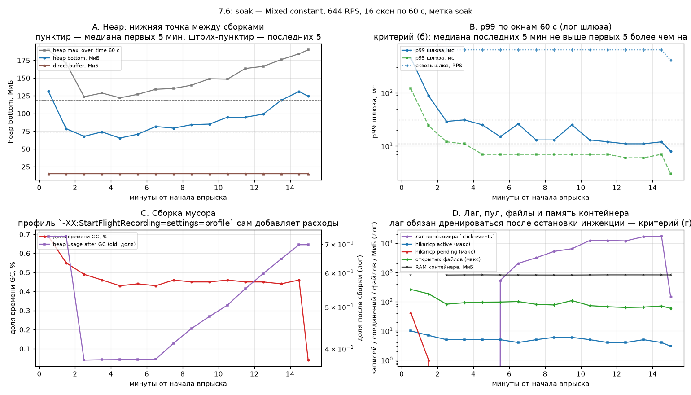

Это не снимок Grafana: серверный рендер PNG на этом стенде недоступен (в образе нет
`grafana-image-renderer`), а по требованиям SHOWCASE скриншот делался бы вручную с живой панели.
Картинка построена по тому же журналу `exp-windows-76.jsonl`, что и таблица выше, поэтому цифры
графика и таблицы не могут разойтись. Для исторического 15-минутного окна снимка Grafana нет;
настоящие серверные снимки Grafana сняты для часовых прогонов closure76 — см. «Снимки Grafana
(closure76)» в разделе «Серия на 322 RPS».

Панели: (A) heap bottom/top и direct buffer — виден восходящий «низ»; (B) p99 и p95 по окнам на
логарифмической шкале вместе со `Cnt/s` — падение объясняется прогревом; (C) доля времени GC и доля
old-gen после сборки — первая плоская, вторая растёт; (D) лаг, пул, открытые файлы и RAM контейнера
на логарифмической шкале — RAM и файлы плоские, растёт только лаг. Пунктир — медиана первых пяти окон,
штрих-пунктир — последних пяти.

## Часовой горизонт (closure, 2026-11-12)

Серия на изолированном стенде `closure76` (шлюз `localhost:28480`, Prometheus `localhost:29090`), без
изменения основной базы. Конфигурация приложения та же, что в историческом 7.6: 2 vCPU / 1 ГиБ,
HikariCP 10, параллельность консьюмера Kafka 3, кэш включён, клики асинхронные. Redis сохраняется
между перезапусками JVM (правило METHODOLOGY), поэтому кэш тёплый. Код: ветка `stage-9-web`, коммит
`6aefea15`. Runner (`soak_runner.py`, приватный каталог вне репозитория) каждую минуту снимает
docker-inspect контейнеров и выборку Prometheus, а также регулярно опрашивает `/actuator/health`
через шлюз с клиентским таймаутом 5 с; любая ошибка пробы немедленно останавливает фазу (fail-fast)
и глушит генератор.

### Попытка на 644 RPS: обрыв на 12-й минуте

Прогрев (60 с, 644 RPS) прошёл с первой попытки: 38 640 запросов, KO 0, p50 4 мс, p95 15 мс,
p99 380 мс, max 1460 мс (результат 10:43:18 UTC; всплеск p99 — прогрев JIT). Измерительный прогон 1
стартовал 10:44:12 UTC, плановая инжекция 3600 с.

В 10:56:07 UTC (12-я минута, ~715 с инжекции) runner остановил фазу с `ProbeError`. Непосредственная
причина: health-проба не получила ответа за 5-секундный таймаут. До этого все 35 проб вернули 200 за
4–83 мс (последняя успешная — 10:55:17, 13 мс); между 10:55:17 и 10:56:07 не завершилась ни одна
проба, и роковой запрос шлюз залогировал как `499` спустя 4,547 с — соединение закрыл клиент (runner).

Это не артефакт пробы: задержка редиректов монотонно росла начиная с 10:55:52. Лог шлюза,
посекундный срез (n — число запросов за секунду, max — максимальное время ответа, с):

| Секунда (UTC) | n | max, с |
|---|---|---|
| 10:55:48 | 667 | 0.124 |
| 10:55:49 | 635 | 0.085 |
| 10:55:50 | 652 | 0.100 |
| 10:55:51 | 568 | 0.172 |
| 10:55:52 | 571 | 0.566 |
| 10:55:53 | 540 | 1.224 |
| 10:55:54 | 20 | 1.543 |
| 10:55:55 | 526 | 3.011 |
| 10:55:56 | 664 | 3.521 |
| 10:55:57 | 687 | 3.343 |
| 10:55:58 | 533 | 3.811 |
| 10:55:59 | 295 | 4.000 |
| 10:56:00 | 257 | 4.191 |
| 10:56:01 | 390 | 5.209 |
| 10:56:02 | 376 | 4.982 |
| 10:56:03 | 326 | 5.683 |
| 10:56:04 | 360 | 6.183 |
| 10:56:05 | 340 | 6.254 |
| 10:56:06 | 450 | 7.176 |
| 10:56:07 | 436 | 6.623 |
| 10:56:08 | 483 | 7.239 |
| 10:56:09 | 514 | 7.895 |
| 10:56:10 | 723 | 7.342 |

Секунда 10:56:11 (1856 запросов с кодом 499) — не отказ сервиса: это клиентские закрытия соединений
в момент остановки генератора runner-ом.

Поминутные снимки (Prometheus + docker stats) показывают, где болело, а где нет:

- HikariCP `pending`: всплески на 3-й минуте — 4, на 5-й — 150, на 8-й — 79, на 9-й — 65,
  на 11-й — 70; остальные минуты 0–1. Паузы случались весь прогон, примерно каждые 2–3 минуты,
  но раньше были достаточно короткими: пробы в те минуты возвращали 200 за 4–83 мс.
- Лаг консьюмера Kafka — 0 на всех минутах; потребление ~612 записей/с совпадает с темпом редиректов
  (644 × 0,95 ≈ 612). На этом стенде консьюмер имел запас — в отличие от исторического 15-минутного
  прогона на основном стенде, где лаг рос с 5-й минуты.
- Heap 91–159 МиБ без тренда; сумма пауз GC 0,25–0,36 с/мин; CPU приложения 102–173 % при потолке
  200 %. JVM причиной не была.
- Postgres: CPU 25–48 %, запись на диск 290–350 МБ/мин, стабильно весь прогон.
- KO: до 695-й секунды инжекции — 0 во всех блоках генератора. В блоке, завершившемся в 10:56:02
  (финальная пауза), — 98 `PrematureCloseException`; к моменту остановки суммарно 1387 KO
  (1234 преждевременных закрытия и 153 `Connection refused`). В логе шлюза нет неуспешных ответов,
  кроме 499 самой пробы и ожидаемого 409 (повторная регистрация пользователя в 10:44:19):
  преждевременные закрытия произошли на транспортном уровне и в access-лог не попали. Деградация
  выражалась прежде всего в задержках, обрывы соединений появились только в финальной паузе.

**Интерпретация (уточнена 2026-11-12 после разбора серии на 322 RPS).** Картина соответствует
периодическим паузам, которые ставят очередь в пул HikariCP: запись идёт стабильно, но в моменты
сброса `pending` растёт, редиректы ждут соединения, время ответа увеличивается. Пауза, начавшаяся
около 10:55:52, длилась дольше 5 с и заблокировала DB-проверку внутри `/actuator/health` — fail-fast
остановил прогон. Прямой снимок `pg_stat_bgwriter` в момент паузы не снят; периодичность спайков
`pending` при стабильном объёме записей — косвенные, но согласованные признаки ритма
checkpoint/autovacuum на хранилище WSL2. Heap, GC, CPU и Kafka исключены числами выше.

**Вторая, связанная причина — таймауты Redis, а не только автономные паузы Postgres.** Разбор
журналов приложения по всей серии показал повторяющиеся строки `redis unavailable … falling back to
database` (LinkCache): 09:16 — 16, 09:43 — 27, 10:08 — 6, 10:37 — 3, **10:56 — 6 (момент обрыва 644)**,
12:36 — 6, 13:17 — 33, 13:40 — 78. Механизм: `spring.data.redis.timeout=200ms` — жёсткий бюджет
команды Lettuce; под конкуренцией за CPU однопоточный Redis на общей 4-vCPU VM не успевает ответить,
клиент получает `QueryTimeoutException`, и каждый такой редирект уходит в Postgres мимо кэша. На
644 RPS это ~612 редиректов/с, то есть даже короткая серия таймаутов сама насыщает пул и поднимает
`pending`. Поэтому спайки `pending` в попытке на 644 RPS могли быть частично следствием каскадного
fallback, а не только ритма Postgres; разделить вклад двух причин по снятым артефактам нельзя, и
отчёт называет обе. Это находка о стенде на часовом горизонте, а не регрессия кода: 15-минутный
прогон на 644 RPS 2026-11-04 прошёл с KO 0 — короткое окно просто не застало паузу такой длины.

**Решение заказчика (2026-11-12).** Снизить уровень до 322 RPS (30 % от точки деградации 1074 RPS
из 7.5), сначала выполнить 15-минутную пробу стабильности, затем три измерительных прогона по
60 минут. Одноразовая авторизация серии runner-а снята с явного согласия; артефакты оборванной
попытки (лог шлюза 77 МБ, снимки, записи прогрева и прогона 1) сохранены в приватном архиве
`.superpowers/closure-2026-11-12/aborted-644/` вне репозитория. Гейт `ko==0` для прогрева и
измерительных прогонов и guard контейнеров не менялись.

### Серия на 322 RPS: проба и три прогона

**15-минутная проба (2026-11-12, 11:09–11:24 UTC) — чистая.** Прямая нагрузка 900 с на 322 RPS
(в обход runner-а, чтобы проба не зависела от его fail-fast): 289 800 запросов, KO 0, ошибок нет.
Лёгкий сэмплер каждые 40 с: HikariCP `pending` 0 во всех 24 замерах, лаг консьюмера 0, CPU
приложения 0,01–0,48. Серверное время `/actuator/health` — единицы–десятки мс (прямая проверка
сразу после пробы: curl — 200 за 7 мс, urllib через `127.0.0.1` — 8 мс). Уровень 322 RPS принят
для измерительной серии.

**Артефакт измерения, найденный пробой.** Сэмплер мерил health через `http://localhost:28480`
и стабильно получал ~2,03 с с первого же замера (ещё до нагрузки). Причина — не сервис: на этом
хосте Windows резолвит `localhost` сначала в `::1`, и попытка IPv6-подключения к порту Docker
ждёт ~2 с перед откатом на IPv4. Прямое сравнение в один момент: urllib `localhost` — 2,078 с,
`127.0.0.1` — 0,008 с; curl — 200 за 0,007 с. Тот же налог присутствовал и в попытке на 644 RPS:
поминутные снимки runner-а длились 37,7–38,6 с (15 запросов Prometheus + 3 пробы, каждая с ~2 с
резолвинга), а времена проб 4–83 мс в логе шлюза — серверные, клиентская сторона платила сверху.
Роковая проба исчерпала 5-секундный клиентский бюджет сочетанием серверной паузы (4,547 с по логу
шлюза) и накладных расходов резолвинга. Для серии на 322 RPS адреса проб и Prometheus в runner-е
заменены на `127.0.0.1` — это убирает артефакт из транспортного слоя измерений; гейты `ko==0`,
fail-fast по ошибке пробы и guard контейнеров не менялись.

**Три прогона по 60 минут (322 RPS, closure76).** Все три часа измерены с `exit=0`, `load_pass=true`,
KO 0, на одном коммите `6aefea15` и идентичной конфигурации (совпадают `config_sha256` compose,
override, `run-load.ps1` и `codes-hot.csv` в `soak-*-passed.json`). Часы набраны как 2+1 по двум
попыткам: attempt-1 дал часы 1 и 2, attempt-2 — час 3; между ними runner обрывался на прогреве после
перезапуска JVM (см. «Обрывы на прогреве» ниже), сами измерительные часы не прерывались. Зачёт трёх
часов — явное решение заказчика от 2026-11-12 («Зачесть 3 часа»).

Таблица A — итог прогона по отчёту Gatling (глобально, все запросы):

| Прогон | Окно инжекции, UTC | Запросов | KO | p50, мс | p95, мс | p99, мс | max, мс |
|---|---|---|---|---|---|---|---|
| 1 (attempt-1 soak-1) | 11:34:33–12:34:49 | 1 159 200 | 0 | 3 | 7 | 16 | 1255 |
| 2 (attempt-1 soak-2) | 12:38:18–13:38:31 | 1 159 200 | 0 | 3 | 26 | 154 | 8308 |
| 3 (attempt-2 soak-1) | 14:21:34–15:21:47 | 1 159 200 | 0 | 3 | 10 | 25 | 2671 |

1 159 200 = 322 RPS × 3600 с; из них 1 101 240 `GET /{code}` и 57 960 `POST /api/links` (95/5).
Перцентили в таблице A — из HTML-отчёта Gatling; поминутные p99 ниже — из Prometheus
(`histogram_quantile` по `http_server_requests_seconds_bucket`), это разные источники и они не
подменяют друг друга.

Таблица B — ресурсы по поминутным снимкам Prometheus + `docker stats` (61 снимок на час):

| Прогон | tenured, МиБ начало→конец (наклон) | heap sum max, МиБ | паузы GC, с (% часа) | сборок | p99 GET мед / max, мс | лаг max | pending max | active max | fds max | CPU прил. mean |
|---|---|---|---|---|---|---|---|---|---|---|
| 1 | 143.8→149.1 (0.063) | 215.1 | 6.704 (0.186 %) | 2161 | 6.0 / 42.5 | 0 | 0 | 5 | 95 | 0.289 |
| 2 | 76.3→120.2 (0.863) | 165.8 | 13.951 (0.387 %) | 2817 | 5.1 / 2213.0 | 5166 | 187 | 8 | 990 | 0.370 |
| 3 | 71.9→80.3 (0.096) | 143.5 | 7.525 (0.209 %) | 2179 | 8.7 / 392.8 | 0 | 0 | 4 | 73 | 0.314 |

Наклон tenured — МНК по 61 поминутной точке `jvm_memory_used_bytes{id="Tenured Gen"}`; это старое
поколение на момент снимка, не дно после GC (дно — из JFR, см. «Разбор JFR»). GC — SerialGC
(minor `Copy`, major `MarkSweepCompact`); доля времени = сумма пауз / 3600 с. CPU приложения —
`process_cpu_usage` (0..1 от одного ядра при потолке 2 vCPU).

**Час 1 — чистый.** tenured плоский (143.8→149.1 МиБ, наклон 0.063 МиБ/мин), все сборки minor,
лаг 0 и `pending` 0 на всех 61 минуте, открытые файлы 63→61 (max 95). p99 GET первых пяти минут
10.6 мс, последних пяти 6.0 мс — дрейф отрицательный (догрев JIT/кэша), деградации нет. Единичный
max 1255 мс в отчёте Gatling не образует тренда: поминутный p99 не превышает 42.5 мс.

**Час 2 — тяжёлый хвост с названной причиной.** На 39-й минуте (13:17 UTC) пауза: p99 GET 2213 мс,
`pending` 187, CPU приложения 0.96, tenured скачком 65.7→97.6 МиБ, открытые файлы 990 (в чистые
часы ≤95). Лаг консьюмера поднимается до 5166 записей к 40-й минуте и дренируется к 44-й
(4502→3416→1721→0); `pending` возвращается к 0 сразу после 39-й минуты, файлы — к 61 к концу часа.
Вторичные всплески p99 на 51-й (247.9 мс) и 55-й (387.7 мс, `pending` 2) минутах. Одна major-сборка
на 22-й минуте сбрасывает tenured 78.6→64.8 МиБ (0.292 с из 13.951 с пауз). KO при этом 0: пауза
осталась ниже 5-секундного бюджета пробы. Причина та же, что в уточнённой интерпретации 644:
таймауты Redis (200 мс) под конкуренцией за CPU → каскадный fallback в Postgres → очередь пула;
в журнале приложения на 13:17 — 33 строки `redis unavailable`. Рост tenured в этом часу
(0.863 МиБ/мин) привязан к очереди лага, а не ко времени: после дренажа лага прирост останавливается
(112.6→120.2 МиБ за последние 16 минут — остаточный плато, а не линейный рост).

**Час 3 — самый чистый.** tenured плоский (71.9→80.3 МиБ, наклон 0.096), все сборки minor, лаг 0,
`pending` 0, файлы 73→53. p99 GET первых пяти минут 15.7 мс, последних пяти 8.3 мс. Единичный
всплеск p99 392.8 мс на 56-й минуте без `pending` и лага — одиночная пауза, не тренд. В журнале
приложения за весь час 14:xx ни одной строки `redis unavailable`.

**Критерии гипотезы по трём часам.** (а) для часов 1 и 3 подтверждается (tenured и after-GC дно
плоские); для часа 2 формально отрицается наклоном 0.863/0.898 МиБ/мин, но с названной причиной
(очередь лага во время паузы), как и в историческом 15-минутном прогоне. (б) для часов 1 и 3
подтверждается (дрейф −43 % и −47 %); для часа 2 порог +20 % превышен (4.8→35.5 мс) — применяется
правило «деградации нет ИЛИ причина найдена и описана», причина описана выше. (в) подтверждается
точно для всех трёх: `links` +57 960 и `click_events` +1 101 240 за каждый час (до/после дренажа в
`soak-*-passed.json`), ровно числа успешных `POST` и `GET`. (г) подтверждается: лаг на конце каждого
часа 0 (час 2 дренировался внутри часа после паузы). (д) подтверждается: файлы возвращаются к
базовым ~60 (61/61/53), `pending` и active не растут от часа к часу, доля GC <0.4 % во всех трёх.

### Обрывы на прогреве (cold-start) — находка о стенде

Оба обрыва серии произошли НЕ в измерительном часе, а на 60-секундном прогреве сразу после
перезапуска JVM между прогонами (runner останавливает app для выгрузки JFR и поднимает заново):

- attempt-1, прогрев soak-3, 13:40 UTC: 78 строк `redis unavailable` за минуту, каскадный fallback
  насыщает Postgres — в окне шлюза 799 ответов 504; проба health не укладывается в 5 с → ProbeError.
- attempt-2, прогрев soak-2, 15:23 UTC: 5 `QueryTimeoutException` Redis в 15:23:08, далее шлюз
  логирует `GET /actuator/health "499" 5.003 s` (Redis-индикатор health встал >5 с); 504 в этом окне
  нет — жертвой стала сама проба, а не поток редиректов. ProbeError → фатальный обрыв.

Механизм: холодная JVM даёт всплеск CPU (JIT + rebalance Kafka + инициализация продюсера +
реинициализация Lettuce) на общей 4-vCPU VM, где вторые 2 vCPU делят postgres+kafka+redis+gateway+
prometheus+grafana+jenkins; однопоточный Redis голодает, клиентские MGET выходят за бюджет
`spring.data.redis.timeout=200ms`. Доказательство, что триггер именно cold-start, а не стационар:
прогрев часа 3 шёл на уже прогретой JVM (up 37 мин) и прошёл с KO 0, а сам час 3 чист; обрываются
ровно переходы «перезапуск → прогрев». Это находка о стенде, не регрессия кода: конфигурация
приложения (timeout 200 мс), cpuset и гейты runner-а не менялись; новая нагрузка после решения
«Зачесть 3 часа» не запускалась.

### Снимки Grafana (closure76)

Серверный рендер PNG выполнен после остановки серии на простаивающем стенде: TSDB
`closure76-prometheus-1` скопирован в отдельный history-том, поднят history-стек
(Prometheus + Grafana + `grafana-image-renderer`), дашборд `shortener-load`. Окна рендера совпадают
с окнами инжекции из таблицы A. По шесть панелей на час: латентность редиректа, доля попаданий
кэша, куча, GC, HikariCP, лаг Kafka.

Час 1 (attempt-1 soak-1):

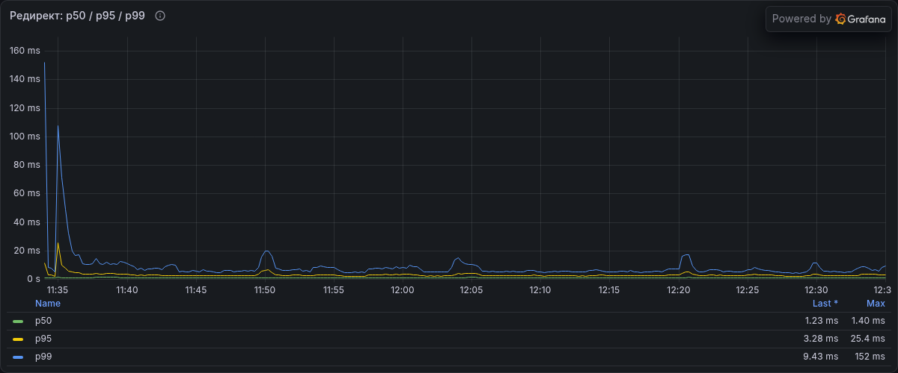
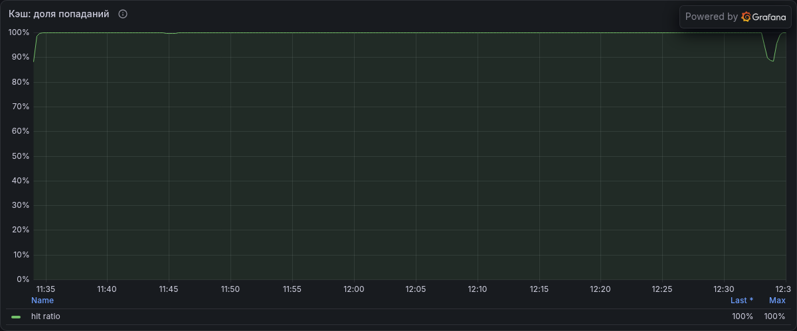
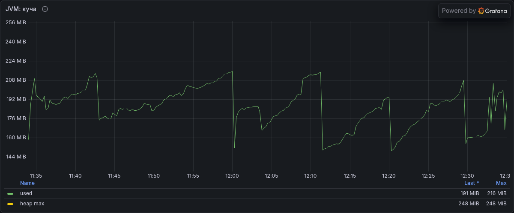
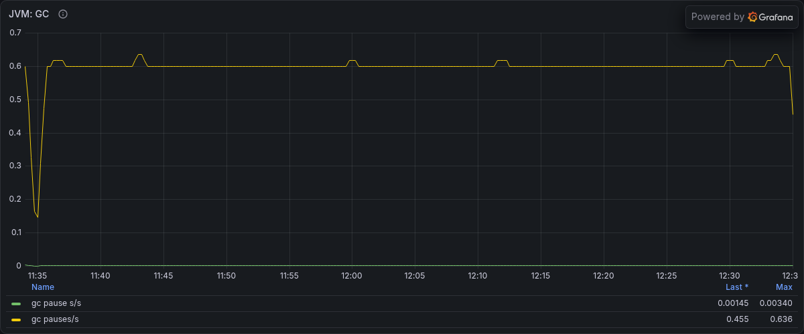
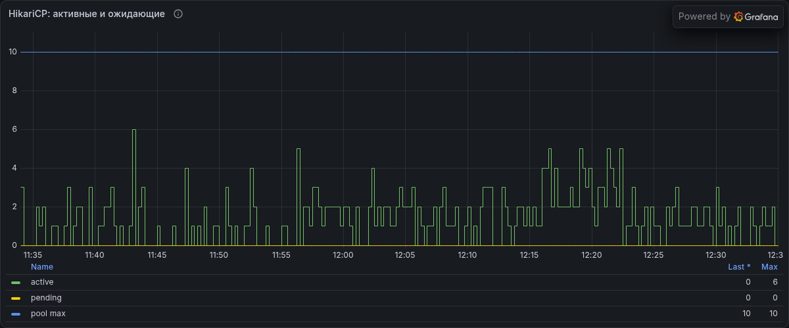
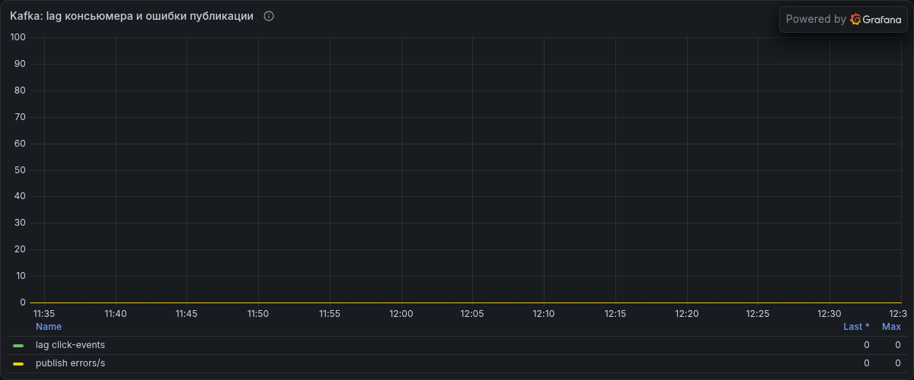

Час 2 (attempt-1 soak-2) — видна пауза 39-й минуты (13:17 UTC) на латентности, пуле и лаге:

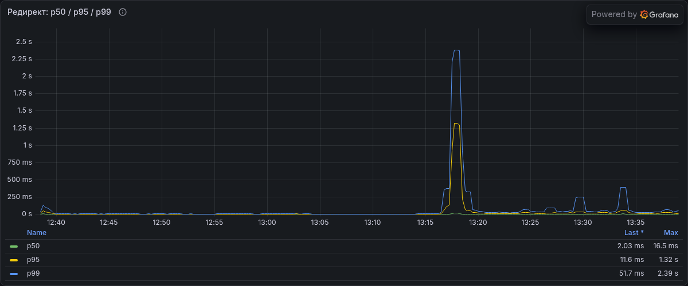
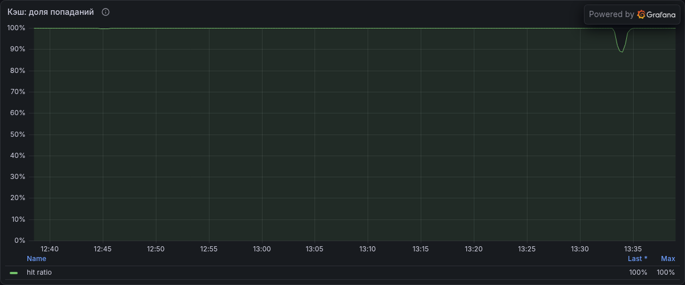
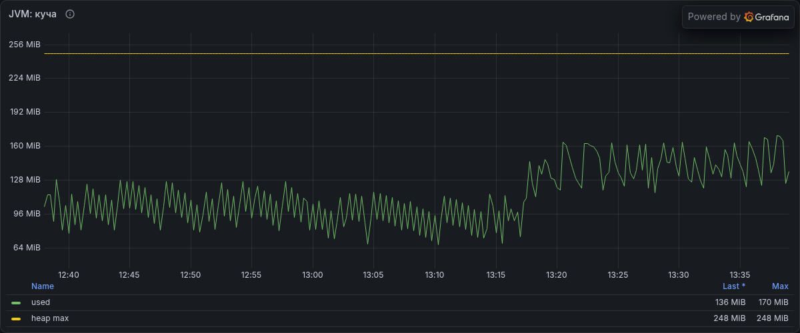
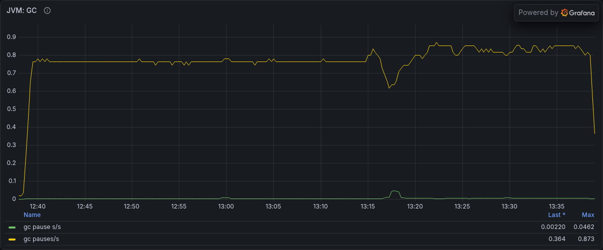
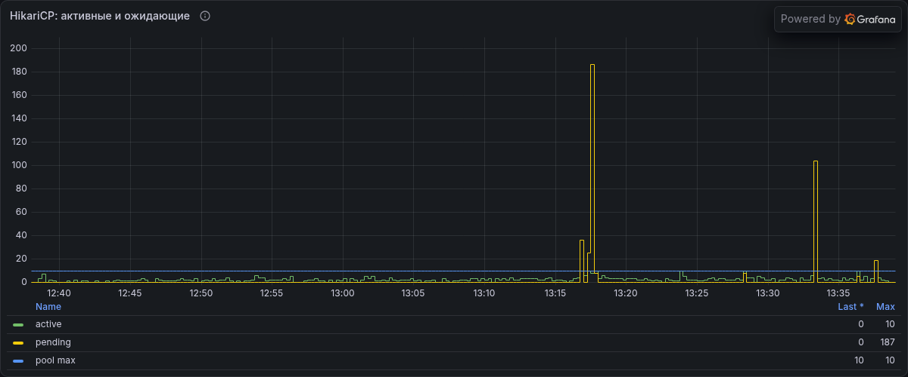
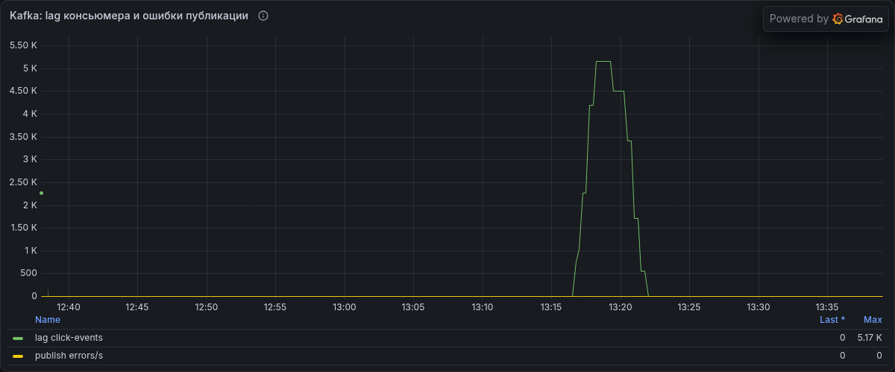

Час 3 (attempt-2 soak-1):

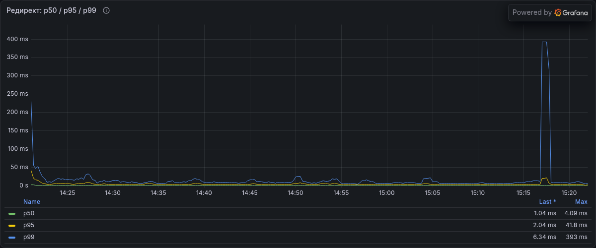
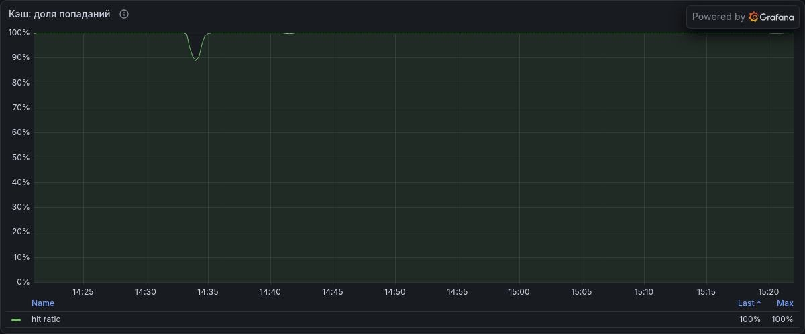
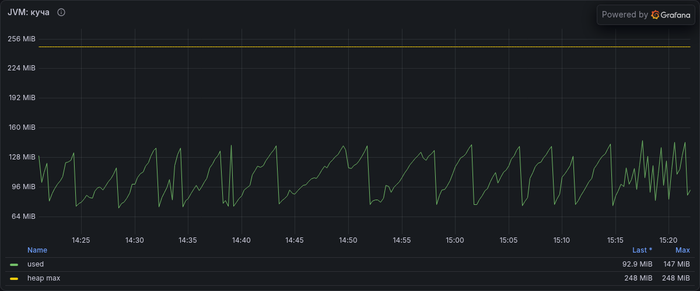
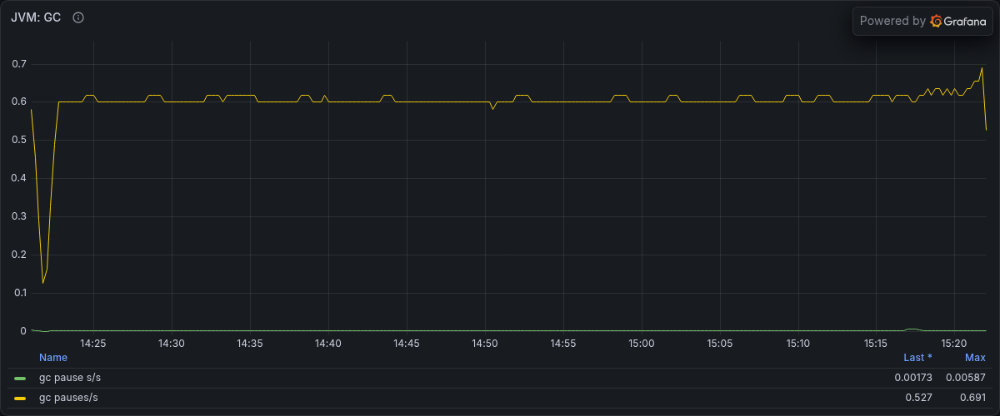
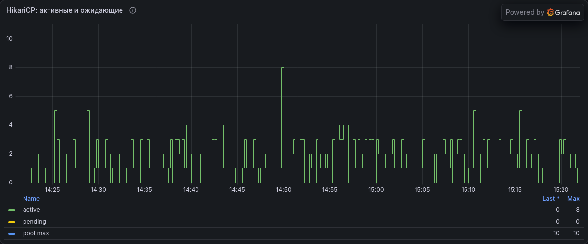
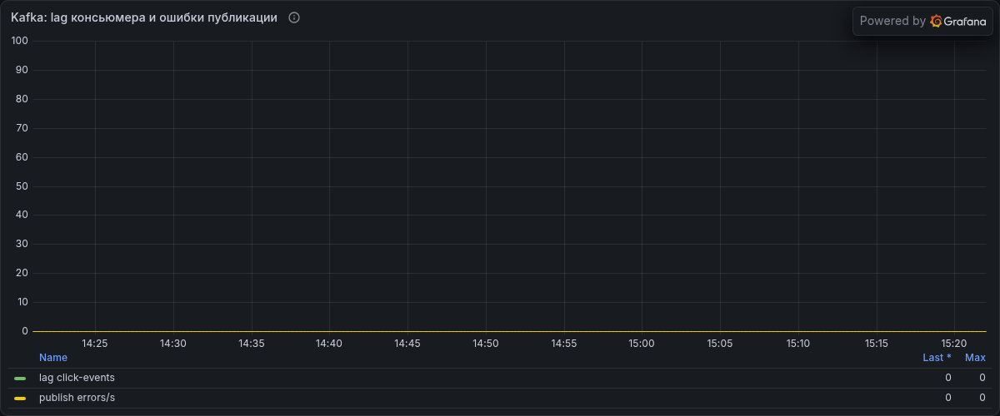

### Разбор JFR

Записи сняты с `settings=profile`, `dumponexit=true`; файлы и sha256 зафиксированы в
`soak-*-passed.json` (час 1 — 320 752 131 Б `5d00fa0a…`, час 2 — 171 950 754 Б `00f7e0a3…`,
час 3 — 187 535 382 Б `363ac54e…`). Разбор локальным JDK (`jfr print --json`), окно фильтрации =
окно инжекции.

- **Дно после GC (`jdk.GCHeapSummary`, `when="After GC"`).** Час 2: 76.9→120.6 МиБ, min 64.1,
  max 123.1, наклон 0.898 МиБ/мин (2818 событий) — рост совпадает с паузой и очередью лага, после
  дренажа выходит на плато. Час 3: 73.1→80.5 МиБ, min 72.4, max 84.9, наклон 0.096 МиБ/мин (2180
  событий) — плоский, утечки нет. Число GC-событий JFR в окне совпадает со счётчиком Prometheus
  (2818/2817 и 2180/2179), поэтому ряды выровнены и им можно верить.
- **Час 1: ряд JFR не выровнен, используется Prometheus.** Запись часа 1 стартует в 10:03 UTC при
  старте контейнера 08:54, число GC-событий в окне 1633 против 2161 у Prometheus, а ряд after-GC
  показывает падение до ~73 МиБ и возврат, которого в tenured нет. Признак разрыва/сдвига шкалы
  времени записи; вывод по heap часа 1 делается по Prometheus tenured (143.8→149.1, наклон 0.063)
  и паузам GC, ряд after-GC из JFR для часа 1 не используется (ограничение 15).
- **Паузы GC (Prometheus `jvm_gc_pause_seconds`).** Суммы пауз за час: 6.704 с (час 1), 13.951 с
  (час 2, из них 0.292 с одна major), 7.525 с (час 3); доля времени 0.186 / 0.387 / 0.209 %,
  счётчик сборок 2161 / 2817 / 2179. Все сборки кроме одной — minor `Copy`; шторм полных сборок
  отсутствует, GC не является причиной хвоста часа 2.

### Вывод по трём часовым прогонам (closure76)

**На уровне 322 RPS (30 % от точки деградации 1074 RPS из 7.5) сервис устойчив на часовом
горизонте: утечек нет, деградации в чистые часы нет.** По трём измеренным часам с KO 0:

- heap после GC не имеет восходящего тренда в чистые часы (час 1 tenured наклон 0.063 МиБ/мин,
  час 3 after-GC наклон 0.096 МиБ/мин); рост в часу 2 (0.863/0.898 МиБ/мин) привязан к очереди лага
  во время паузы и останавливается после её дренажа — та же природа, что в историческом
  15-минутном прогоне (стоимость обслуживания отставания консьюмера, а не недостижимые объекты);
- доля времени GC плоская и малая во всех трёх часах (0.186 / 0.387 / 0.209 %), шторм полных
  сборок отсутствует;
- p99 в чистые часы не дрейфует вверх (−43 % и −47 % первые→последние пять минут); хвост часа 2
  (p99 154 мс, max 8308 мс) объяснён паузой Redis-таймаутов на 39-й минуте и не является трендом;
- лаг консьюмера дренируется до нуля (в часу 2 — внутри часа после паузы), события не теряются:
  `click_events` прирастает ровно на число успешных редиректов в каждом часу (+1 101 240);
- открытые файлы и соединения пула возвращаются к базовым значениям к концу каждого часа.

**Ограничивающий фактор стенда — конкуренция за CPU вокруг однопоточного Redis, а не HTTP-путь,
GC или консьюмер.** На прогретой JVM при 322 RPS запас есть (лаг 0, pending 0); паузы возникают,
когда всплеск CPU (cold-start после перезапуска либо фоновая конкуренция) голодает Redis и
таймауты 200 мс каскадом уводят редиректы в Postgres. Отсюда обе находки: обрывы серии на
прогреве после перезапуска и тяжёлый хвост часа 2. Это свойства стенда (4 vCPU, app 2 vCPU,
остальные сервисы на вторых 2 vCPU), а не регрессия кода.

**Критерий этапа «длительность 60–120 мин» выполнен** по трём часовым окнам heap/GC/p99; чекбокс
DoD отмечается с оговоркой 2+1 (ограничение 12) и с названной причиной хвоста часа 2
(ограничение 13). Исторический 15-минутный вывод ниже остаётся в силе как замер своего окна и
своей конфигурации (644 RPS, усиленный консьюмер): он объясняет рост дна через лаг, и часовые
прогоны на 322 RPS этот механизм подтверждают, а не опровергают.

## Вывод (что подтвердилось, что нет, почему)

**Гипотеза в целом не подтвердилась: heap после GC за 15 минут растёт.** По пунктам:

- **(а) Не подтвердилось.** По Prometheus heap bottom: 74.1 → 81.7 → 99.2 МиБ по медианам
  интервалов, наклон по МНК за 15 полных окон **+2,122 МиБ/мин, но с плохой аппроксимацией
  (R = 0,44)** — и это само по себе вывод: выборка `min_over_time[…][60s:5s]` ловит не дно, а
  случайную точку между сборками. По JFR, где дно измерено точно (`jdk.GCHeapSummary`,
  `when="After GC"`): 64.8 → 68.9 → **101.1 МиБ** по третьям прогона, по минутам (максимум за
  минуту) 65.1 (2-я) → 122.0 (14-я), наклон **4,565 МиБ/мин**. Формально это отрицание гипотезы —
  но с названной причиной, и причина не «утечка» (см. ниже).
- **(б) Подтвердилось с запасом.** p99 первых 5 мин 31,0 мс, последних 5 мин инжекции 12,0 мс,
  дрейф **−61,3 %** при пороге +20 %. Команда `report` печатает −64,5 %, потому что в её «последние
  5 окон» попадает 1-секундное окно уже после остановки инжекции (p99 8,0 мс); здесь и в таблице
  используется вариант только по полным окнам, а вывод не меняется ни в одном из двух: порог не
  превышен. Объяснение дрейфа — продолжающийся прогрев JIT и кэша (p99 падал и на последнем окне),
  а не «сервис стал быстрее». Отрицательный дрейф корректно означает «деградации нет»; вывод об
  улучшении из этих чисел не следует.
- **(в) Подтвердилось точно.** +550 620 строк `click_events` против 550 620 ответов `302` —
  разница 0; +28 980 `links` против 28 980 ответов `201`.
- **(г) Подтвердилось только про дренаж.** После остановки инжекции лаг ушёл 17 342 → 0.
  Во время прогона он не дренировался, а монотонно рос с 5-й минуты.
- **(д) Подтвердилось.** Открытые файлы 263 → 59 при потолке 1 048 576; доля времени GC по третьям
  0.61 / 0.44 / 0.45 % (плоско); медиана паузы 3.83 → 4.05 мс, p95 7.83 → 5.59 мс; committed heap
  247.5 МиБ и резерв 256.0 МиБ не менялись ни разу; metaspace 128.5 → 128.7 МиБ; RAM контейнера
  809.5 → 819.9 МиБ (+10.4 МиБ за 15 мин при лимите 1 ГиБ). 982 сборки за прогон, 981 из них —
  `Allocation Failure`.

**Причина роста живого heap названа по JFR, и это не недостижимые объекты.** `jdk.OldObjectSample`
(семплы сняты при дампе записи, 18:30:59 UTC — через 13,7 мин после остановки инжекции):
206 блоков, 56.83 МиБ, из них **81 блок / 55.30 МиБ (97 %)** аллоцированы через
`java.nio.HeapByteBuffer.<init>` ← `java.nio.ByteBuffer.allocate`, а из них
**62 блока / 55.07 МиБ** — внутри `org.apache.kafka.common.memory.MemoryPool$1.tryAllocate` ←
`org.apache.kafka.common.network.NetworkReceive.readFrom`, то есть это приёмные буферы ответов Kafka. Крупнейшая однородная группа — `byte[]` вместимостью 1 048 650
элементов (`max.partition.fetch.bytes` по умолчанию 1 048 576 плюс 74 байта заголовка сообщения):
34 блока по 1 048 672 байта (самих данных 1 048 650, остальное — заголовок массива с выравниванием),
в сумме 34.00 МиБ. Все 34 созданы внутри окна инжекции (18:10:27…18:16:55 UTC) потоком
`kafka-coordinator-heartbeat-thread | click-writer`, и их возраст на момент дампа 14,1–20,5 мин —
то есть эти буферы жили почти весь прогон. Всего внутри окна инжекции создано 69 блоков из 206,
54.39 МиБ из 56.83 (96 %). Дальше — совпадение во времени: при нулевом лаге heap-after-GC плоский
(медианы минут 2–4 — 64.6 / 64.7 / 65.1 МиБ; минуты 0–1 отброшены, они ещё несут остаток прогрева,
медиана 0-й — 126.0 МиБ), а с 5-й минуты, когда лаг появляется (532 записи), растёт почти линейно:
Пирсон r(лаг, heap после GC) по 13 минутам (2–14) = **0,975**.

Значит, растущее дно — это стоимость обслуживания отставания консьюмера внутри кучи, а не утечка:
при нулевом лаге прироста нет, и 101.1 МиБ after-GC при committed 247.5 и резерве 256.0 МиБ до
отказа ещё далеко. Экстраполяция «4,565 МиБ/мин × 60 мин = 274 МиБ» здесь невалидна: рост привязан
к размеру очереди, а не к времени.

**Поправка 2 к этому отчёту оказалась неверной, и это надо зафиксировать явно.** Нулевой лаг в
30-секундных окнах разгона (`ramp`: 0.0 на 586,2 RPS; `ramp-fix`: 0.0 вплоть до 878,8 RPS) не
означает дренируемой ёмкости консьюмера. При непрерывных 644 RPS и параллельности 3 дефицит
составляет ~19,3 записей/с в среднем по прогону (17 342 за 900 с) и ~36 записей/с в последней трети
(10 888 за 300 с). 30-секундное окно при дефиците 10–20 записей/с даёт 300–600 записей лага — ровно
столько, сколько и наблюдалось в `ramp` (368 записей на 683,8 RPS), то есть разгон физически не мог
опровергнуть накопление; стационар измеряется только непрерывным прогоном.

**Что это значит для этапа.** Узкое место стенда — не HTTP-путь, а консьюмер `click-events`
(потребление событий клика и запись в Postgres): тот же вывод был по итогам 7.5, и soak его
повторяет на другом временнóм масштабе. Следствие для метода: критерий (а) на этом стенде невыполним
в конфигурации прогона — либо консьюмер должен иметь запас, либо уровень инжекции обязан быть ниже
точки дренирования. Точка дренирования (RPS, при котором лаг не растёт на горизонте ≥ 15 мин) не
измерялась — это явный пробел, и подменять его косвенными оценками из 30-секундных окон разгона
нельзя (см. разбор поправки 2 выше).

## Ограничения

1. **15 минут вместо 60–120.** Медленная утечка (десятки МБ/час) на этом горизонте неотличима от
   шума измерений; соответствующий чекбокс DoD этапа не отмечается. Найденный рост (4,565 МиБ/мин)
   объяснён и ограничен размером очереди, но «объяснён» ≠ «безопасен на часе»: на часе нужен
   отдельный прогон.
2. **Один прогон, а не три.** Метод soak проверяет тренд во времени, а не воспроизводимость
   отдельного окна; отступление от «≥ 3 прогона на вариант» зафиксировано в шаге 3 метода.
3. **Дрейф p99 отрицательный из-за прогрева.** За 15 минут переходный процесс не закончился (p99
   падал и на последнем окне), поэтому «нет деградации» — корректный вывод, «есть улучшение» — нет.
4. **Генератор на той же машине** (4 vCPU, за прогон `CPU vm=177.72 %`): и Gatling, и сервис делят
   ядра, абсолютные RPS и латентности стендовые, не продуктовые. Первый же прогрев это показал
   (насыщение Tomcat 200 + пул, 3 565 обрывов шлюза).
5. **JFR с `settings=profile` сам добавляет расходы** (аллокационный сэмплинг с стеками, OldObjectSample).
   Все цифры heap этого прогона сняты с включённым JFR; без него дно могло бы быть ниже.
6. **heap bottom из Prometheus — нижняя измеренная точка**, а не дно после GC: `min_over_time[…:5s]`
   может пропустить реальный минимум. Настоящее дно взято из `jdk.GCHeapSummary` и отличается
   (74.1 против 64.8 МиБ на первом интервале) — в отчёте используются оба, не смешивая.
7. **`SELECT count(*)` снимался только до и после**, поэтому колонка «потреблено» — производная
   (302 − Δлаг), а не независимый замер; согласуется она с итогом прогона, а не с интервалами.
8. **Лаг — оценка из метрики консьюмера** (`kafka_consumer_fetch_manager_records_lag_max` и сумма по
   партициям) на момент снимка; точное число не потреблённых за интервал записей из него не следует.
   `increase()` по счётчикам `kafka_producer_topic_record_send_total` /
   `kafka_consumer_fetch_manager_records_consumed_total` за окно в этом стенде вернул 0 — на него
   ссылаться нельзя.
9. **Конфигурация прогона не штатная**: `RATE_LIMIT_CREATE_PER_MINUTE=12000` (поправка 1) и
   `SPRING_KAFKA_LISTENER_CONCURRENCY=3` (поправка 2). Вывод про heap относится к конфигурации с
   *усиленным* консьюмером; при `concurrency=1` (значение по умолчанию в compose) лаг на 644 RPS
   рос бы быстрее.
10. **Атрибуция объектов в JFR косвенная**: `OldObjectSample` даёт место аллокации и поток, который
    её выполнил. «Это fetch-буферы консьюмера `click-writer`» следует из имени потока и размера буфера
    (≈`max.partition.fetch.bytes`); прямого замера владельцев этих буферов не было.
11. **Одна машина, один день, шум.** Снимок `docker stats` в одном окне (60-я секунда) пустой —
    `RAM=None`, `CPU=None`: команда не успела ответить, а не показала ноль; в наклоне RAM это
    уменьшает выборку с 15 окон до 14. Точечный `docker stats --no-stream` в принципе не видит
    коротких всплесков между снимками.
12. **Три часа набраны как 2+1 по двум попыткам, а не одной серией.** attempt-1 дал часы 1 и 2
    (11:34–12:34 и 12:38–13:38 UTC), attempt-2 — час 3 (14:21–15:21 UTC). Между ними runner обрывался
    на прогреве после перезапуска JVM (cold-start), измерительные часы при этом не прерывались.
    Воспроизводимость «трёх прогонов подряд на одном стенде в одном сеансе» этим не доказана;
    зачёт трёх часов — явное решение заказчика от 2026-11-12.
13. **Час 2 (attempt-1 soak-2) имеет тяжёлый хвост, а не плоский p99.** Глобальный p99 154 мс и
    max 8308 мс против p99 16/25 мс у часов 1 и 3; на 39-й минуте пауза с `pending` 187 и лагом 5166.
    KO при этом 0. Вывод «нет деградации» для часа 2 делается с названной причиной (Redis-таймауты →
    fallback → очередь пула), а не из плоского p99.
14. **Обрывы серии — cold-start прогрев, находка о стенде.** Оба обрыва (attempt-1 soak-3 warmup
    13:40 UTC, attempt-2 soak-2 warmup 15:23 UTC) произошли сразу после перезапуска JVM между
    прогонами, когда JIT+Kafka rebalance+инициализация продюсера+Lettuce дают всплеск CPU на общей
    4-vCPU VM и голодают однопоточный Redis. Измерительные часы на прогретой JVM чистые. Это не
    регрессия кода и не дефект harness-гейтов; конфигурация приложения (Redis timeout 200 мс) и
    cpuset не менялись.
15. **JFR часа 1 не выровнен по wall-clock с окном измерения.** Запись `soak-1.jfr` (attempt-1)
    стартует в 10:03 UTC при старте контейнера 08:54, а её ряд `GCHeapSummary After GC` в окне
    11:34–12:34 расходится с Prometheus tenured (падение до ~73 МиБ и возврат, которого в tenured
    нет); число GC-событий в окне (1633) не совпадает с счётчиком Prometheus (2161). Похоже на
    разрыв/сдвиг шкалы времени записи (перезапуск JFR либо скачок часов VM). Поэтому вывод по heap
    часа 1 опирается на Prometheus tenured и паузы GC, а ряд after-GC из JFR для часа 1 не
    используется. Для часов 2 и 3 число GC-событий JFR совпадает с Prometheus (2818/2817 и
    2180/2179), и after-GC ряд согласуется с tenured — там JFR используется.
16. **Tenured из Prometheus — не дно после GC.** `jvm_memory_used_bytes{id="Tenured Gen"}` снимается
    в произвольный момент между сборками; настоящее дно после GC берётся из JFR
    `GCHeapSummary when="After GC"` (часы 2 и 3). Наклоны tenured и after-GC для часов 2 и 3
    совпадают по знаку и порядку (0,863 против 0,898 и 0,096 против 0,096 МиБ/мин), но это разные
    величины, и в отчёте они не смешиваются.
17. **Генератор и рендер на той же машине.** Gatling делит ядра с сервисом (как в историческом
    прогоне); снимки Grafana рендерились уже после остановки серии, на простаивающем стенде,
    поэтому на измерения не влияли. Абсолютные RPS и латентности остаются стендовыми.

## Как повторить

Серия — только через блокировку (`bash with-lock.sh …`, mkdir-замок `exp74.lock.d` в `%TEMP%`).
Драйверы лежат в `%TEMP%`, вне репозитория: `qoder_76_soak.py` (прогон, окна, журнал, критерии),
`qoder_76_agg.py` (таблица 5-мин интервалов), `qoder_76_jfr.py` (разбор JFR и корреляция с лагом),
`qoder-76-chart.py` (кадр), `qoder_76_env.ps1` (окружение прогона), `qoder_76_verify.py` (сверка
отчёта с журналами), `qoder_76_mutate.py` (мутационная проверка верификатора). Журналы
`exp-windows-76.jsonl`, `exp-gatling-76.jsonl`, `exp-samples-76.jsonl`, `exp-boundary-76.json`
скопированы в `docs/experiments/assets/`; `soak.jfr` (86 885 868 байт) — в
`docs/experiments/results/` и не коммитится (`.gitignore: *.jfr`). Строка прогона (итоговые
запросы/KO/перцентили) лежит в общем с 7.5 журнале `exp-results-75.jsonl` — его пишет `qoder_75.py`.

1. Окружение задаётся из PowerShell, а не из Git Bash: `JAVA_TOOL_OPTIONS` со значением
   `/tmp/rec.jfr` MSYS переписывает в windows-путь, и JVM не стартует (`Failure when starting JFR
   on_create_vm_3`, контейнер `Exited (1)`, шлюз отвечает 504 на health). Команда:
   `pwsh -NoProfile -File qoder_76_env.ps1` — внутри она выставляет
   `RATE_LIMIT_CREATE_PER_MINUTE='12000'`, `SPRING_KAFKA_LISTENER_CONCURRENCY='3'`,
   `JAVA_TOOL_OPTIONS='-XX:StartFlightRecording=filename=/tmp/rec.jfr,dumponexit=true,settings=profile'`
   и вызывает `pwsh -NoProfile -File D:\URL_Shortener\scripts\reset-state.ps1`. Вывод reset-state
   печатает фактические переключатели — сверить с таблицей «Условия».
2. Предпроверка (она же внутри `run`): `python qoder_76_soak.py check` — отказывает, если JFR нет в
   `JAVA_TOOL_OPTIONS`, лимит не 12000, пул не 10, health не UP или лог шлюза без временных меток.
3. Прогон — одной командой, она делает всё по шагам метода: прогрев `soak-warm` (60 с), `settle`,
   снимок границ, измерительный прогон и фоновый поток 60-секундных снимков в
   `exp-samples-76.jsonl`:
   `bash with-lock.sh qoder_76_soak.py run soak 644 900 > soak-run.log 2>&1` (в `%TEMP%`; вывод —
   строки «покой», «граница soak: …», «soak-warm | exit=…», «soak | exit=0»). Длительность
   инжекции задаётся третьим аргументом (`900`), уровень — вторым (`644`).
   У драйвера есть известная мелочь, о которой надо помнить при чтении журнала: поле
   `utc_before_warm` в `exp-boundary-76.json` пишется уже *после* прогрева и `settle`, то есть это
   время перед измерительным прогоном, а не перед прогревом; сами счётчики
   `links_before_warm` / `clicks_before_warm` снимаются до прогрева корректно. Фактическое окно
   инжекции определяется по логу шлюза: 18:02:19…18:17:20 UTC. Снимок «после»
   (`links_after` / `clicks_after` / `utc_after_snapshot`) дописан в тот же журнал вручную после
   дренажа лага — драйвер его не снимал, а без него критерий (в) сверяется только пока стенд не
   пересеван.
4. Разбор: `python qoder_76_soak.py windows soak` (16 окон по 60 с из среза лога шлюза + Prometheus),
   `python qoder_76_soak.py gstats soak 644 900` (блоки консоли Gatling),
   `python qoder_76_soak.py report soak` (критерии (а)–(д) и консистентность),
   `python qoder_76_agg.py soak` (таблица интервалов и пооконная проверка).
5. JFR: `docker compose -f infra/docker-compose.yml --env-file infra/.env stop app` (флеш дампа по
   `dumponexit=true`), затем
   `docker compose -f infra/docker-compose.yml --env-file infra/.env cp app:/tmp/rec.jfr docs/experiments/results/soak.jfr`
   — здесь 86 885 868 байт. Дальше локальным JDK (Temurin 25.0.4.1):
   `jfr summary soak.jfr` и
   `jfr print --json --events jdk.GCPhasePause,jdk.GCHeapSummary,jdk.GarbageCollection,jdk.MetaspaceSummary soak.jfr`;
   `jdk.OldObjectSample` тоже разбирается из JSON (`jfr print --json --events jdk.OldObjectSample
   soak.jfr`): там есть и `object.type.name`, и `objectSize` в байтах, и `stackTrace.frames`, и
   `arrayElements` — текстовый вывод `jfr print` для этого события удобен для чтения, но печатает
   размеры в десятичных MB, из-за чего сумма расходится с побайтовой на несколько процентов, поэтому
   в отчёте используются значения из JSON. Всё это делает
   `python qoder_76_jfr.py` — окно инжекции в нём задано константами
   `RUN_START=18:02:20`, `RUN_END=18:17:20` UTC и сверено с первой и последней строками
   `gw-soak.log`.
6. Кадр: `python qoder-76-chart.py soak docs/experiments/assets/76-soak.png`.
7. Сверка (обязательно **до** возврата стенда — шаг 8 пересевает базу, и живые счётчики больше не
   совпадут с журналом): `python qoder_76_verify.py` пересчитывает каждую ячейку таблицы и каждую
   константу прозы из `exp-windows-76.jsonl`, `exp-gatling-76.jsonl`, `exp-boundary-76.json`, среза
   лога шлюза, `soak.jfr` и живого `psql`; `exit=0` — расхождений нет (здесь: «проверено значений:
   133 | расхождений: 0»; число проверок растёт вместе с отчётом, фиксировать надо «расхождений: 0»).
   `--no-jfr` считает то же без разбора
   записи. Повторные прогоны берут срез `soak.jfr` из кэша `jfr76-cache.json` (4,25 МБ, строится
   первым полным прогоном, перестраивается по `SOAK_JFR_REFRESH=1` или при удалённом файле) — в нём
   лежит вывод `jfr print --json` от самой записи, а не из отчёта; полный прогон без кэша 21 с, с
   кэшем 12 с. Верификатор проверен подменами: `python qoder_76_mutate.py` меняет в копии текста 16
   чисел (пять ячеек таблицы и одиннадцать констант прозы), `python qoder_76_mutate.py --jfr`
   добавляет девять подмен по JFR; каждая обязана дать ровно одно `РАСХОЖДЕНИЕ` с именем строки, а
   чистая копия — нуль. Числа, повторяющиеся в отчёте несколько раз (`550 620`, `28 980`), сверяются
   по каждому контексту отдельно — иначе подмена в одном месте остаётся незамеченной, пока то же
   число стоит в другом. Числа прозы сверяются не с текстом, а с данными: в верификатор переписаны
   определения (медианы третей, максимумы/медианы минут, МНК, доля пауз через реальный интервал
   трети, побайтовые веса `OldObjectSample`), то есть он отвечает на вопрос «верно ли то, что
   написано», а не «повторяется ли опечатка».
8. Возврат стенда: `git checkout stage-7` (если менялся compose),
   `$env:RATE_LIMIT_CREATE_PER_MINUTE='1000'`, `$env:SPRING_KAFKA_LISTENER_CONCURRENCY=''`,
   `$env:JAVA_TOOL_OPTIONS=''`, затем `pwsh -NoProfile -File scripts/reset-state.ps1`.
